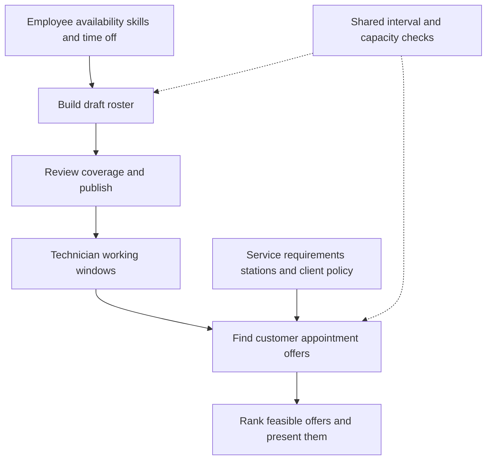
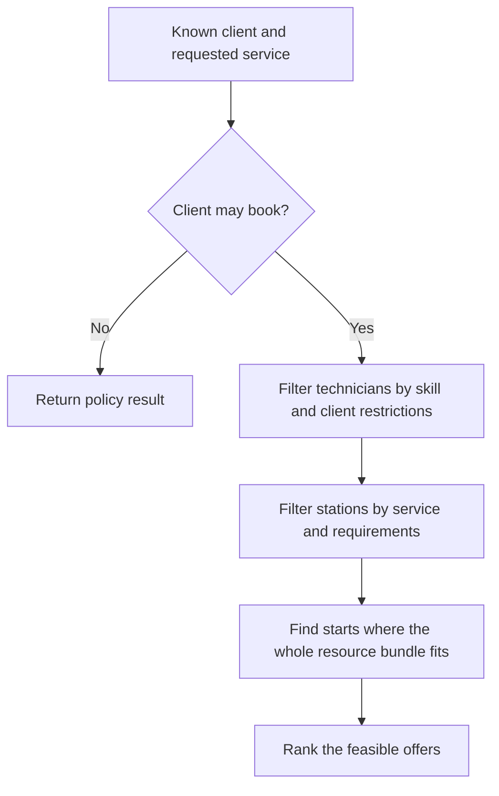
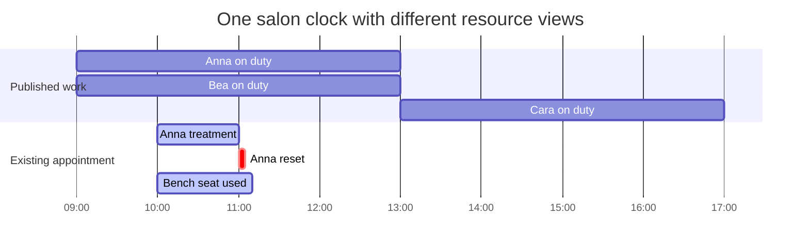
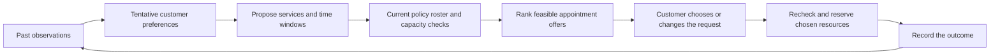

# Packing Algorithms in C# Part 2 Scheduling a Nail Salon

<datetime class="hidden">2026-11-10T14:00</datetime>
<!-- category -- C#, .NET, Algorithms, Scheduling, Recommendations -->

The nail salon has two manicure seats, and one is empty. Can it take a gel appointment at ten? Perhaps. Someone qualified to provide that service must be working, free for the whole treatment, and allowed to serve this client. An empty seat answers only one of those questions.

In [Part 1](/blog/packing-algorithms-in-csharp), we moved from packing bins to finding gaps for restaurant tables. This time we'll build two features in one application: the employee roster and customer appointments. Then we'll add recommendation attributes, with the eventual goal of suggesting a useful appointment to a particular customer before they ask.

We're deliberately not building a UX yet. The console example keeps our attention on the scheduling rules, capacity checks and recommendation logic. Once those decisions are clear and tested, we can put staff and customer interfaces around the same services.

This assumes you are comfortable with C# records, collections and LINQ. The new ideas are scheduling constraints, recommendation scores and learning a preference from past choices. We will introduce each through a concrete salon example before its implementation. The names, policies and code are independent teaching examples, with no code from a customer system.

The [complete .NET 10 console sample](https://github.com/scottgal/mostlylucidweb/tree/main/samples/NailSalonScheduling) runs without additional NuGet packages:

```bash
dotnet run --project samples/NailSalonScheduling/NailSalonScheduling.csproj
dotnet run --project samples/NailSalonScheduling/NailSalonScheduling.csproj -- --check
```

[TOC]

The series moves from [finding gaps](/blog/packing-algorithms-in-csharp) to **salon rules and preferences**, [live availability and holds](/blog/packing-algorithms-in-csharp-part-3), then [adapting when the plan changes](/blog/packing-algorithms-in-csharp-part-4). We build the rules in small console samples first, then carry them into the reusable `mostlylucid.packing` implementation. A future Part 5 will return to restaurants to forecast ingredient needs from customer, chef and service context, with an optional AI or LLM interface.

## Two features sharing one idea

First, the manager assigns employees to work blocks. Then customers book appointments inside those published working hours.

| Question | Employee roster | Customer booking |
|---|---|---|
| What are we placing? | A work block needing coverage | A treatment and its reset time |
| Which resources are needed? | An eligible employee | A technician, a suitable seat and the client |
| Which attributes matter? | Skills, possible working hours, time off, maximum assigned minutes | Service offered, equipment, seat capacity, client restrictions |
| What can we prefer? | Fewer already-assigned minutes, preferred work blocks | A convenient time, familiar technician or quiet station |
| What is the result? | A draft assignment or uncovered work | Feasible appointment offers |

An **allocation** uses some amount of a resource for an interval. An **attribute** describes that resource or the request, such as a technician's gel qualification or a client's preferred time.

We will make three decisions: **is it allowed, will it fit, and which valid option should we show first?** A rule that must pass is a **hard constraint**. A preference helps choose between options that already pass. We call an option **eligible** or **feasible** when it meets the applicable rules; **ranking** means putting those valid options in a useful order.



The distinction between a **possible working window**, a **published work block** and an **appointment** is essential. Anna saying she can work nine to five doesn't establish that she is rostered for eight hours. Publishing her nine-to-one work block makes her available for appointments; it doesn't make her busy with a customer for four hours.

We use two calendar representations of the same employee. The rostering calendar prevents overlapping work assignments. The appointment calendar gets its available windows from the reviewed roster, then records treatments within them.

## Start with a small salon

Here are our sample technicians:

| Technician | Services | Possible hours | Time off | Maximum assigned work |
|---|---|---|---|---|
| Anna | Manicure, gel | 09:00–17:00 | None | 240 minutes |
| Bea | Manicure, pedicure | 09:00–17:00 | None | 240 minutes |
| Cara | Manicure, gel, pedicure | 09:00–17:00 | 09:00–13:00 | 240 minutes |

Those limits are sample business configuration. A work block means continuous work: a planned break divides it into separate blocks rather than leaving the employee bookable through lunch.

For this one-day example, `0` means 09:00, `60` means 10:00 and `480` means 17:00. Imagine planning this example day before the salon opens. We reuse Part 1's `TimeRange` and `Availability.FindGaps` directly by linking their source file into this project.

```csharp
public sealed record Technician(
    string Id,
    string Name,
    IReadOnlySet<string> Services,
    IReadOnlyList<TimeRange> Availability,
    IReadOnlyList<TimeRange> TimeOff,
    int MaxDailyMinutes);

public sealed record ShiftNeed(string Id, TimeRange Time, string? RequiredService = null);
public sealed record ShiftAssignment(string NeedId, string TechnicianId, TimeRange Time);
```

`Services` contains stable service IDs such as `"gel"`; display names can change independently. A `ShiftNeed` describes coverage the manager wants to provide, while a `ShiftAssignment` records who will provide it. `RequiredService = null` means general headcount; a pedicure-coverage block requires that specific capability.

## Generalise the calendar without generalising every business rule

A table has seats. A technician has skills. A workstation has equipment. Putting all of them into a class with every possible property would make the example harder to use.

Instead, keep their domain types and give the calendar only what it needs:

```csharp
public sealed record CalendarResource(
    string Id,
    int Capacity,
    IReadOnlyList<TimeRange> Windows);

public sealed record Demand(string ResourceId, TimeRange Time, int Units = 1);
```

A resource's **capacity** is how many units can be used simultaneously. A technician has capacity one. A shared manicure bench with two interchangeable seats has capacity two. Each appointment demands one seat.

That's an important difference from our restaurant example. A restaurant party normally occupies its assigned table exclusively. Two unrelated salon clients can use different seats at the same bench. We must preserve those semantics when generalising the calendar.

If the seats have different equipment or accessibility, model them separately. A pool of two seats is appropriate only when either seat can fulfil the same requirement. A booking for three friends also needs three eligible technicians and three places together; increasing one technician's capacity to three doesn't solve that assignment.

### Count simultaneous use rather than every overlapping booking

For a single resource, sort events that add capacity usage at the start of an allocation and subtract it at the end. The running total must stay at or below capacity.

```csharp
var seats = new CapacityCalendar(new[]
{
    new CalendarResource("bench", 2, new[] { new TimeRange(0, 240) })
});

Console.WriteLine(seats.TryReserve(new[] { new Demand("bench", new TimeRange(0, 60)) }));   // True
Console.WriteLine(seats.TryReserve(new[] { new Demand("bench", new TimeRange(30, 90)) }));  // True
Console.WriteLine(seats.TryReserve(new[] { new Demand("bench", new TimeRange(45, 75)) }));  // False
```

The first two bookings use different seats. The third would produce three simultaneous users between minute 45 and minute 60.

| Minute | Change if all three were accepted | Running usage |
|---|---|---|
| 0 | First client arrives | 1 |
| 30 | Second client arrives | 2 |
| 45 | Third client would arrive | 3, exceeding capacity |

Here is `CanReserve` from `CapacityCalendar.cs`:

```csharp
public bool CanReserve(IReadOnlyList<Demand> proposed)
{
    foreach (var demand in proposed)
    {
        if (!_resources.TryGetValue(demand.ResourceId, out var resource) || demand.Units <= 0 ||
            !IsCovered(demand.Time, resource.Windows)) return false;
    }

    foreach (var group in proposed.GroupBy(demand => demand.ResourceId))
    {
        var resource = _resources[group.Key];
        var allocations = _reserved.Where(demand => demand.ResourceId == group.Key).Concat(group);
        var events = allocations.SelectMany(demand => new[]
        {
            (Time: demand.Time.Start, Delta: (long)demand.Units),
            (Time: demand.Time.End, Delta: -(long)demand.Units)
        });
        long used = 0;
        foreach (var instant in events.GroupBy(change => change.Time).OrderBy(instant => instant.Key))
        {
            // Apply arrivals and departures together: [start, end) permits back-to-back use.
            used += instant.Sum(change => change.Delta);
            if (used > resource.Capacity) return false;
        }
    }
    return true;
}
```

`IsCovered` checks that the demand fits the resource's working windows. Adjacent windows can provide continuous coverage; a gap between them cannot.

`GroupBy` collects demands for the same resource. `SelectMany` expands each allocation into two events. Grouping those events by their time applies departures and arrivals together: an appointment ending at eleven can release capacity for one starting at eleven. These are the half-open intervals `[start, end)` from Part 1.

Notice that the calendar checks **all proposed demands together**, including several demands on the same resource. Testing each in isolation could accept a bundle whose combined usage exceeds capacity.

`TryReserve` calls this check before appending any demands. A failed bundle leaves the existing calendar untouched. This is a single-threaded in-memory sample; a multi-user application must coordinate the equivalent check and write in persistent storage.

## Use the calendar to build the employee roster

The manager asks for three work blocks:

```csharp
var needs = new[]
{
    new ShiftNeed("morning-general", new TimeRange(0, 240)),
    new ShiftNeed("morning-pedicure", new TimeRange(0, 240), "pedicure"),
    new ShiftNeed("afternoon-general", new TimeRange(240, 480))
};
```

We first subtract each employee's time off from their possible working windows. Part 1 already gives us that operation:

```csharp
var workingWindows = technician.Availability.SelectMany(window =>
    Availability.FindGaps(window, technician.TimeOff, minimumLength: 1)).ToArray();
```

Here the “occupied” intervals supplied to the gap finder are time off. The gaps are the times when work could be assigned. `SelectMany` joins the results from all possible windows into one sequence.

Then the roster planner computes eligible employees for a need:

```csharp
List<Technician> Eligible(ShiftNeed need)
{
    var eligible = new List<Technician>();
    foreach (var technician in technicians)
    {
        var hasSkill = need.RequiredService is null || technician.Services.Contains(need.RequiredService);
        if (!hasSkill) continue;

        var assignedMinutes = assigned.Where(shift => shift.TechnicianId == technician.Id)
            .Sum(shift => (long)shift.Time.Length);
        if (assignedMinutes + need.Time.Length > technician.MaxDailyMinutes) continue;

        var demand = new Demand(technician.Id, need.Time);
        if (calendar.CanReserve(new[] { demand })) eligible.Add(technician);
    }
    return eligible;
}
```

The helper applies three checks in order: the employee has the skill, adding the work block stays within their minute limit, and the calendar has continuous capacity for the interval. The caller receives only employees who pass all three.

The planner repeatedly chooses the remaining need with the fewest eligible employees. It recalculates after every assignment. Within that eligible set, it prefers the employee with fewer already-assigned minutes and breaks ties by stable ID.

That gives us:

```text
Anna: 09:00–13:00, general coverage
Bea:  09:00–13:00, pedicure coverage
Cara: 13:00–17:00, general coverage
```

Bea is the only eligible morning pedicure specialist. Assigning her there first preserves Anna for the general block. Cara's morning time off excludes her from both morning needs.

This is a **greedy** scheduling rule: make a useful local choice, record it, then move on. It can miss a complete roster that a different assignment order would find. Uncovered needs remain in `Roster.Unfilled` for review. The sample refuses to publish a roster with uncovered needs. Different contracted hours also change what “fair” distribution means; fewest minutes is an inspectable starting preference, not a complete workforce policy.

For larger rosters, Google's [employee-scheduling example](https://developers.google.com/optimization/scheduling/employee_scheduling) shows how coverage, limits and preferences can be represented in a **constraint solver**, a tool that searches combinations of assignments against declared rules. Our application still needs to define those rules before choosing that tool.

## Published work becomes appointment availability

When we construct the appointment planner, each technician gets capacity one and windows taken from the published roster:

```csharp
var windows = publishedRoster.Assigned
    .Where(shift => shift.TechnicianId == technician.Id)
    .Select(shift => shift.Time)
    .ToArray();

var resource = new CalendarResource($"tech:{technician.Id}", 1, windows);
```

The important transformation is from an approved work assignment to an appointment-availability window. Prefixes such as `tech:`, `station:` and `client:` keep resource IDs distinct inside the appointment calendar.

We also create capacity resources for stations and clients. A client has capacity one because they can't attend two treatments at once. The workstation's capacity comes from its seat count.

The two calendars now answer different questions without two different interval engines. Roster allocations do not get copied into the appointment calendar as busy time; only their **windows** are copied.

## Give a booking its own requirements

A service describes how long the treatment takes and how much reset time each resource needs:

```csharp
public sealed record SalonService(
    string Id, string Name, int Minutes,
    int TechnicianResetMinutes, int StationResetMinutes);

public sealed record Station(
    string Id, string Name, int Seats, IReadOnlySet<string> Services,
    bool Accessible, bool Quiet = false);

public sealed record Client(
    string Id, bool MayBook, IReadOnlySet<string> ExcludedTechnicianIds);

public sealed record AppointmentRequest(
    string ClientId, string ServiceId, int EarliestStart, int LatestStart,
    string? PreferredTechnicianId = null, bool NeedsAccessibleStation = false);
```

The manicure bench has two seats and supports manicures and gel treatments. The pedicure chair has one seat and supports pedicures. A spare manicure seat cannot substitute for the pedicure equipment.

`MayBook` is the sample's salon-level client restriction. `ExcludedTechnicianIds` can prevent a particular pairing. These are trusted application records, rather than flags a customer supplies with a request. An application also needs a verified client identity; the console example uses known IDs. Eligibility changes govern new offers; cancellation of an existing appointment is a separate operation.

We apply those gates before looking for times:



A blocked client doesn't become eligible because the diary is empty. Excluding Anna also doesn't become a penalty that a high recommendation score can overcome. A preferred technician is different: it is a soft preference among eligible choices. A requirement to see only a particular technician would need an additional hard filter.

Operational reason codes such as `ClientNotAllowed`, `NoSuitableStation` and `NoAvailability` let the application distinguish policy from capacity. A later staff interface could use that detail, while customer-facing copy could give an appropriate neutral response without exposing internal notes.

### One appointment creates three allocations

A gel treatment takes 60 minutes in our sample. The technician needs 5 minutes afterwards, and the station needs 10. The client finishes at the end of the treatment.

```csharp
public static Demand[] Demands(string clientId, SalonService service, string technicianId, string stationId, int start)
{
    var end = checked(start + service.Minutes);
    return new[]
    {
        new Demand($"tech:{technicianId}", new TimeRange(start, checked(end + service.TechnicianResetMinutes))),
        new Demand($"station:{stationId}", new TimeRange(start, checked(end + service.StationResetMinutes))),
        new Demand($"client:{clientId}", new TimeRange(start, end))
    };
}
```

For an eleven o'clock start:

| Resource | Occupied interval |
|---|---|
| Technician | 11:00–12:05 |
| Station seat | 11:00–12:10 |
| Client | 11:00–12:00 |

The intervals differ because the resources do different work. We require technician reset to fit inside working hours and station reset inside station opening hours. Those are sample policies; model a separate cleanup shift if that is how the salon operates.

The appointment planner tries permitted starts on a five-minute grid, combines an eligible technician with a suitable station, and asks `CanReserve` about the three-demand bundle. This small search is bounded to one day. A five-minute grid is an explicit approximation: it can miss a valid start at 11:03. Change the grid or generate starts from calendar boundaries if that matters to the product.

## Follow the example through both calendars

Anna already has a gel appointment from 10:00 to 11:00. Her reset ends at 11:05. The shared bench seat remains occupied until 11:10; its other seat is free.



A new client wants gel with an arrival between ten and eleven. Anna is occupied; Bea doesn't provide gel; Cara isn't on duty until one. There is no feasible offer, despite the empty seat.

Extend the arrival window to 11:30 and the first offer becomes Anna at 11:05, finishing at 12:05. The bench can accept another user while its earlier seat is still resetting because its capacity is two.

Before saving a chosen offer, we rebuild it against the current policy and calendar:

```csharp
public bool TryBook(AppointmentRequest request, Offer chosen)
{
    // Recreate the chosen offer from trusted policy and current capacity, not its supplied demands.
    var current = FindOffers(request, limit: int.MaxValue).Offers.FirstOrDefault(offer =>
        offer.ClientId == chosen.ClientId && offer.ServiceId == chosen.ServiceId &&
        offer.TechnicianId == chosen.TechnicianId && offer.StationId == chosen.StationId &&
        offer.Start == chosen.Start && offer.ServiceEnd == chosen.ServiceEnd);
    return current is not null && _calendar.TryReserve(current.Demands);
}
```

If that exact technician, station and interval no longer fits, booking fails rather than silently substituting another appointment. We regenerate the demands instead of trusting a supplied list of allocations. Persistent confirmation also needs coordinated writes and a way to recognise repeated requests; those are application concerns around the same capacity check.

Changing a roster after accepting appointments needs the same care. A proposed work change must account for existing commitments. The sample publishes a snapshot and does not implement roster editing or move confirmed bookings.

## Recommend a good spot among the feasible ones

This connects directly to [From Behaviour to Recommendations in C#](/blog/show-me-what-you-got-part2-building-relevance). That article separates eligibility from relevance: a sold-out product cannot win a recommendation just by matching someone's interests. Here, a blocked client or unavailable technician cannot become bookable through scoring.

Each offer has four parts: **service, technician, station and start time**. The scheduler has established that it can be booked. The recommender now answers a different question: how well does this valid offer match this particular client?

The familiar .NET pattern is filtering followed by sorting. The recommendation concepts explain which values we sort on and where those values come from.

| Feature | Meaning | Sample weight |
|---|---|---|
| Time fit | Closeness to the target arrival time, scaled to 0–1 | 0.45 |
| Preferred technician | 1 when the offer matches the current soft preference | 0.30 |
| Continuity | 1 when it matches the recorded previous technician | 0.15 |
| Quiet station | 1 when a quiet station was wanted and this station is quiet | 0.10 |

A **feature** is a number describing one aspect of an offer. For example, technician preference is `1` for a match and `0` otherwise. Time needs a gradual score: being five minutes away from the target should usually count as closer than being two hours away.

### Work out a recommendation by hand

Suppose the client can arrive between 10:00 and 14:00, targets 13:00, prefers Cara and saw Cara on their previous visit. Both Anna at 11:05 and Cara at 13:00 are feasible.

We define time fit as:

```text
timeFit = 1 - min(1, distance from target / length of arrival window)

Anna: 115 minutes from target / 240-minute window
      timeFit = 1 - 115/240 = about 0.521

Cara: 0 minutes from target
      timeFit = 1
```

This is **feature scaling**: convert minutes into a documented 0–1 range. An exact time match gives 1; an offer a whole arrival-window length away gives 0. Without a conversion like this, 115 minutes could swamp a technician-match value of 1 merely because the units use larger numbers.

A **weight** says how much each feature contributes. Multiplying features by weights and adding them is a **weighted score**:

```text
score = 0.45 × timeFit
      + 0.30 × preferredTechnician
      + 0.15 × continuity
      + 0.10 × quietStation
```

| Offer | Time fit | Preferred | Continuity | Quiet | Score |
|---|---|---|---|---|---|
| Anna, 11:05 | About 0.521 | 0 | 0 | 0 | About 0.234 |
| Cara, 13:00 | 1 | 1 | 1 | 0 | 0.900 |

Cara comes first under these rules. The result can be explained: the time matches, the preferred technician matches and the client gets continuity.

The weights are choices made by us for this example. A score of 0.9 is not a 90% booking probability. Also, preferred technician and previous technician may be the same person: we have deliberately rewarded that match twice, so those weights need testing against the experience we want to provide.

### Express those steps in C#

The request defines which arrivals are allowed. `SlotPreferences` describes which of those arrivals and resources the client would prefer; the target time is a scoring input rather than another eligibility rule. `SlotFeatures` holds the numbers calculated for one offer.

```csharp
public sealed record SlotPreferences(
    int TargetStart,
    string? PreviousTechnicianId = null,
    bool PreferQuiet = false);

public sealed record SlotFeatures(
    double TimeFit,
    double PreferredTechnician,
    double Continuity,
    double QuietStation);
```

`Describe` in `SlotRecommender.cs` converts a feasible offer into those values:

```csharp
private static SlotFeatures Describe(Offer offer, AppointmentRequest request,
    SlotPreferences preferences, Station station)
{
    var windowMinutes = Math.Max(1, request.LatestStart - request.EarliestStart);
    var distanceMinutes = Math.Abs((double)offer.Start - preferences.TargetStart);
    var timeFit = 1 - Math.Min(1, distanceMinutes / windowMinutes);

    var preferred = request.PreferredTechnicianId is not null &&
        offer.TechnicianId == request.PreferredTechnicianId;
    var continuity = preferences.PreviousTechnicianId is not null &&
        offer.TechnicianId == preferences.PreviousTechnicianId;
    var quiet = preferences.PreferQuiet && station.Quiet;

    return new SlotFeatures(timeFit, preferred ? 1 : 0, continuity ? 1 : 0, quiet ? 1 : 0);
}
```

`Math.Max(1, ...)` handles a request with only one allowed arrival time without dividing by zero. `Math.Min(1, ...)` keeps the distance penalty within the stated range. With no technician preference or previous visit recorded, that feature contributes zero for every offer; the code doesn't interpret missing history as a dislike.

Then `Score` performs the calculation we just worked through:

```csharp
private static double Score(SlotFeatures features) =>
    0.45 * features.TimeFit +
    0.30 * features.PreferredTechnician +
    0.15 * features.Continuity +
    0.10 * features.QuietStation;
```

The public `Recommend` method gets feasible offers, calls these helpers, sorts by score and returns the requested number. It keeps the feature values alongside each result for explanations. The full method is in the runnable sample; there is no model service involved in this calculation.

Notice the order of operations: generate the feasible pool, score it, then keep the best few. Taking the earliest ten slots before scoring could discard every afternoon slot with Cara. In a larger system we may deliberately inspect only some candidates to control cost, but that selection needs to preserve useful alternatives.

The roster already has a small ranking step too: among eligible employees, choose someone with fewer assigned minutes. We can add employee work preferences there. The same filter-then-rank structure works for both features, with attributes defined for each decision.

## Learn enough to suggest an appointment before the customer asks

The eventual aim is to anticipate a useful appointment for a particular person. We have to estimate the service, technician and time they might want, then ask the scheduler what is possible now.

[From Behaviour to Characterisation](/blog/show-me-what-you-got-streaming-recommendations) develops the idea of turning observations into a useful summary of what we know about someone. Here, that summary is a few estimated booking preferences. A booking history can supply evidence about service choice, technician continuity, local time of day and weekday. It doesn't establish that the customer wants the same thing today.

### Start with observations we can inspect

Before introducing a more complicated machine-learning model, we can write a simple reference implementation, usually called a **baseline**. This one learns by counting past choices and summarising observed times. The resulting **profile** is just data: a likely service, technician and arrival time, with the number of visits used to estimate them.

Imagine suggesting an appointment for Tuesday 10 November. This client has these completed visits:

| Past visit | Service | Technician | Arrival |
|---|---|---|---|
| Tuesday 20 October | Gel | Cara | 13:00 |
| Tuesday 27 October | Gel | Cara | 13:05 |
| Tuesday 3 November | Gel | Cara | 13:00 |

A first estimate is easy to follow: gel was chosen three times, Cara three times, and all three arrivals were around one. This is evidence for a suggestion, not a new request from the client.

Our `Learn` method follows four steps:

1. Select this customer's visits before the day being planned.
2. Use visits on the same weekday when enough are available; otherwise use the earlier visits across all weekdays.
3. Find the most frequent service, then the most frequent technician for that service. Require at least three matching service visits in this example.
4. Find the most common hour of arrival and take the middle observed time within that hour.

That middle value is the **median**. Sorting `13:00, 13:05, 13:00` gives `13:00, 13:00, 13:05`, whose middle is `13:00`. For an even number of observations, this implementation takes the earlier of the two middle values.

Historical starts use the same minutes-since-nine coordinates as the planner. Dividing a start by 60 groups it into an hour band: minute `240` and minute `245` both fall in the 13:00–13:59 band.

```csharp
public sealed record PastVisit(string ClientId, DateOnly Date, string ServiceId, string TechnicianId, int Start);
public sealed record LearnedBookingProfile(string ServiceId, string TechnicianId, int TargetStart,
    int SupportingVisits, bool UsedWeekdayContext);

public static class CustomerLearning
{
    public static LearnedBookingProfile? Learn(string clientId, DateOnly serviceDate,
        IEnumerable<PastVisit> history, int minimumSupport = 3)
    {
        ArgumentOutOfRangeException.ThrowIfNegativeOrZero(minimumSupport);
        var visits = history.Where(visit => visit.ClientId == clientId && visit.Date < serviceDate).ToArray();
        if (visits.Any(visit => visit.Start < 0 || visit.Start >= 1440))
            throw new ArgumentException("Historical starts must use the sample's minute coordinate system.");
        var sameWeekday = visits.Where(visit => visit.Date.DayOfWeek == serviceDate.DayOfWeek).ToArray();
        var contextual = sameWeekday.Length >= minimumSupport;
        var evidence = contextual ? sameWeekday : visits;
        var service = evidence.GroupBy(visit => visit.ServiceId)
            .OrderByDescending(group => group.Count()).ThenBy(group => group.Key, StringComparer.Ordinal).FirstOrDefault();
        if (service is null || service.Count() < minimumSupport) return null;
        var serviceVisits = service.ToArray();
        var technician = serviceVisits.GroupBy(visit => visit.TechnicianId)
            .OrderByDescending(group => group.Count()).ThenBy(group => group.Key, StringComparer.Ordinal).First().Key;
        // Keep the most common hour band: averaging morning and evening can invent a midday preference.
        var mostCommonHour = serviceVisits.GroupBy(visit => visit.Start / 60)
            .OrderByDescending(group => group.Count()).ThenBy(group => group.Key).First();
        var starts = mostCommonHour.Select(visit => visit.Start).Order().ToArray();
        var target = starts[(starts.Length - 1) / 2]; // Lower median within the most common band.
        return new LearnedBookingProfile(service.Key, technician, target, service.Count(), contextual);
    }
}
```

Grouping keeps a frequent time-of-day pattern instead of combining every habit into one average. Clock hours are a coarse grouping: 13:59 and 14:01 fall in different bands despite being two minutes apart. A richer profile could use more flexible groups and retain several possible preferences.

Here, **support** means the number of matching service visits behind the estimate, stored in `SupportingVisits`. `UsedWeekdayContext` records whether we had enough same-weekday visits or used the broader history. Three visits are a sample threshold and do not make the guess certain. When there are too few, the method returns `null` so the application can show ordinary availability or ask what the client wants. This lack of personal history is often called the **cold-start problem**.

A client with three earlier Tuesday gel visits with Cara, around one, produces a tentative profile of `gel`, `cara`, minute `240`. We can turn that into an internal proposed request:

```csharp
var profile = CustomerLearning.Learn(clientId, serviceDate, history);
if (profile is not null)
{
    var proposed = new AppointmentRequest(clientId, profile.ServiceId,
        EarliestStart: 0, LatestStart: 420, PreferredTechnicianId: profile.TechnicianId);
    var target = Math.Clamp(profile.TargetStart, proposed.EarliestStart, proposed.LatestStart);
    var suggestions = SlotRecommender.Recommend(planner, proposed,
        new SlotPreferences(target), stations);
}
```

This proposed request came from history, not from words the customer supplied. Retain which preferences came from history and which the customer explicitly supplied when explaining the suggestion. In a later UX, that suggestion could become: “Would you like another gel appointment with Cara around one on Tuesday?” The customer could then change the service, time or technician before choosing. Here we inspect the proposed appointment through console output.



The demo still searches one selected service on one day. It does not predict when a treatment is due, search several weeks or train the weights from recommendation outcomes. Those are later extensions: propose several possible services and time windows, query each against actual availability, then rank the feasible offers. Keep intervals attached to dates and venue time-zone rules when making that jump.

Learning also needs honest evidence. A booked time might have been the only option offered. Record which slots were actually shown, which were chosen and whether the appointment was completed, changed or cancelled. A customer who wasn't shown an afternoon slot has supplied no evidence that they dislike afternoons.

### What a learned ranker would add

The profile above is estimated from history, while the ranking weights are still hand-picked. A machine-learning ranker could learn those weights, or a more complicated scoring rule, from recorded examples. The inputs are offer features; the **outcome** is something we observed afterwards, such as the client choosing that offer. **Training** means adjusting the model using those examples.

Start by comparing against a clear alternative, such as always offering the earliest feasible time. Test using records from later dates than those used to build the profile or train the ranker. Otherwise we might accidentally use a November booking to claim we could have predicted it in October. Using information that would not yet have existed is called **data leakage**.

Our baseline filters visits before the day being planned. When suggesting a future date in a live system, also record when the suggestion was made and use only observations known at that moment. Track both whether an offer was chosen and whether the appointment was eventually attended; those answer different questions.

The existing relevance work provides the direction for richer characterisations and ranking contributors. This sample keeps the first preference learner and scorer visible in plain C# so we can inspect their assumptions before connecting a larger model.

## Run both features and check the boundaries

The demo first prints the roster, then runs appointment and recommendation scenarios:

```text
Staff roster:
  anna: 09:00–13:00 (morning-general)
  bea: 09:00–13:00 (morning-pedicure)
  cara: 13:00–17:00 (afternoon-general)
Gel manicure, 10:00–11:00 arrival: NoAvailability
Offer: anna, bench, 11:05–12:05
Earliest feasible: anna at 11:05
Recommended: cara at 13:00, score 0.90
Booked chosen offer: True
Blocked client: ClientNotAllowed
Client excluding Anna: NoAvailability
Before asking: perhaps gel with cara at 13:00 (3 past visits).
```

The `--check` run covers skills, time off, assigned-minute limits, overlapping work blocks, seat pools, different reset times, blocked clients, technician exclusions, stale offers and a client trying to attend two appointments at once. It also checks recommendation attributes and historical cutoffs. Five hundred generated capacity scenarios are compared with an independent minute-by-minute counter.

The generalisation is useful because it preserves what each feature means. Employee scheduling establishes when capable people will be available. Customer booking consumes several resources together. Recommendations help decide which valid option is worth showing first—and, eventually, which useful question to ask before the customer has started typing.

## Carry the salon rules into a live calendar

The [standalone implementation, mostlylucid.packing](https://github.com/scottgal/mostlylucid.packing), now gives these ideas a typed calendar API. Its `CalendarResource` describes identified capacity and capabilities, `BookingRequirements` identifies the service and client, and a `CalendarMatch` carries a feasible appointment and its resource demands. The application still owns the meaning of qualifications and customer preferences.

There are two deliberate changes from this teaching sample. The package uses dated `DateTimeOffset` periods on a declared UTC grid. Its search window bounds the **whole occupied footprint**, including reset time; this article's `EarliestStart` and `LatestStart` bound arrival only. A 45-minute service with ten minutes of station cleanup needs at least a 55-minute package search period.

It also lets a service release the technician during a drying stage while keeping the station occupied. Our simpler sample reserves the technician continuously. Both are valid modelling choices for different services; we need to declare which one the salon actually provides.

In [Part 3, Streaming Availability Holds and a Moving Window](/blog/packing-algorithms-in-csharp-part-3), we keep feasible choices current as holds expire, reservations change and time advances. We first update affected resource ranges in a small in-memory example, then use the package's SQLite store to persist the same booking decisions. [Part 4](/blog/packing-algorithms-in-csharp-part-4) starts after the first arrangement: a customer changes their mind, new preference evidence arrives or another box needs to go in the tote. We decide what can stay and what needs revising.
