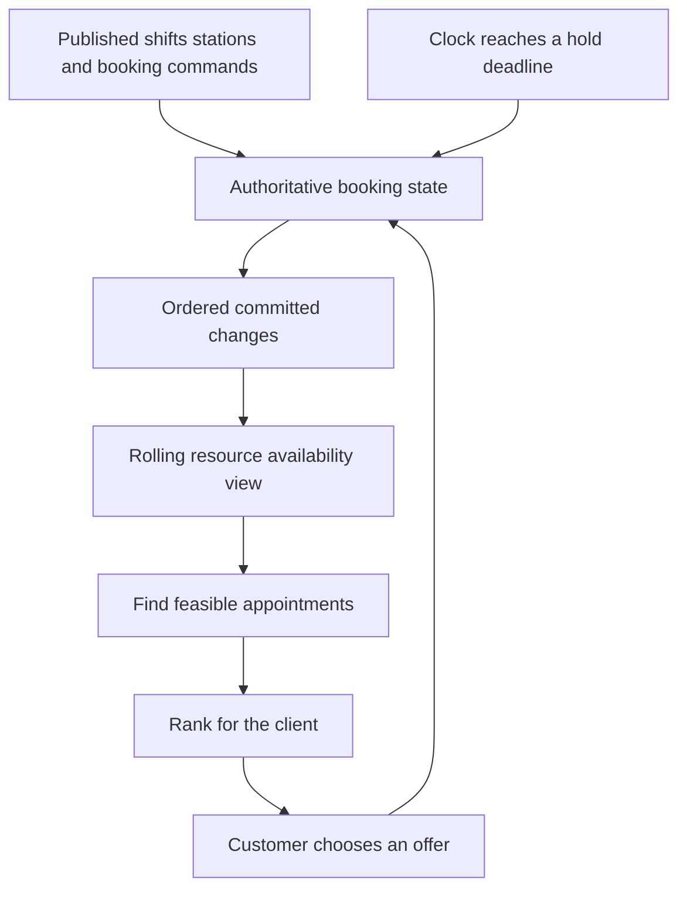
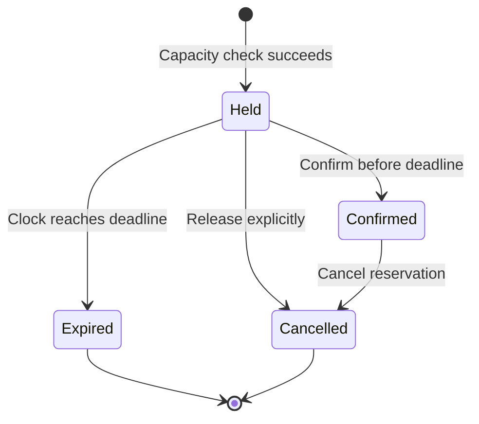
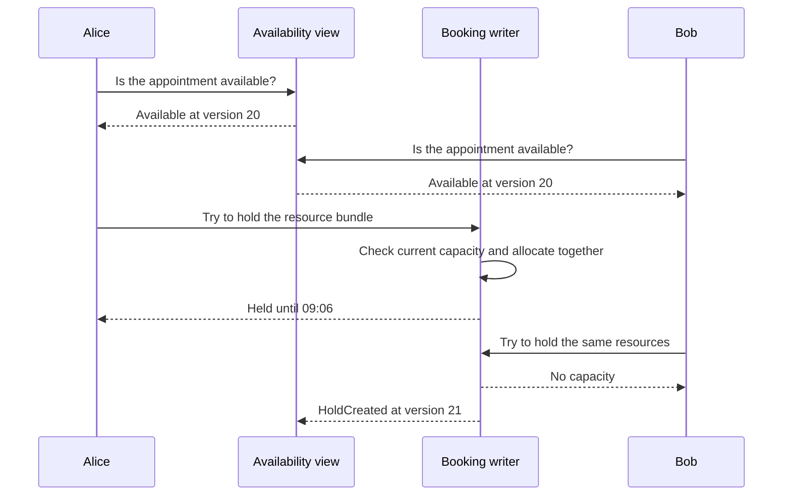

# Packing Algorithms in C# Part 3 Streaming Availability Holds and a Moving Window

<datetime class="hidden">2026-11-10T16:00</datetime>
<!-- category -- C#, .NET, Algorithms, Scheduling, Streaming, Architecture -->

At nine o'clock, the salon has an appointment available next Tuesday. At nine-oh-one, someone holds it while deciding. At nine-oh-six, that hold expires. Nothing about next Tuesday's opening hours changed, but the answer to “can I book this?” changed twice in five minutes.

Rebuilding future availability overnight won't keep up with that. We need to update what changed, expire temporary allocations, and keep a useful stretch of the future ready to query as time moves forward.

In [Part 2](/blog/packing-algorithms-in-csharp-part-2), we used the same calendar logic for employee rosters and customer appointments, then ranked feasible offers. Here we give that calendar a stream of changes, holds and a bounded look-ahead window. We are deliberately still working on the logic, with a console example rather than a UX.

This assumes ordinary .NET knowledge: collections, locks and async methods. We'll explain the scheduling and streaming ideas through the salon. All code is an independent teaching example.

The [complete .NET 10 sample](https://github.com/scottgal/mostlylucidweb/tree/main/samples/StreamingAvailability) has no extra package dependencies:

```bash
dotnet run --project samples/StreamingAvailability/StreamingAvailability.csproj
dotnet run --project samples/StreamingAvailability/StreamingAvailability.csproj -- --check
```

[TOC]

The series moves from [finding gaps](/blog/packing-algorithms-in-csharp) and [salon rules and preferences](/blog/packing-algorithms-in-csharp-part-2) to **live availability and holds**, then [adapting when the plan changes](/blog/packing-algorithms-in-csharp-part-4). A future Part 5 will combine restaurant bookings, customer behaviour and chef/service context to begin forecasting stock requirements. Here we'll build the streaming mechanics first, then use the newer [mostlylucid.packing implementation](https://github.com/scottgal/mostlylucid.packing) to show how the rules carry into persistent bookings. The package examples run in that separate repository.

## Keep the useful cache and change how it is maintained

One approach is a scheduled ETL job: **extract** bookings and working hours, **transform** them into available slots, and **load** the result into a fast read store. Readers get a daily availability map.

Precomputing a useful answer can be sensible. The weakness is treating the next batch run as the way that answer becomes current. A live system also has holds, cancellations, new bookings, changed shifts and station outages.

Instead, keep a **materialized view**: data calculated in advance for reading, updated as its inputs change. Microsoft's [materialized-view guidance](https://learn.microsoft.com/en-us/azure/architecture/patterns/materialized-view) describes that separation. A full rebuild remains useful for startup, recovery and checking correctness; it doesn't have to be the normal response to one appointment changing.

We will distinguish three things:

| Data | Purpose | How it changes |
|---|---|---|
| Booking facts | Holds, confirmed reservations and published resource capacity | Accepted commands |
| Resource availability view | Capacity and usage over a bounded future window | Small updates from committed changes |
| Appointment recommendations | Feasible service, technician, station and start combinations for a client | Query current availability, then rank |

Keeping those separate avoids precomputing every client × service × technician × station × future time combination. Most of that combination space will never be requested.



A small application may serve reads from its authoritative index directly. The sample separates the read view so we can demonstrate lag and recovery. Streaming is a way to maintain state, not a requirement to add a message broker or another service.

## An offer a hold and a confirmed reservation are different

An **offer** says an arrangement was feasible when we looked. It doesn't consume capacity.

A **hold** temporarily consumes the full resource bundle. A **confirmed reservation** continues consuming that capacity until it is cancelled or otherwise changed under the business rules.



A hold has two unrelated time intervals:

```text
Appointment occupancy:  Tuesday 10:00–11:05 for the technician
Hold lifetime:         Today 09:01–09:06 while the client decides
```

Expiring the hold releases the future appointment capacity. It doesn't wait until Tuesday, and it doesn't shorten the treatment to five minutes.

As in Part 2, the resource intervals can differ: technician time includes their reset, a station includes its cleanup, and the client occupies only the treatment interval. Hold creation acquires all those allocations together.

## Use one place to decide whether capacity can be acquired

The read view can be behind the booking state. Two clients can both see the final suitable appointment as available before either client's hold reaches the view.



The writer owns the decision. It rechecks current capacity and acquires the bundle as one operation. A cached “available” result is useful for finding options, while the hold result establishes whether this client acquired one.

Our `BookingLedger` uses a C# lock for one venue. Inside it, hold creation expires due holds, checks command retries, validates the proposed usage, updates the resource counts and appends the committed change. The console constructs a known resource bundle. In the salon application, the Part 2 service would construct it after applying service skills, blocked-client rules and other eligibility checks; those checks still belong at the command boundary.

For a multi-instance application, the database operation must coordinate competing writers—for example through a shared venue version or an appropriate lock inside the transaction. Simply inserting each reservation in its own transaction doesn't make two prior availability checks safe. Microsoft's [transaction guidance](https://learn.microsoft.com/en-us/ef/core/saving/transactions) explains atomic writes; the isolation and conflict strategy must cover this particular check-and-acquire operation.

## Represent the future on a declared grid

The example uses five-minute UTC slots. Each resource cell stores two integers:

```csharp
public readonly record struct Cell(int Capacity, int Used);
```

A slot can accept an additional demand when:

```text
used + requestedUnits <= capacity
```

For a two-seat bench with one occupied seat, another one-seat appointment can fit. For a capacity-one technician, it cannot. Every slot in every resource interval must pass, including combined demands on the same resource. Zero capacity means there is no published bookable capacity for that cell; explaining a closure or an unpublished roster is a separate application concern.

A demand uses absolute slot numbers:

```csharp
public sealed record Demand(string ResourceId, long Start, long End, int Units = 1)
{
    public static Demand Between(string resource, DateTimeOffset start, DateTimeOffset end, int units = 1) =>
        new(resource, Slots.Exact(start), Slots.Exact(end), units);
}
```

`Slots.Exact` converts an instant into its five-minute position and rejects off-grid appointment boundaries. Intervals remain half-open: `[Start, End)`. We don't round an existing booking down and accidentally free part of it. All times must use the declared grid for this representation to be exact.

Hold deadlines remain full `DateTimeOffset` instants. A hold expiring at 09:06:30 does not acquire a new deadline of 09:10 merely because appointments use five-minute cells.

Resolve local opening hours and appointment times with the venue's time-zone rules before mapping them to UTC. A local day crossing a daylight-saving change isn't necessarily 288 five-minute slots. The demo uses UTC instants throughout to keep that conversion outside the capacity algorithm.

## Change only the affected resource cells

A committed change describes a range update, rather than asking the reader to recalculate all future combinations:

```csharp
public sealed record Change(
    string ResourceId, long Start, long End,
    int UsedDelta = 0, int? Capacity = null);

public sealed record CalendarEvent(
    long Sequence, string Kind, Guid? ReservationId,
    IReadOnlyList<Change> Changes);
```

`UsedDelta` is an addition to occupied capacity: `+1` acquires one unit; `-1` releases it. `Capacity` sets a resource's available capacity when a published schedule changes. One event can contain the whole multi-resource bundle.

| Accepted change | Occupancy update |
|---|---|
| Create hold | Add the hold's resource demands |
| Confirm hold | Keep existing usage; change reservation state |
| Expire hold | Subtract its demands once |
| Cancel held or confirmed reservation | Subtract its demands once |
| Publish changed resource capacity | Update that resource's affected range |

Confirmation doesn't add the appointment again: the hold already occupied it. An old expiry entry also cannot release a hold that has since been confirmed.

For each delta, the projection touches only its intersection with the current window:

```csharp
for (var slot = Math.Max(delta.Start, _start);
     slot < Math.Min(delta.End, _start + _width);
     slot++)
{
    // Update this resource's capacity or used count for this cell.
}
```

The complete implementation stages the updates, checks the resulting counts, and publishes the event's changes under one read-view lock. A reader doesn't see half of a multi-resource event applied.

Reducing a technician's capacity below existing holds or confirmed work is rejected by the sample. A roster edit needs explicit resolution of those commitments; an incremental update shouldn't make them disappear.

## Expire holds without scanning every reservation

A **priority queue** keeps the nearest deadline at the front. When time advances, remove due entries until the next deadline lies in the future. We don't revisit every confirmed booking to find a few expired holds.

Here is the expiry handler from `BookingLedger.cs`:

```csharp
private void ExpireDue()
{
    var now = clock.GetUtcNow();
    while (_expiry.TryPeek(out var id, out var deadline) && deadline <= now)
    {
        _expiry.Dequeue();
        var hold = _reservations[id];
        if (hold.State != ReservationState.Held || hold.ExpiresAt != deadline) continue;
        _reservations[id] = hold with { State = ReservationState.Expired };
        Adjust(hold.Demands, -1);
        Append("HoldExpired", id, ToChanges(hold.Demands, -1));
    }
}
```

The state check matters. A hold might be confirmed before its queue entry becomes due. Removing that old entry must leave the confirmed reservation's usage intact.

Confirmation also runs this expiry check inside the writer's lock before examining the hold:

```csharp
public Reply Confirm(Guid commandId, string owner, Guid holdId)
{
    var fingerprint = JsonSerializer.Serialize(new { Kind = "Confirm", owner, holdId });
    lock (_gate)
    {
        ExpireDue(); // Equality with the deadline is expired, even if the timer has not fired.
        if (Previous(commandId, fingerprint) is { } replay) return replay;
        if (!_reservations.TryGetValue(holdId, out var hold) || hold.Owner != owner)
            return Remember(commandId, fingerprint, new(false, "NotFound", Version: _journal.Count));
        if (hold.State != ReservationState.Held)
            return Remember(commandId, fingerprint, new(false, "HoldNotActive", holdId, hold.ExpiresAt, _journal.Count));
        _reservations[holdId] = hold with { State = ReservationState.Confirmed };
        Append("HoldConfirmed", holdId, Array.Empty<Change>()); // Already occupied: do not count twice.
        return Remember(commandId, fingerprint, new(true, "Confirmed", holdId, Version: _journal.Count));
    }
}
```

The policy is explicit: `now >= ExpiresAt` is expired. Timer delivery can be late; a confirmation exactly at the deadline still fails. An external response arriving later must resolve against the current reservation state rather than reviving an expired hold.

We inject [`TimeProvider`](https://learn.microsoft.com/en-us/dotnet/standard/datetime/timeprovider-overview) so tests can move the clock without waiting five real minutes. The console's small `ManualClock` controls the logical clock used by these checks. It doesn't implement virtual timer scheduling.

## Keep a moving window with a ring buffer

A **ring buffer** is a fixed-size array whose cells are reused as its logical contents advance. Each resource gets one ring covering the same future interval.

```text
Before:  [ A | B | C | D ]  logical future slots A through D
After:   [ E | B | C | D ]  logical future slots B through E
           ^ reused cell
```

The physical array isn't shifted. Its lookup index is:

```csharp
private int Index(long slot) => checked((int)(slot % _width));
```

Only the newly entering tail overwrites the old head. Within a contiguous window of `_width` slots, each absolute slot has a distinct array position. Queries outside that logical window must be rejected so they cannot read a reused cell as an unrelated date.

The sample returns `Available`, `Unavailable` or **`OutsideWindow`**, plus the view's sequence position. Outside the window means this cache cannot answer. It must not become “the salon is fully booked”. A caller can load another bounded range or use an authoritative query.

For 50 resources and a 14-day elapsed-time window:

```text
14 × 24 × 12 = 4,032 cells per resource
50 × 4,032 × 8 bytes = 1,612,800 bytes, about 1.54 MiB of raw cell values
```

Add array and dictionary overhead. Booking records, command results and the event journal have their own storage requirements. The bounded window limits the read grid, not the size of all business history.

### Load the entering tail from current facts

A future reservation can be made beyond today's cached window. Its event won't alter any current grid cell, but its facts must still be present when that date later enters the window.

Therefore the new tail is loaded from authoritative state. Filling it with empty cells would advertise appointments that were booked days earlier.

There's a second subtlety. Suppose the view is at version 20, and the tail snapshot is captured at version 25. Events 21–25 may also affect cells that remain in the window. We must apply those retained-cell changes before claiming the view is current at 25.

`Advance` handles both at one source version:

```csharp
public void Advance()
{
    lock (_gate)
    {
        var next = Math.Max(_start, Slots.Floor(_source.Clock.GetUtcNow()));
        if (next == _start)
        {
            CatchUp();
            return;
        }
        if (next - _start >= _width)
        {
            Rebuild(); // No retained cells: loading the new window is cheaper than replaying old changes.
            return;
        }
        var oldEnd = _start + _width;
        var nextEnd = next + _width;
        var tailStart = Math.Max(oldEnd, next);
        // Both retained-cell events and entering-tail values are captured at the same source version.
        var snapshot = _source.Capture(tailStart, nextEnd, _cursor);
        foreach (var change in snapshot.Pending) ApplyCore(change);
        _start = next;
        Hydrate(snapshot, tailStart, nextEnd);
        if (_cursor != snapshot.Version) throw new InvalidOperationException("Snapshot and stream positions disagree.");
    }
}
```

`Capture` takes the tail values, stream position and pending changes under the source lock. Pending events update the old window; tail values then populate the new cells. The result is one view at one version, rather than a fresh tail attached to stale retained cells.

If the clock jumps far enough that none of the old window remains, a fresh window snapshot is simpler than replaying changes into cells about to be discarded. The code takes that path too.

## Time must advance even when no customer sends a message

A booking event can wake the consumer, but silence doesn't prevent holds expiring or the horizon advancing. We need both event processing and a periodic clock check.

The sample uses a bounded .NET channel as a **wake-up signal**. The ordered journal holds the changes themselves. Many notifications can collapse into one signal because the consumer reads every journal entry after its last processed sequence. Microsoft's [Channels documentation](https://learn.microsoft.com/en-us/dotnet/core/extensions/channels) covers this producer/consumer mechanism.

```csharp
public static class AvailabilityWorker
{
    // One event consumer; a periodic tick also expires holds and moves the horizon when the venue is quiet.
    public static async Task RunAsync(BookingLedger ledger, RollingAvailability view, CancellationToken cancellationToken)
    {
        using var stop = CancellationTokenSource.CreateLinkedTokenSource(cancellationToken);
        var token = stop.Token;
        var events = ConsumeAsync();
        var clock = AdvanceAsync();
        await Task.WhenAny(events, clock);
        await stop.CancelAsync();
        await Task.WhenAll(events, clock);

        async Task ConsumeAsync()
        {
            await foreach (var _ in ledger.Changes.ReadAllAsync(token)) view.CatchUp();
        }

        async Task AdvanceAsync()
        {
            using var timer = new PeriodicTimer(TimeSpan.FromSeconds(1), ledger.Clock);
            while (await timer.WaitForNextTickAsync(token)) view.Advance();
        }
    }
}
```

The event consumer catches up after writes. The timer calls `Advance`, which also processes expiry and pending events when the window hasn't moved. A one-second timer is a sample cadence, not the precision of the writer's deadline checks. Use `TimeProvider.System` for this hosted loop; the console demonstrates the same transitions with explicit clock advances and catch-up calls.

If either loop fails, the linked cancellation stops its sibling. A host can then recover the view before restarting consumption.

## Treat retries and missed events as normal cases

An **idempotency key** identifies one command attempt and its retries. Repeating hold creation with the same key and payload returns the original result. It doesn't acquire capacity twice or renew the deadline. Reusing that key for different content is rejected.

A returned command result describes that operation's outcome. If the original hold has since expired, an old successful response doesn't make it active again; its deadline and current state remain decisive. Use a new command for an intentional new attempt.

Each venue's committed changes also have increasing sequence numbers. A projection keeps a **cursor**, meaning the last sequence it has processed:

```csharp
if (change.Sequence <= _cursor) return;
if (change.Sequence != _cursor + 1)
    throw new InvalidOperationException("Stream gap: fetch missing events or rebuild before advancing the cursor.");
```

An older event is a duplicate or already covered by a snapshot. A later event with a missing predecessor is a gap, not permission to skip ahead. Catch up from the journal or rebuild the window with a consistent snapshot and cursor.

The prototype journal and deduplication records are in memory. Production needs durable command results and a **transactional outbox**: save the business change and its pending event in the same transaction, then deliver the event from that stored record. Microsoft's [outbox explanation](https://learn.microsoft.com/en-us/azure/architecture/databases/guide/transactional-out-box-cosmos) illustrates that commit boundary. Consumers must still tolerate repeated delivery.

Keep deduplication retention separate from the availability window. Dropping a past command key when its grid cells leave the cache could let an old retry behave like a new operation.

This also doesn't require making the event log the only source of booking truth. Ordinary booking tables plus reliable change publication can maintain a projection. [Event sourcing](https://learn.microsoft.com/en-us/azure/architecture/patterns/event-sourcing) is the further choice to reconstruct authoritative business state from an event history; it brings additional design commitments.

## Invalidate appointment starts rather than just occupied cells

A resource cell becoming busy at 14:00 affects more than appointments starting at 14:00. A one-hour treatment starting at 13:30 overlaps that cell too.

For a fixed occupied duration `L`, an appointment starting at `a` uses `[a, a + L)`. It intersects a changed interval `[s, e)` when:

```text
a < e  AND  a + L > s

Therefore: s - L < a < e
```

On a grid of size `g`, with aligned boundaries and duration, the affected starts run from `s - L + g` through `e - g` inclusive. For a change from 14:00 to 14:10, a 60-minute occupancy and a five-minute grid, starts from 13:05 through 14:05 may change. A 13:00 appointment ends at 14:00 and doesn't overlap the changed range.

That's the region to refresh if you maintain a service-specific start-time cache. Use each resource's actual occupied duration: the technician and station can have different reset allowances.

The runnable sample maintains resource cells and checks proposed bundles directly. It doesn't maintain those additional start maps. Once measurements justify one, a **bitset**—one bit per possible start—can compactly mark usable starts. For an appointment of `m` cells, all `m` consecutive capacity cells must have enough free units. Combine the resulting technician, station and client start maps, after eligibility filtering, to obtain feasible bundle starts.

A simple boolean “busy” bit is insufficient for the two-seat bench. Build the mask from `Capacity - Used >= requestedUnits`, so the second seat remains usable.

Client blocks and skill changes are eligibility changes, not necessarily occupancy changes. They can invalidate offers even when resource counts remain identical. Rebuild an accepted offer from current policy before acquiring capacity. Define separately what a later policy change means for an already held or confirmed appointment.

## Carry the booking rules into mostlylucid.packing

The in-memory sample exposes the mechanics: one authority, a sequence of committed changes and a bounded projection. The newer [standalone implementation](https://github.com/scottgal/mostlylucid.packing) adds typed calendar queries and a SQLite reservation authority. It also models staged treatments and friends booking together.

That implementation is a .NET 10 preview. The code below uses its actual public API and its [salon fixture](https://github.com/scottgal/mostlylucid.packing/blob/main/samples/Salon/SalonFixture.cs). Run the reference example from the standalone repository root:

```bash
dotnet run --project samples/Salon -c Release
dotnet test Mostlylucid.Packing.slnx -c Release
```

The fixture declares Sarah and Anna, stations, drying lamps, services and clients for one explicit UTC day. Its manual clock starts before the appointments, so the example remains repeatable when you run it on a later date.

```csharp
using Mostlylucid.Packing;
using Mostlylucid.Packing.Calendar;
using Mostlylucid.Packing.Sqlite;
using SalonExample;
using static SalonExample.SalonFixture;

var definition = Create();
var clock = new ManualClock(Day);
using var store = new SqliteCalendarStore(":memory:", definition, clock);
var calendar = Pack.Calendar(definition, store);

var result = calendar.FindBest(
    At(10), At(12), Minutes(45), Gels());

if (result.Best is { } match)
{
    var hold = calendar.TryHold(
        Guid.NewGuid(), "alice", match, TimeSpan.FromMinutes(5));
    Console.WriteLine($"Hold: {hold.Reason}");
}
```

`Gels()` requests Alice's gel treatment with Sarah. `FindBest` returns a typed match with appointment times, role assignments, demands and the source revision. It creates no reservation. `TryHold` reconstructs that match's demands from the service definition before asking the store to acquire the complete bundle.

The `:memory:` database keeps this first example disposable. Replace it with a file path to retain reservations, command results and change records across store instances and restarts. The store binds that database to the definition's version and rejects a different definition on reopen; changing the service catalogue requires an explicit migration approach.

### Make resource use follow the treatment stages

Part 2 kept the technician occupied throughout a treatment. A gel service can have a drying stage during which the technician is free to do something else. The station and lamp remain occupied, and the same technician must return for finishing.

This is the service definition used by the package fixture. `Minutes` and `Set` are small fixture helpers for `TimeSpan` and sets of capability names:

```csharp
var gels = new Service("gels", Minutes(45),
    [
        new("technician", Set("technician", "gels")),
        new("station", Set("manicure-station")),
        new("lamp", Set("drying-lamp"))
    ],
    [
        new("prepare", Minutes(0), Minutes(15), ["technician", "station"]),
        new("dry", Minutes(15), Minutes(20), ["station", "lamp"]),
        new("finish", Minutes(35), Minutes(10), ["technician", "station"]),
        new("tech-reset", Minutes(45), Minutes(5), ["technician"]),
        new("station-reset", Minutes(45), Minutes(10), ["station"])
    ]);
```

Each stage names its offset from arrival, duration and required roles. A role is bound to one resource for the appointment, so `technician` remains Sarah through preparation, finishing and reset. Fixed offsets make the whole appointment one candidate with several occupied intervals.

For a 10:00 arrival:

| Resource | Occupied intervals |
|---|---|
| Sarah | 10:00–10:15 and 10:35–10:50 |
| Manicure station seat | 10:00–10:55 |
| Drying lamp | 10:15–10:35 |
| Alice | 10:00–10:45 |

Sarah can take a 15-minute consultation at 10:15. One starting at 10:35 conflicts with finishing. The package's salon sample checks both. The release during drying doesn't remove the later commitment to return.

The package search bounds **all occupancy**. A search from 10:00 to 10:45 cannot contain this service, even though the client leaves at 10:45: station reset lasts until 10:55. The `Minutes(45)` argument must match the catalogue's service duration; it cannot shorten the treatment or omit cleanup. This differs from Part 2's arrival-only bounds.

Staged services also refine the start-cache invalidation rule above. A stage with offset `o` and duration `L` uses `[a + o, a + o + L)`. A change `[s, e)` affects starts satisfying `s - o - L < a < e - o`. Refresh the union of those ranges for the stages using the changed resource. Treating the whole appointment as continuously busy is simpler but would hide the consultation gap we just created.

The preview implements fixed stage offsets. Allowing drying to last anywhere from 15 to 25 minutes, or waiting for a different finishing technician, needs additional timing and continuity rules.

### Hold friends' appointments as one bundle

Two friends asking to start together need more than two independently good suggestions. One friend's appointment must not be acquired while the other's fails.

On a fresh store, the package call is:

```csharp
var together = calendar.FindTogether(
    At(10), At(12), [Gels(), Pedi()]);

if (together.Best is { } group)
{
    var commandId = Guid.NewGuid();
    var reply = calendar.TryHold(
        commandId, "alice", group, TimeSpan.FromMinutes(5));

    if (reply.Success)
    {
        var confirmed = calendar.Confirm(
            Guid.NewGuid(), "alice", reply.ReservationId!.Value);
        Console.WriteLine($"Confirmation: {confirmed.Reason}");
    }
}
```

`Gels()` and `Pedi()` name different clients and services. `FindTogether` returns one match containing both appointments at the same start. `TryHold` acquires all technician, station, equipment and client demands in one transaction. If the pedicure no longer fits, the gel appointment isn't partially held.

The command owner is Alice, while the match includes her friend. The host application must establish that Alice may book for that friend before invoking this operation. Client eligibility and command ownership don't establish that delegation by themselves.

SQLite uses an immediate write transaction around expiry, retry lookup, the current capacity check and reservation writes. Separate connections therefore coordinate through the database. This replaces the teaching ledger's process-local lock at the acquisition boundary. A stale match can still succeed if its exact arrangement remains valid and fits now; its old revision doesn't reserve anything.

Confirmation keeps the hold's occupancy. Cancellation or expiry releases it once. A retry with the original command ID and payload returns the original reply and deadline. If that deadline has passed, the old successful reply doesn't reactivate the hold. The provider processes due expiry on relevant operations, including reads and confirmation, so correctness doesn't depend on a timer firing exactly on time.

### Query a bounded view without running an optimiser

The SQLite provider also supplies allocation blocks and capacity summaries for a requested viewport:

```csharp
var page = calendar.GetBlockPage(
    At(10), At(11), ["sarah", "manicure"], limit: 100);

var capacity = calendar.GetCapacityBlocks(
    At(10), At(11), ["sarah", "manicure"],
    resolution: TimeSpan.FromMinutes(15));

// After all snapshot pages have been read:
var changes = calendar.GetBlockChanges(page.View);
```

Allocation blocks describe holds and confirmed work. Capacity summaries describe how much of a selected resource remains. A 15-minute summary can contain both free and occupied cells, so each block preserves minimum and maximum remaining units. A positive maximum doesn't prove that a complete service fits.

When `page.Next` is present, read the remaining pages before consuming changes. Apply removal IDs and upsert blocks by their stable IDs, then continue from the returned view token. If the status is `ResnapshotRequired`, discard that view and load a fresh bounded snapshot. Relevant writes during paging, pruned history and oversized delta batches can require that recovery. Unrelated writes advance the stream cursor without changing the selected viewport's revision. Tokens identify the query and source; the host still authorises which resources the caller may see.

These are synchronous database projections over a configured finite horizon. The provider does **not** run the ring-buffer worker from this article, maintain a materialised tile cache or automatically extend the definition's horizon. It carries forward the same snapshot, revision and recovery principles through a different storage implementation. Moving that persisted horizon forward remains further provider work.

## Let recommendations use the live feasible set

Part 2's customer profile can remain unchanged while availability changes repeatedly. Store those learned preferences, query the current resource view, then rank the feasible results.

A hold by another client might remove Cara at one from the feasible set. Expiry might make it available again. That is an availability update, not fresh evidence that this client now prefers a different technician.

This gives us a useful streaming split:

| Change | Recalculate |
|---|---|
| Booking, cancellation or hold expiry | Affected availability and dependent appointment starts |
| Published employee hours or station capacity | Affected resource ranges and dependent offers |
| Client or service eligibility rule | Relevant eligible combinations |
| New customer preference evidence | That customer's profile or ranking inputs |
| Time moves forward | Evicted head, hydrated tail and due holds |

We can cache popular date/service queries at a known version or track their resource dependencies. Personalised recommendations can be ranked from those current candidates when requested, avoiding a fan-out rebuild for every client whenever one seat changes.

A temporary hold also isn't the same outcome as an attended appointment. Keep those facts distinct when feeding the recommender described in [From Behaviour to Recommendations](/blog/show-me-what-you-got-part2-building-relevance).

The package's `mostlylucid.packing.relevance` adapter follows this order too: capture the bounded feasible pool, score that pool, then select the best few. It preserves source revision and candidate completeness. In Part 4, we use that API to revise an informed suggestion when the customer asks for something different today.

## Check the behaviour and the amount of work

The demo deliberately delays the read view so readers can see why the writer's recheck matters:

```text
Cached view before hold: Available
Alice's hold: Held
Delayed view still says: Available
Bob's competing hold: NoCapacity
Caught-up view: Unavailable
Confirm exactly at expiry: HoldNotActive
After expiry: Available
Bob confirms: Confirmed
Confirmed usage remains: Unavailable
Day-three query before window moves: OutsideWindow
Day-three query after window moves: Unavailable
Tail cells written: 576
```

The window is two days wide and advances by one day over two resources. The entering day needs `288 × 2 = 576` explicit cell writes. A reservation made beyond the old horizon is correctly present in that new tail.

The relevant costs are:

| Operation | Work in this representation |
|---|---|
| Hold acquisition | Inspect and update the demanded resource cells |
| Streamed occupancy change | Update affected cells that intersect the read window |
| One-slot window advance | Load one entering cell per existing resource, plus pending changes |
| Due hold expiry | Pop due queue entries and release their resource cells |
| Proposed appointment check | Inspect its demanded cells |
| Full window rebuild | Load every resource cell in the new window |

Finding all appointment offers still requires choosing resource combinations and starts. The grid makes each capacity check cheap; it doesn't make every possible query constant-time. For sparse calendars or sub-grid precision, interval indexes may be a better representation. Benchmark against actual resource counts, durations, change rates and query patterns.

The checks cover 32 concurrent hold attempts, exact expiry boundaries, idempotent retries, stale expiry entries, cancellation, whole-bundle accounting, capacity edits, duplicates, stream gaps, quiet-period expiry and asynchronous consumption. Five hundred generated update steps compare the streamed view with an independent recount of active reservation records. Further cases cover bookings crossing the horizon and pending events during rollover.

The authority, journal and command results remain in memory in the `StreamingAvailability` sample. Rebuild tests recover its projection while that authority is still present; they don't demonstrate business-data recovery after process loss. The standalone SQLite tests separately exercise persistence on reopen, competing connections, exact expiry, grouped holds and projection recovery. Run those checks in the standalone repository; the streaming sample doesn't acquire these features merely by sharing the article.

We now have two concrete implementations to inspect: a rolling in-memory projection that shows how time and deltas interact, and a durable calendar that checks and reserves complete service footprints. UX, payments, hold renewal and amendments remain later work.

In [Part 4, Adapting When the Plan Changes](/blog/packing-algorithms-in-csharp-part-4), we start with a suggestion or arrangement already in progress. A customer changes their time or technician preference; another box arrives after we've selected a tote. We try to accommodate the change, reconsider the affected choices and distinguish a new proposal from changing something already promised. Reusing solver work supports that adaptation where the planning inputs remain unchanged.
