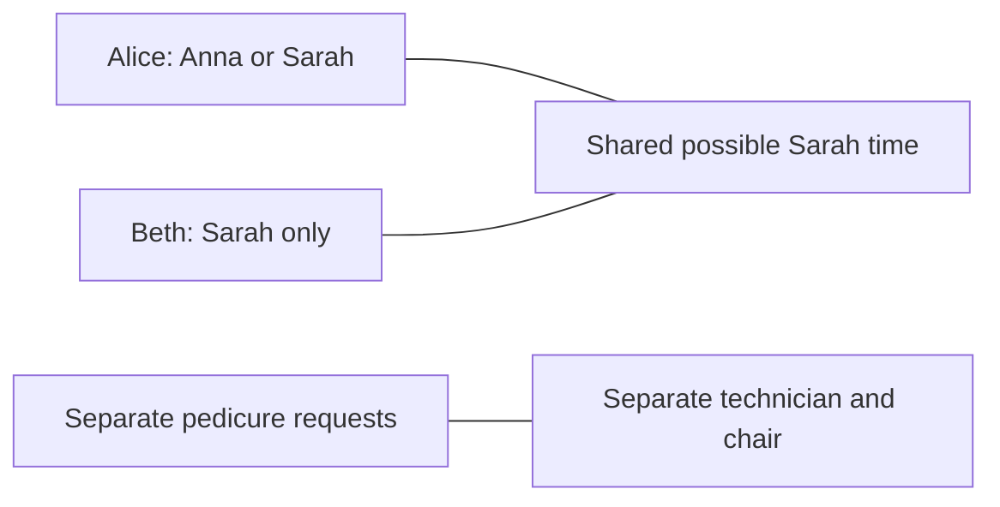

# Packing Algorithms in C# Part 4 Adapting When the Plan Changes

<datetime class="hidden">2026-11-10T18:00</datetime>
<!-- category -- C#, .NET, Algorithms, Scheduling, Recommendations, Optimization -->

You've chosen a tote and started packing it. Then another box arrives. Can it go in the remaining space? Do you need to move something? Or was the tote you selected too small for what you now have?

A salon has the same problem. Past visits suggest that Alice would like a gel appointment with Sarah around one. We find a suitable offer. Then Alice says she needs to come before noon, and this time she'd like Anna. The earlier suggestion was reasonable given what we knew. Now we know something different.

The first three articles built the happy path: [find space](/blog/packing-algorithms-in-csharp), [apply requirements and preferences](/blog/packing-algorithms-in-csharp-part-2), then [keep availability current and reserve resources](/blog/packing-algorithms-in-csharp-part-3). This article starts with an arrangement already in progress. **How do we adapt it when the contents, the customer or our understanding of their preferences changes?**

We'll follow those changes through the [mostlylucid.packing implementation](https://github.com/scottgal/mostlylucid.packing). The examples use its .NET 10 calendar, spatial and Relevance APIs. We already have the fit checks from earlier parts; here we decide when to reuse an arrangement, when to revise it and what we are allowed to disturb. We'll also introduce the inventory information a revised request needs, preparing for a future Part 5 on restaurant demand and stock forecasts, with an optional AI or LLM interface.

[TOC]

## Start with an informed proposal

A booking application can use previous choices to suggest a service, technician and time. A packing application can preselect a tote size from the expected contents and previous successful shipments. Both save someone from starting with an empty form.

That first choice remains provisional. A customer may want something different today. A shipment may acquire another item after its packaging was selected.

| Starting proposal | New information | Adaptation to consider |
| --- | --- | --- |
| Sarah around one, based on past visits | Alice needs a morning appointment | Search the new window and rank its feasible offers |
| Anna is a soft preference | Alice says only Anna will do | Make Anna a requirement for this request |
| Small tote selected for the expected contents | Another box arrives | Try the remaining space, then reconsider the tote |
| Several unconfirmed appointments planned | One customer changes service or time | Reconsider that request and the others it competes with |
| Suggestions ranked from an older profile | New preference evidence arrives | Refresh ranking where that evidence matters |

Keep the source of each input. “Usually books Sarah” is inferred from history. “Only Anna today” is an explicit requirement. “Anna is unavailable” is a capacity fact. They cause different updates even when they all change the next suggestion.

## Try the existing arrangement first

Suppose a tote is `4 × 2 × 2`. One `2 × 2 × 2` box is already at the origin. A second arrives. Before planning a new layout, check whether it fits in the remaining space:

```csharp
using Mostlylucid.Packing;
using Mostlylucid.Packing.Spatial;

var tote = Pack.Spatial3D(
    new Box3D(4, 2, 2), [new(0, 0, 0), new(2, 0, 0)]);

var packed = new List<PlacedBox>
{
    new(new Box3D(2, 2, 2), new Point3D(0, 0, 0))
};
var incoming = new Box3D(2, 2, 2);
var position = new Point3D(2, 0, 0);

if (tote.Fits(position, incoming, packed))
    packed.Add(new PlacedBox(incoming, position));

Console.WriteLine($"Boxes in the existing tote: {packed.Count}");
```

The result is two boxes, with the first left where it was. `Fits` checks the proposed position against the existing layout. The application then adds that placement to its own state. Choosing trial positions and permitted orientations remains the host's insertion strategy; this call checks the position we supplied.

This is often the cheapest useful adaptation: retain the current arrangement and add the new thing. An empty result from a few trials means that insertion attempt failed. It doesn't by itself establish that rearranging the contents could never work.

## Reconsider the tote when the contents change

Now a third cube arrives. Our preselected tote held the expected two, but it cannot contain three cubes of that size. We can consider the available tote sizes again, including **all** the contents rather than planning the incoming item in isolation.

The package's spatial profile works with one container per planning call. The host can try its preferred container first and then another permitted size:

```csharp
using Mostlylucid.Packing.OrTools;

BoxItem[] contents =
[
    new("first", new Box3D(2, 2, 2), Required: true),
    new("second", new Box3D(2, 2, 2), Required: true),
    new("incoming", new Box3D(2, 2, 2), Required: true)
];
Box3D[] toteChoices = [new(4, 2, 2), new(6, 2, 2)];
Point3D[] anchors = [new(0, 0, 0), new(2, 0, 0), new(4, 0, 0)];

foreach (var size in toteChoices)
{
    var space = Pack.Spatial3D(size, anchors, new CpSatPackingSolver());
    var proposal = space.Plan(contents, TimeSpan.FromSeconds(10));
    if (proposal.Placements.Count != contents.Length) continue;

    Console.WriteLine($"Revised tote: {size.Width} × {size.Depth} × {size.Height}");
    break;
}
```

With these choices, the larger tote holds all three cubes. Marking every item required prevents an apparently successful plan that quietly leaves out an existing item. The ordering of `toteChoices` expresses the host's preference for trying the smaller tote first. A richer policy could order feasible packaging by cost, material use or observed success, while keeping dimensions and loading rules as requirements.

This call produces a fresh layout for the complete item list. It has no constraint preserving the old coordinates and no objective minimising how many boxes move. That distinction matters if the tote has already been physically packed. The host must decide whether repacking is allowed before applying a proposal. The current profile also searches supplied anchors and axis rotations; its result reports incomplete candidate coverage. A failed bounded search shouldn't become an unsupported claim that every possible arrangement has been ruled out.

The useful progression is: try insertion, consider an allowed rearrangement, then widen the packaging choices when needed. The preview supplies checks and bounded planning calls for those steps. The host orchestrates them; there isn't yet a single automatic repair operation.

## A changed resource can change what the request consumes

Back at the restaurant, a party of four asks for a high chair. Suppose this venue's layout assigns a high chair two place units. The party still has four people, but now needs five place units and one available high chair. The four-place table from the first proposal no longer fits that footprint. We reconsider a six-place table without pretending another guest has arrived.

The [AdaptiveAllocation sample](https://github.com/scottgal/mostlylucidweb/tree/main/samples/AdaptiveAllocation) compiles that change into the actual Packing package. Its adapter checks table suitability, reserves the selected table exclusively in the proposed model and includes high-chair stock as a separate limit. This fixture uses one service interval. A full restaurant profile would attach the demands to the booking and cleaning intervals from the earlier parts.

The same sample gives the chef three specials, one protected for eligible customers. Public orders can consume at most two, even if selling a third to them would have a higher margin. Eligible customers still share the same total stock. When the chef releases the reserve, public orders can compete for that third special. The chef's decision is a policy update, separate from a learned guess about what someone might choose.

From the article repository root:

```bash
dotnet run --project samples/AdaptiveAllocation -c Release
dotnet test samples/AdaptiveAllocation/Tests/AdaptiveAllocation.Tests.csproj -c Release
```

The sample consumes the local Packing and Relevance projects, with an alternative mode that consumes packed NuGet artifacts. It produces checked proposals. It doesn't commit table amendments or decrement a durable stock ledger.

## Let today's request change yesterday's suggestion

Return to Alice. We have evidence favouring Sarah around one. The [standalone Relevance integration](https://github.com/scottgal/mostlylucid.packing/tree/main/integration/Relevance) turns prior choices into a ranker and scores the calendar's current feasible appointment pool.

The following query code belongs in that integration's `Program.cs`, after its calendar and `Ranker` setup. We search for the gel service from Part 3 using the same learned technician/time preferences. The fixture uses a manual clock and an explicit service day, so the scenario remains repeatable:

```csharp
var originalQuery = calendar.Query()
    .During([new Period(SalonFixture.At(9), SalonFixture.At(17))])
    .OfSize(SalonFixture.Minutes(45))
    .Where(new BookingRequirements("gels", "alice"));

var suggested = await originalQuery.WithRelevance(Ranker("alice")).TopKAsync(5);
var firstSuggestion = suggested.Best?.Match;

// Alice now says: "Before noon, and only Anna today."
var revisedRequirements = new BookingRequirements("gels", "alice",
    RequiredResources: new Dictionary<string, string>
    {
        ["technician"] = "anna"
    });

var revisedQuery = calendar.Query()
    .During([new Period(SalonFixture.At(10), SalonFixture.At(12))])
    .OfSize(SalonFixture.Minutes(45))
    .Where(revisedRequirements);

var revised = await revisedQuery.WithRelevance(Ranker("alice")).TopKAsync(5);
foreach (var offer in revised.Matches)
    Console.WriteLine($"Revised suggestion: {offer.Match.Start:HH:mm}");
```

The same historical ranker can still prefer Sarah at one. Those appointments aren't in the revised feasible pool: the explicit request now requires Anna and a morning window. Learning supplies a useful starting point, and the new request supplies information we must act on.

If Alice had said “I'd prefer Anna”, we would use `PreferredResources` instead. That keeps other eligible technicians available as alternatives. The difference is in what the customer asked, rather than how strongly an old model scored Sarah.

A service change also changes the footprint. Adding nail art to the gel treatment requires rebuilding the request using the selected service's catalogue duration, stages and resources. Editing a time label on the old offer would leave the wrong resource demands attached to it.

### A correction today and a lasting preference change are different

Alice choosing Anna this morning doesn't establish that she has stopped liking Sarah or afternoon appointments. The time restriction might be specific to today. Preserve the explicit request for this interaction, then record the observed choice with its context for later learning.

Over several visits, the evidence may support a different default. Refresh the customer characterisation and rank newly feasible offers with that updated evidence. That can change suggestions even when the capacity calendar hasn't changed at all.

Record the alternatives actually shown. If Sarah was unavailable, Alice choosing Anna gives different evidence from choosing Anna when both were offered. The same applies to packaging: using the larger tote because the small one couldn't fit the contents doesn't establish that the larger tote should always be preferred.

The current bridge ranks the bounded feasible pool and retains its source revision and completeness flag. It doesn't automatically encode domain features, interpret conversational corrections or collect feedback. Those belong to the host and its configured Relevance pipeline. Part 2 explains the preference baseline; here the new work is deciding which inputs a change invalidates.

## Revisit the inventory when the treatment changes

Alice now asks for nail art as well. We need to know what that treatment requires before deciding whether the revised appointment is possible. The service catalogue from Part 3 already characterises duration, qualifications, roles and stage occupancy. Inventory adds another question: do we have the supplies needed to deliver it?

An inventory here includes identified resources and their relevant characteristics, plus quantities of consumable supplies. These have different lifetimes:

| Resource or supply | What the treatment needs | What happens afterwards |
| --- | --- | --- |
| Qualified technician | A person with the required skills during the relevant stages | Their time becomes available after work and reset |
| Station and drying lamp | Suitable equipment during specified stages | Equipment becomes available after use and cleaning |
| Gel product or nail-art supplies | A defined quantity, unit and eligible product variant | Stock is consumed according to the fulfilment policy |
| Shipping tote | A permitted size and one available container | A dispatched tote leaves the packaging inventory unless it is returnable |

This changes both examples. An extra item may require a larger tote, but that size must also be in stock. Nail art may require a longer appointment, another qualification and supplies that the original treatment didn't need. A resource description should carry the characteristics used by these decisions: capabilities for people and equipment, dimensions and load limits for totes, and units and variants for supplies.

The treatment definition supplies its requirements. A customer's message selects or modifies a treatment request; it doesn't get to invent a shorter duration or omit the stock demand. If an alternative product or treatment is permitted, its substitution rules belong in the catalogue and may require the customer's agreement.

### Reserve stock as well as time

Suppose there are ten usable doses on hand and three are reserved for upcoming treatments. Seven are available to promise. A new two-dose treatment can reserve two of those, leaving five for other requests.

The reservation ties that stock to the appointment. Cancelling before use can release the reservation. Once a dose has been used, cancelling the appointment doesn't put the product back on the shelf. Reusable equipment and consumable stock therefore need different release rules. The host must define when preparation or fulfilment consumes stock and whether any opened or wasted material can be reused.

The same distinction applies to our tote. Choosing its size is a planning decision. Reserving one unit of that size prevents another shipment from being promised the same last container. Dispatch records its departure from inventory.

The current package's calendar provider reserves resource capacity over time. It doesn't implement a consumable stock ledger, tote inventory, replenishment or consumption transactions. The shared planning core can express a finite stock limit alongside other capacities, but a complete integration must generate those demands and coordinate stock and appointment reservations. Two separate successful availability reads don't reserve the combined treatment-and-supplies bundle.

For this article, the catalogue and inventory are the information an adaptation must consult. Durable stock accounting and coordinated acquisition are extensions to implement, with explicit units, identities and reservation state. This also gives a future allocation agent concrete data to work from.

## Decide what can move before revising the plan

Changing an unaccepted suggestion is easy: generate revised alternatives. An existing hold or confirmed booking carries a different commitment.

| Existing state | Meaning of adaptation |
| --- | --- |
| Suggested appointment | Replace the suggestion with newly checked alternatives |
| Temporary hold | Retain or release its capacity under an explicit replacement policy |
| Confirmed booking | Use an amendment workflow with the customer's agreement |
| Proposed box layout | Recompute within the permitted movement rules |
| Physically packed tote | Account for unpacking, repacking and which items may move |

The package calendar keeps active reservations as occupied capacity when querying or planning. A new preference doesn't silently move an accepted appointment. Likewise, its spatial `Plan` call produces a proposal; it doesn't move the boxes in our application's existing layout.

The SQLite provider currently offers holds, confirmation and cancellation. It has no atomic “replace this reservation with that one” command. Cancelling the original and then acquiring the replacement can leave the customer with neither. Acquiring a second hold first can fail because the original still consumes overlapping client or resource capacity. A complete amendment workflow needs the authority to evaluate the intended release and acquisition together. We should describe that as further implementation work rather than pretend two independent calls provide the same guarantee.

There is also a distinction between preserving valid choices and finding the least disruptive revision. The current optimiser maximises fulfilled requests, then additive preference utility. It doesn't minimise movement from the previous plan. A future repair policy would need to declare which assignments are fixed, which may move and how movement is valued. Keeping a solver instance alive alone doesn't establish that policy.

## Reconsider the requests connected to the change

When Alice changes an unconfirmed request, she may need a resource that another pending request was using. Adapting only her selected appointment can miss a better revision involving both customers.

Follow **all eligible alternatives** when identifying the affected group. Suppose Alice could use Anna or Sarah, while Beth could use only Sarah. Even if Alice's current proposal uses Anna, her Sarah alternative connects the two requests. If Anna becomes unavailable, the next plan may need to reconsider both.



The pedicure group can retain its result while the connected group changes, provided its complete planning inputs remain identical. A shared station or a newly allowed technician can join groups that previously looked independent.

Part 3 updated resource cells after a hold, cancellation or clock tick. This step updates the **decisions made from those cells**, also accounting for changed requests and preference scores. Those are separate dependencies: a preference update can change a plan without altering any resource usage.

The package's `IncrementalPackingSolver` finds connected components from the current candidates, resource use and declared conflicts. For each component it compares requests, required flags, capacities, candidates, utility and conflicts. It reuses an unchanged proven optimum or infeasibility proof, solves changed components and verifies the combined result against the current full problem.

A feasible result that ran out of search time gets another search on the next call. New alternatives can merge components; removed alternatives can split them. This is why caching only the currently selected appointments isn't enough.

For calendar planning, keep the wrapper instance between calls:

```csharp
using Mostlylucid.Packing.Planning;

var incremental = new IncrementalPackingSolver(new CpSatPackingSolver());
var planningCalendar = Pack.Calendar(definition, store, incremental);

// Call planningCalendar.Plan(...) with the current pending requests.
// On later calls, changed requests, utility or capacity invalidate affected proofs.
```

Here `definition` and `store` are the salon definition and SQLite store from Part 3. This wrapper reuses solver work. The current calendar still regenerates its bounded candidates, and the combined plan is checked again. Reusing a proof is a computation saving; preserving a customer's previous assignment is a separate product decision.

## Include the cost of changing suppliers

Changing an arrangement can consume resources itself. Moving to another table can require a reset. Repacking a tote takes work. Moving an LLM conversation to another model can require replaying its accumulated context.

The `AdaptiveAllocation` sample also routes a small work item between fictional local and online model suppliers. Target-specific token estimates, execution slots, permitted modes, estimated latency and context limits determine which options fit. Completed task/supplier outcomes supply an explicitly uncalibrated success estimate; Relevance supplies a separate, bounded preference bonus. Neither can override capacity or a restriction on remote execution.

For fresh work, the cheaper online supplier wins. With an 8,000-token conversation retained locally, local execution wins because switching would replay that history. If the local context is evicted or the local execution slots run out, we reconsider online execution with the replay cost included. More observed online failures can change the choice again without changing capacity.

Retention must be evidenced by a matching, unexpired context record. Selecting the same model name isn't proof that the context is still there. Reused history still occupies the full context window and can have a cache-read charge. The sample separates replay cost from an optional disruption penalty, so token work isn't charged twice under different names.

All costs and supplier outcomes in this fixture are synthetic. No remote model is called. The current solver still maximises fulfilment count before utility; it isn't a general maximum-profit planner. This example makes the cost of adaptation explicit using the existing selection core. Its adapters remain application code while we learn which contracts deserve extraction.

## Measure how much adaptation actually saves

The article repository's [ResourcePacking sample](https://github.com/scottgal/mostlylucidweb/tree/main/samples/ResourcePacking) compares a complete solve with selective replanning. Its synthetic areas have separate technicians and customer requests. An unavailable technician moves between areas over five updates. Both the restored area and the newly affected area need fresh work.

From the `mostlylucidweb` repository root:

```bash
dotnet run --project samples/ResourcePacking/Examples/ResourcePacking.Examples.csproj -c Release -- --benchmark
dotnet test samples/ResourcePacking/Tests/ResourcePacking.Tests.csproj -c Release
```

A recorded local Release run on macOS Arm64 with .NET 10 produced these medians over five updates. Every update reached the same proven request count and utility through both approaches:

| Fixture | Requests | Full solve | Selective solve |
| --- | ---: | ---: | ---: |
| 8 independent areas | 64 | 34.98 ms | 10.00 ms |
| 32 independent areas | 256 | 199.84 ms | 21.03 ms |
| 8 areas sharing station capacity | 64 | 35.69 ms | 40.67 ms |

Selective timing includes partitioning, signatures, changed-component searches and combined verification. Input construction is measured separately. The shared station connects every area, so there is no independent solver work to retain and the wrapper adds overhead. These fixture measurements demonstrate where reuse helps; they don't establish production latency or how much human disruption a revised plan causes.

The tests also change preference utility, add and remove alternatives, merge and split components, and compare selective results with complete solves over generated updates. From the standalone repository root, run `dotnet test Mostlylucid.Packing.slnx -c Release` for its calendar, spatial, Relevance and solver checks.

## Prepare for tomorrow's restaurant inventory

Part 5 returns to a restaurant question: “Tomorrow is specials night, Ben is cooking, and these customers have booked. What stock might we need, and what might be left over?” The next requirement grows from the booking and inventory information we already have.

Customer history can inform likely meal choices. The chef and the kind of service can affect those choices and the applicable preparation quantities. We will combine that context in a small demand baseline, translate expected meals into ingredient requirements through versioned recipes, and compare them with stock projected to be available at service time. Changing the chef, menu or bookings then triggers another adaptation.

Expected demand remains different from a preorder or an accepted reservation. We need observed quantities, available menu choices and later outcomes to evaluate the forecast; a relevance rank isn't a dish-choice probability. The first version can report supported estimates and shortages or possible surplus for staff to consider. It needn't order supplies, redesign the menu and run the kitchen automatically.

An optional LLM can interpret a question or propose a typed scenario change, then explain the calculated comparison. The demand estimator, catalogue, inventory projection and allocation checks supply the numbers. This is the incremental design exercise: start with packing, encounter another concrete requirement, add the smallest useful capability and inspect whether it helps. The current preview doesn't yet supply the restaurant demand model, durable stock ledger, language adapter or atomic amendment operation.

A useful adaptation can be small: keep the tote and add the box, or keep the learned profile and search the customer's new window. Sometimes it needs a wider revision: choose another tote, reserve different supplies or reconsider competing pending requests. The application needs to explain what changed, what it retained, what it proposes moving and what still needs acceptance. That is the new responsibility once the happy path has produced its first arrangement.
