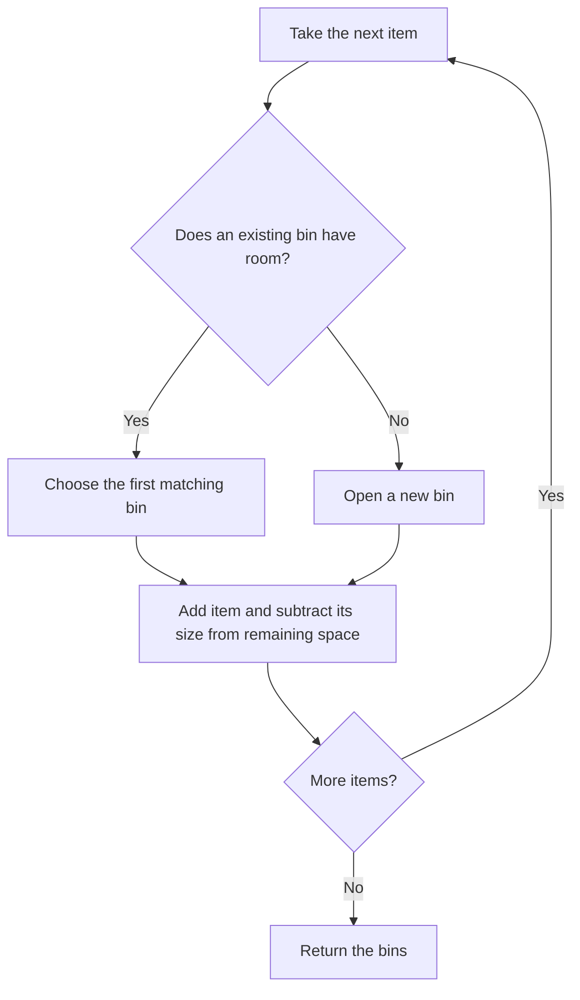
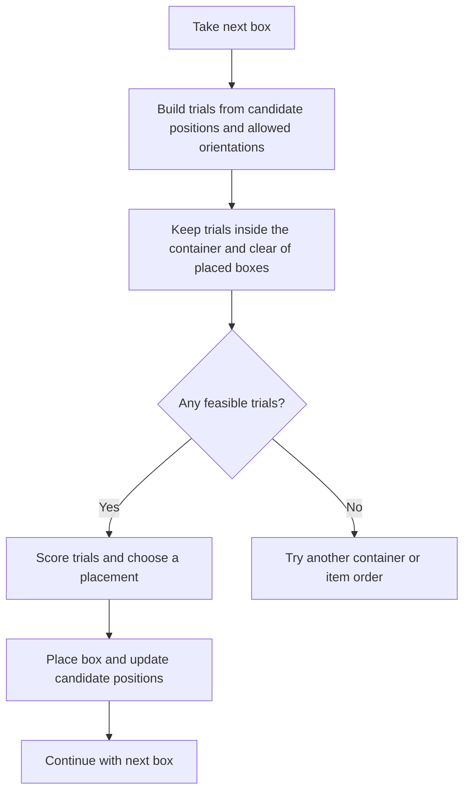
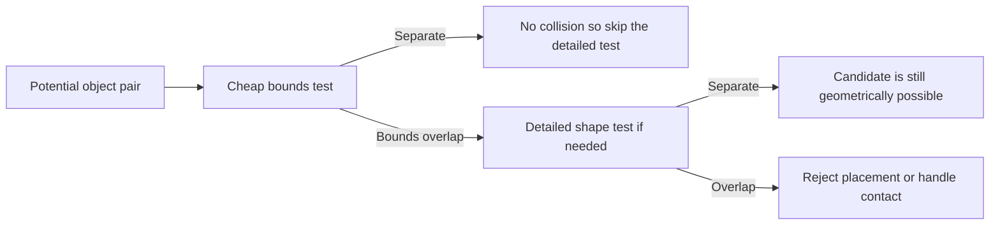
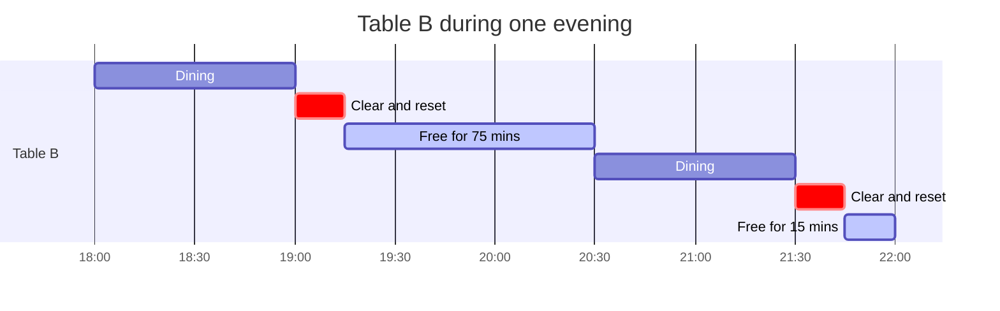
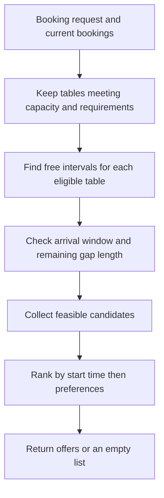

# Packing Algorithms in C# From Boxes to Restaurant Bookings

<datetime class="hidden">2026-11-10T12:00</datetime>
<!-- category -- C#, .NET, Algorithms, Beginners, Scheduling, Optimization -->

You have a collection of things and somewhere to put them. Parcels into boxes. Images into a sprite sheet. Jobs onto machines. Meetings into a calendar. The awkward bit is that “there's enough space” doesn't necessarily mean everything will fit.

Over the years I've worked on travel-agent sites, appointment systems and, more recently, [Zenchef](https://www.zenchef.com/), a leading European restaurant booking company. Finding useful space in a busy schedule is a subject I keep coming back to. **None of the code in this or any of my other articles comes from a customer system.** These are independent teaching examples.

Packing algorithms give us a way to reason about that problem. We'll start with ordinary bins, follow a few algorithms by hand, look at shipping boxes, spheres and irregular shapes, then build a small C# example that finds restaurant booking slots. Along the way we'll handle table sizes, arrival windows, accessibility and the time needed to clear a table.

You need basic C#: variables, lists, loops and methods. I'll explain unfamiliar terms as we meet them. The [runnable sample](https://github.com/scottgal/mostlylucidweb/tree/main/samples/PackingCalendars) uses .NET 10 and has no additional package dependencies. The code blocks below come from its named classes, so you can follow along in those files without assembling a project from fragments.

[TOC]

## Start with items and bins

Imagine each box can hold 10 kilograms. You have parcels weighing:

```text
6, 8, 2, 4
```

For this first example, weight is the only limit. We deliberately ignore the parcels' physical dimensions.

A **bin** is a container with a capacity. An **item** consumes some of that capacity. The classic **bin packing problem** asks how to place every item while using as few bins as possible. Google's [bin packing guide](https://developers.google.com/optimization/pack/bin_packing) distinguishes this from knapsack problems, where choosing which valuable items to include is part of the task.

We can calculate an optimistic starting point:

```text
Total weight:              6 + 8 + 2 + 4 = 20
Capacity per bin:          10
At least this many bins:   round up(20 / 10) = 2
```

That's a **lower bound**: a result cannot use fewer bins. It doesn't promise that two bins will work for every collection totalling 20. Three items of size 6 also need three bins, despite their total being only 18, because no pair fits together.

Two ideas will keep coming back: total capacity and the shape of the remaining space.

## First fit uses the first place with enough room

The simplest useful strategy keeps a list of bins. For each item, scan from the beginning and use the first bin with enough remaining capacity. Open another bin if necessary.

This is **first fit**, a greedy algorithm. “Greedy” means it makes a choice from the current situation and continues without reconsidering earlier choices. It doesn't mean the choice is always globally best. Dalhousie University's [algorithm notes](https://web.cs.dal.ca/~nzeh/Teaching/4113/book/greedy_approx/bin_packing/algorithm.html) describe this rule and analyse its guarantees for ordinary bin packing.

Follow our items in their original order:

| Item | Decision | Bins afterwards |
|---|---|---|
| 6 | Open bin A | A: `6` |
| 8 | It won't fit in A; open B | A: `6`, B: `8` |
| 2 | A is the first bin with room | A: `6 + 2`, B: `8` |
| 4 | Both bins have only 2 left; open C | A: `6 + 2`, B: `8`, C: `4` |

We used **three bins**, although two are enough. At the moment we placed the 2, we made a perfectly legal decision that left an inconvenient pair of gaps.

The decision repeats for every item:



Here's the complete method from the sample's `BinPacking` class:

```csharp
public static List<List<int>> FirstFit(IEnumerable<int> sizes, int capacity)
{
    ArgumentOutOfRangeException.ThrowIfNegativeOrZero(capacity);
    var bins = new List<List<int>>();
    var remaining = new List<int>();

    foreach (var size in sizes)
    {
        if (size <= 0 || size > capacity)
            throw new ArgumentOutOfRangeException(nameof(sizes), "Items must be positive and fit in an empty bin.");

        var index = remaining.FindIndex(space => space >= size);
        if (index == -1)
        {
            bins.Add(new List<int>());
            remaining.Add(capacity);
            index = bins.Count - 1;
        }

        bins[index].Add(size);
        remaining[index] -= size;
    }

    return bins;
}
```

`IEnumerable<int>` means a sequence of integers we can loop through, such as an array or a list. `List<List<int>>` means a list of bins, each containing a list of item sizes. `remaining` keeps the unused capacity of the corresponding bin. `FindIndex` returns the first matching position, or `-1` when nothing matches.

The expression `space => space >= size` is a **lambda**: a small function answering “can this space hold this item?” The lambda is used as the test for each entry.

`ArgumentOutOfRangeException` reports an invalid argument to the caller; `ThrowIfNegativeOrZero` is a .NET helper for that check. We reject zero, negative and oversized items. Otherwise, an impossible parcel could quietly produce an invalid packing. An empty input produces an empty list of bins.

This simple implementation can scan up to `n` bins for each of `n` items: `O(n²)` work in the worst case. The sample's best-fit implementation has the same worst-case growth. Those are properties of these straightforward implementations; specialised data structures can reduce the searching work. Packing quality and CPU efficiency are separate things to measure.

## Best fit uses the tightest available space

**Best fit** examines all eligible bins and chooses the one with the least space remaining before insertion. For a fixed incoming item, that also leaves the smallest remainder afterwards.

When our item of size 2 arrives, A has 4 left and B has 2 left. Best fit chooses B:

```text
After 6 and 8:       A [6 ....]    B [8 ..]
Place 2 in B:        A [6 ....]    B [8 2]
Place 4 in A:        A [6 4]       B [8 2]
```

Now we use **two bins**. Filling B exactly preserved A's larger gap for the later item of size 4.

The `BestFit` method uses the same lists, but keeps looking after finding a possible bin:

```csharp
public static List<List<int>> BestFit(IEnumerable<int> sizes, int capacity)
{
    ArgumentOutOfRangeException.ThrowIfNegativeOrZero(capacity);
    var bins = new List<List<int>>();
    var remaining = new List<int>();
    foreach (var size in sizes)
    {
        if (size <= 0 || size > capacity)
            throw new ArgumentOutOfRangeException(nameof(sizes));
        var index = -1;
        for (var i = 0; i < remaining.Count; i++)
        {
            if (remaining[i] >= size && (index == -1 || remaining[i] < remaining[index]))
            {
                index = i;
            }
        }
        if (index == -1)
        {
            bins.Add(new List<int>());
            remaining.Add(capacity);
            index = bins.Count - 1;
        }
        bins[index].Add(size);
        remaining[index] -= size;
    }
    return bins;
}
```

The `for` loop visits each bin's position, `i`. The condition first checks whether the item fits, then whether this is our first candidate or a tighter fit than the one already selected. Keeping `<` rather than `<=` for that second comparison retains the earlier bin when two bins tie.

Best fit is still a heuristic: a practical decision rule, rather than a promise to find the minimum on every input. Choosing the tightest gap doesn't account for all the items that will arrive later. The [bin packing chapter in Mathematical Optimization](https://scipbook.readthedocs.io/en/latest/bpp.html) discusses heuristics and exact optimisation approaches.

## Sorting changes the decisions

If we have all the items before packing begins, we can sort them from largest to smallest and then apply first fit. This is **first-fit decreasing**:

```csharp
var sizes = new[] { 6, 8, 2, 4 };
var largestFirst = sizes.OrderByDescending(size => size);
var bins = BinPacking.FirstFit(largestFirst, capacity: 10);
```

The order becomes `8, 6, 4, 2`. We place 8 in A, 6 in B, 4 beside the 6, and 2 beside the 8. Again, two bins.

`OrderByDescending` is a LINQ operation: it produces a sequence in descending order. It doesn't modify the original array. The idea behind the algorithm is that large items have fewer places to go, so we handle them while useful space is still available.

| Strategy | Input order | Rule | Bins for this example |
|---|---|---|---|
| First fit | Arrival order | First bin that fits | 3 |
| Best fit | Arrival order | Tightest bin that fits | 2 |
| First-fit decreasing | Largest first | First bin that fits | 2 |

This table describes **our example**, not a universal ordering of algorithm quality.

The distinction between **online** and **offline** algorithms matters here. An online algorithm handles items as they arrive without knowing all the future items. An offline algorithm can inspect the whole input first. Best fit can operate online; sorting a complete collection requires knowing that collection.

A restaurant accepting bookings throughout the week has the same tension. It can optimise today's known requests, but tomorrow someone may ask for exactly the table it just assigned.

## Physical packing adds dimensions

Weight-only packing is one-dimensional: each item consumes one number. Cutting rectangles from a sheet, arranging images in an atlas and loading a van add geometry. Enough total area or volume doesn't prove that the shapes fit.

These illustrations come from the OptaPlanner documentation, now held in Apache KIE's documentation repository:


*The yellow rectangle has the same area in every arrangement. Different placements produce different outlines. Source: [OptaPlanner documentation illustration](https://github.com/apache/incubator-kie-docs/blob/c73a9dfb3d1f6fa314fd87ff52ba9753c8da32be/optaplanner-docs/src/main/asciidoc/UseCasesAndExamples/SurfaceBinPacking/binPackingIsNpComplete1.png), Apache License 2.0.*


*The square leaves strips too narrow or short for the long rectangle. Source: [OptaPlanner documentation illustration](https://github.com/apache/incubator-kie-docs/blob/c73a9dfb3d1f6fa314fd87ff52ba9753c8da32be/optaplanner-docs/src/main/asciidoc/UseCasesAndExamples/SurfaceBinPacking/binPackingIsNpComplete2.png), Apache License 2.0. Original images are unchanged; display sizes are constrained through ImageSharp.*

The diagrams' complexity labels concern the general packing problem. There isn't a known algorithm that always finds its optimum efficiently as the problem grows. Small instances can still be solved exactly, and heuristics can produce useful answers quickly. Finding gaps in an already fixed calendar is a much simpler task, as we'll see below.

For a visual account of a particular rectangle-packing algorithm, Jake Gordon's [binary tree packing walkthrough](https://jakesgordon.com/writing/bin-packing/) shows how placing a rectangle divides the unused space into smaller rectangles. Its diagrams and [interactive demo](https://jakesgordon.com/writing/bin-packing/demo) are useful companions to the one-dimensional examples above.

## More dimensions change what fits

“Multidimensional” can mean independent resource limits or actual physical dimensions. They need different checks:

| Problem | What must fit | Example use |
|---|---|---|
| One capacity | One total, such as kilograms | Our first-fit bins |
| Several capacities, also called vector packing | Every resource total stays within its own limit | CPU and RAM when assigning jobs to servers |
| Two-dimensional geometry | Rectangles fit within a surface without overlapping | Cutting sheet material or packing image atlases |
| Three-dimensional geometry | Boxes fit in a volume with permitted orientations | Pallets, delivery vans and shipping containers |
| Irregular geometry | Actual outlines or surfaces fit without intersecting | Garment cutting, laser cutting and arranging 3D parts |

A **vector** here means several resource quantities considered together, such as `(CPU cores, gigabytes of memory)`.

### Check each resource separately

A server with spare memory can still be out of CPU cores. We can extend the one-number capacity check into two checks joined by `&&`, meaning both must be true:

```csharp
public sealed record Resources(int CpuCores, int MemoryGb);

public static class MultiResourcePacking
{
    public static bool CanAdd(Resources used, Resources item, Resources capacity)
    {
        if (used.CpuCores < 0 || used.MemoryGb < 0 || item.CpuCores < 0 || item.MemoryGb < 0 ||
            capacity.CpuCores < 0 || capacity.MemoryGb < 0)
            throw new ArgumentOutOfRangeException(nameof(item), "Resource amounts cannot be negative.");

        return item.CpuCores <= capacity.CpuCores - used.CpuCores &&
               item.MemoryGb <= capacity.MemoryGb - used.MemoryGb;
    }
}
```

A `record` groups related values into a named data type. The declaration above gives each instance `CpuCores` and `MemoryGb` properties. The guard at the start rejects negative quantities before we compare the remaining resources.

```csharp
var capacity = new Resources(8, 16);
var used = new Resources(6, 4);

Console.WriteLine(MultiResourcePacking.CanAdd(used, new Resources(3, 2), capacity));
// False: needs 3 cores, but only 2 remain.

Console.WriteLine(MultiResourcePacking.CanAdd(used, new Resources(2, 12), capacity));
// True: both limits are met exactly.
```

A first-fit loop can use this test when choosing a server, then update both resource totals after placing a job. Best fit needs an extra policy: is one spare core more valuable than one spare gigabyte? Adding those raw numbers together would mix units. You might compare fractions of each resource left, but that is a scoring choice to evaluate on your workload.

A truck's weight and volume limits can be checked in the same way. Passing both checks still doesn't establish that its boxes can physically be arranged inside it.

### Pack surfaces with shelves or free rectangles

**Shelf packing** places rectangles side by side in rows. Each row's tallest item determines its height. When an item won't fit across, start another shelf. It is easy to picture and implement, but mixing tall and short items can waste space above the shorter ones.

**Guillotine packing** places an item and divides the remaining rectangle with straight cuts. It's useful when physical cutting rules require that pattern. A placement that looks dense on screen might be impossible to manufacture with the allowed cuts.

**MaxRects** keeps a list of candidate free rectangles, scores placements within them, then updates and removes redundant free rectangles after placing an item. It can use space more flexibly than fixed shelves, with more bookkeeping. Jukka Jylänki's [RectangleBinPack implementations and accompanying paper](https://github.com/juj/RectangleBinPack) cover these families of algorithms. These are different placement rules, not stronger guarantees that every layout is optimal.

## Pack boxes in three dimensions


*An example layout from Florian Fontan's [PackingSolver box documentation](https://fontanf.github.io/packingsolver/box.html), MIT licence. This shows what a 3D placement looks like; our smaller worked example below uses three cartons.*

A 3D box needs a size and a position. We'll use `X` for left to right, `Y` for front to back, and `Z` for height. The origin `(0, 0, 0)` is the container's front-left floor corner. All measurements below use the same arbitrary unit.

```csharp
public sealed record Box3D(int Width, int Depth, int Height);
public sealed record Point3D(int X, int Y, int Z);
public sealed record PlacedBox(Box3D Size, Point3D Position);
```

For a first algorithm, keep box edges parallel to the container's edges. This is **axis-aligned packing**. Rotating a box by a quarter turn changes which dimension is its width, depth or height. A box with three different dimensions has up to six distinct such orientations. A cube has only one. The sample's `BoxGeometry.Orientations` generates these permutations and removes duplicates.

At a proposed position, two separate questions determine geometric validity: does the box stay inside the container, and does it overlap anything already placed?

### Check the container and the neighbours

Here is the containment check from `BoxGeometry.cs`. Its `Validate` helper rejects zero or negative dimensions.

```csharp
public static bool FitsInside(Box3D container, PlacedBox item)
{
    Validate(container);
    Validate(item.Size);
    var p = item.Position;
    return p.X >= 0 && p.Y >= 0 && p.Z >= 0 &&
           item.Size.Width <= container.Width - p.X &&
           item.Size.Depth <= container.Depth - p.Y &&
           item.Size.Height <= container.Height - p.Z;
}
```

A width of 4 fits in a container of width 6 at `X = 0`, but fails at `X = 4`: only 2 units remain there.

For two axis-aligned boxes, test their intervals on all three axes:

```csharp
public static bool Overlaps(PlacedBox a, PlacedBox b)
{
    Validate(a.Size);
    Validate(b.Size);
    // Use long for interval ends so adding two int values cannot wrap around.
    return a.Position.X < (long)b.Position.X + b.Size.Width &&
           b.Position.X < (long)a.Position.X + a.Size.Width &&
           a.Position.Y < (long)b.Position.Y + b.Size.Depth &&
           b.Position.Y < (long)a.Position.Y + a.Size.Depth &&
           a.Position.Z < (long)b.Position.Z + b.Size.Height &&
           b.Position.Z < (long)a.Position.Z + a.Size.Height;
}
```

The boxes overlap only when their interiors overlap on **every** axis. Separation on even one axis is enough to keep them apart. This is the same interval idea we'll use for bookings, repeated in three directions. The strict comparisons allow boxes to share a face without their interiors intersecting.

For actual cuboid cartons under this orientation model, these tests describe their geometry directly. For an irregular object enclosed in a box, they only describe its bounds—we'll return to that distinction shortly.

### Choose candidate positions instead of every possible point

A **pivot** is a position worth trying for the next box. Start with the origin. After placing a box, add candidate positions immediately to its right, behind it and above it. Try the allowed orientations at those positions, rejecting candidates outside the container or overlapping a placed box.



If all candidates fail, that search rule can try another container, another item order or leave the item unplaced. Exhausting a small pivot list isn't proof that no possible layout exists. More capable methods maintain additional extreme points or free-space regions. The [py3dbp implementation](https://github.com/enzoruiz/3dbinpacking/blob/master/py3dbp/main.py) provides a concrete example of pivot and rotation trials.

Let's pack three identical `4 × 4 × 2` cartons into a `6 × 4 × 4` container. One valid sequence is:

| Step | Oriented dimensions | Position | Why it fits |
|---|---|---|---|
| A | `4 × 4 × 2` | `(0, 0, 0)` | Starts on the floor at the origin |
| B | `2 × 4 × 4` | `(4, 0, 0)` | Rotated upright into the narrow strip beside A |
| C | `4 × 4 × 2` | `(0, 0, 2)` | Sits in the space above A |

View the result as two horizontal layers, each 2 units high. Each letter occupies one unit square in this top-down drawing:

```text
Lower layer, Z = 0..2        Upper layer, Z = 2..4
A A A A B B                 C C C C B B
A A A A B B                 C C C C B B
A A A A B B                 C C C C B B
A A A A B B                 C C C C B B
```

B spans both layers. Its original width of 4 would not fit at `X = 4`; rotation makes its width 2. We can verify the three placements with the sample's geometry helpers:

```csharp
var container = new Box3D(6, 4, 4);
var placed = new List<PlacedBox>();
var proposals = new[]
{
    new PlacedBox(new Box3D(4, 4, 2), new Point3D(0, 0, 0)),
    new PlacedBox(new Box3D(2, 4, 4), new Point3D(4, 0, 0)),
    new PlacedBox(new Box3D(4, 4, 2), new Point3D(0, 0, 2))
};

foreach (var candidate in proposals)
{
    if (!BoxGeometry.CanPlace(container, candidate, placed))
        throw new Exception("Invalid box placement.");

    placed.Add(candidate);
}
```

This code checks a proposed arrangement; it doesn't discover those coordinates. The pivot procedure describes how a heuristic searches for them. Keeping placement checks separate from the search lets us change the search without weakening validity checks.

A shipping plan needs additional checks for weight, support underneath boxes, crushing limits and unloading order. A box that doesn't intersect anything can still be floating in mid-air. A parcel may also fit inside the van but not through its door. Geometric fit is one part of a loadable plan.

## Spheres in a glass show why volume is only a bound

Imagine pouring identical marbles into a glass. Dividing the glass's volume by one marble's volume gives an optimistic capacity estimate, but leaves out the spaces between curved surfaces. Shaking the glass can help marbles rearrange; it doesn't make those gaps disappear.


*Ordered sphere packing in a cube, rather than a random pour into a glass. The curved surfaces leave gaps even in a regular arrangement. Image by Twisp, cropped by Belbury, [Wikimedia Commons](https://commons.wikimedia.org/wiki/File:Close_packing_box_(cropped).svg), public domain; downloaded as a PNG rendering.*

Ordered layers can fill gaps differently from a casual pour. For identical spheres in unbounded three-dimensional space, the maximum packing density is about **74.05%**, as established by [Hales's proof of the Kepler conjecture](https://annals.math.princeton.edu/wp-content/uploads/annals-v162-n3-p01.pdf). That is a bulk result, not a calculator for the exact number of marbles in a particular glass. Walls, sphere size and finite-container geometry matter.

A random pour also depends on how the particles settle and rearrange. There isn't one universal “random packing percentage” for every procedure; [Torquato, Truskett and Debenedetti](https://arxiv.org/abs/cond-mat/0003416) explain why the traditional idea of random close packing needs care.

Checking two proposed spheres is much easier than discovering the best arrangement. They overlap when the distance between their centres is less than the sum of their radii. We can compare squared distances to avoid calculating a square root:

```csharp
public sealed record Sphere(double X, double Y, double Z, double Radius);

// From SphereGeometry; Validate checks finite values and a positive radius.
public static bool Overlaps(Sphere a, Sphere b)
{
    Validate(a);
    Validate(b);
    var dx = a.X - b.X;
    var dy = a.Y - b.Y;
    var dz = a.Z - b.Z;
    var radii = a.Radius + b.Radius;
    return dx * dx + dy * dy + dz * dz < radii * radii;
}
```

The radius is the distance from a sphere's centre to its surface. `dx`, `dy` and `dz` are the differences between the two centres. Equality means touching, so this check uses `<` rather than `<=`.

```csharp
var a = new Sphere(0, 0, 0, 1);
Console.WriteLine(SphereGeometry.Overlaps(a, new Sphere(2, 0, 0, 1)));   // False: touching
Console.WriteLine(SphereGeometry.Overlaps(a, new Sphere(1.9, 0, 0, 1))); // True
```

To model a straight cylindrical glass with inner radius `R` and height `H`, a sphere of radius `r` must keep its centre at least `r` from the wall, floor and rim. With the glass centred on the vertical axis, that includes `x² + y² <= (R - r)²` and `r <= z <= H - r`, with `r <= R`. Then check against the other spheres. A tapered glass needs a different wall check.

A physically poured arrangement also needs a way for each marble to enter and settle under gravity. A set of non-overlapping final positions alone doesn't establish that pouring will produce it.

## Irregular shapes need their actual outlines

Rectangles and spheres have convenient geometry. A coat sleeve, an L-shaped metal bracket or a scanned sculpture doesn't. **Nesting** is the usual term for arranging irregular parts on material while reducing waste. Uses include cutting fabric, sheet metal and leather, and arranging parts within a 3D printer's build space.


*The actual outlines matter: these pieces use space that their surrounding rectangles would obscure. Source: Florian Fontan's [PackingSolver irregular-shape example](https://fontanf.github.io/packingsolver/irregular.html), MIT licence.*

Wrapping each part in a rectangle is easy but can hide usable space inside notches. Two L-shaped pieces can interlock even though their bounding rectangles overlap:

```text
A B B
A A B
```

Each piece has area 3. Their occupied cells fill a `3 × 2` sheet with no overlap, but each piece's bounding rectangle has area 4. Treating those rectangles as the final shapes would reject this valid arrangement.

Here is that small example in C#. A tuple `(X, Y)` stores a pair of coordinates, and a `HashSet` stores distinct occupied cells:

```csharp
var shapeA = new HashSet<(int X, int Y)> { (0, 0), (0, 1), (1, 1) };
var shapeB = new HashSet<(int X, int Y)> { (1, 0), (2, 0), (2, 1) };

Console.WriteLine(shapeA.Overlaps(shapeB)); // False: no shared cells
```

This is a **raster** representation: describe a shape by the cells it occupies. In three dimensions, those cells become **voxels**, little volume elements. Resolution matters: coarse cells may hide useful gaps. If we halve cell size on all three axes, the same region needs eight times as many cells. Conservatively marking every cell touched by the shape avoids missed collisions, at the cost of sometimes rejecting a fit that finer geometry would allow.

### Polygons and no-fit polygons

A polygon describes a two-dimensional outline using vertices and straight edges. A shape with an inward notch is **concave**. Curves can be approximated with short edges, at a chosen tolerance. Polygon tests have to account for containment as well as edges crossing: one part can sit entirely inside another without their boundaries crossing.

A **no-fit polygon** moves some of that work into preprocessing. For a fixed orientation of moving part B, choose a reference point on B. Trace the positions of that point as B touches the outside of stationary part A without penetrating it. The boundary describes touching positions; its forbidden region describes reference-point positions that would overlap. Container-containment geometry restricts the remaining choices.

A nesting algorithm can then:

1. Choose an order and permitted rotations for the parts.
2. Compute or reuse the relevant no-fit and containment regions.
3. Choose a feasible position near already placed parts, using a rule such as bottom-left placement.
4. Score the resulting layout and try another order or rotation if the result wastes too much material.

[SVGnest's algorithm explanation](https://github.com/Jack000/SVGnest#outline-of-algorithm) shows this combination of no-fit geometry and a search over order and rotation. Its genetic algorithm maintains a population of candidate plans, combines and changes them, and keeps promising results. It searches for good layouts; the label “genetic” doesn't guarantee the optimum.

Real cutting also needs spacing for the cutting tool, permitted rotations for fabric grain, and rules for using holes or cut-outs. [Clipper2](https://github.com/AngusJohnson/Clipper2) provides C# polygon operations and offsets that can help build such geometry. It supplies building blocks, rather than a complete nesting strategy.

For irregular 3D parts, extend the representation to surface triangles, collections of simpler shapes or voxels. There is no single radius or three-number size that captures every concavity. Rotations now change which surfaces face each other, adding work to both placement search and collision checks.

## Why the search becomes expensive

There are two costs: **checking a proposed placement** and **searching for worthwhile placements**.

An axis-aligned box check uses a few comparisons. For a detailed irregular shape, a precise test may involve many polygon edges or surface triangles. Checking every pair among `n` objects takes `n × (n - 1) / 2` pair tests: 1,000 objects already give 499,500 pairs for just one complete arrangement.

Searching multiplies that work. Twenty distinct objects have `20!`, about `2.43 × 10¹⁸`, possible insertion orders. Trying up to six orientations per box introduces further choices, before choosing positions. Clever algorithms avoid exploring most combinations, and identical objects share equivalent states, but those counts explain why “try everything” stops being useful quickly.

With free rotations and continuous positions, the choice isn't even a short finite list until we discretise it or choose candidate positions. Discretising means restricting the search to selected values: a grid of positions or, for example, 15-degree rotation steps. A finer choice can find a fit a coarse one misses, while requiring more trials. Restricting candidates saves time but can miss valid layouts; it doesn't change the underlying validity rules.

### Games use the same geometry to reject most work early

A game engine often encloses a detailed character or object in a simpler shape: a box, sphere, capsule or several such volumes. These are often called **hitboxes** or collision proxies. A bounding shape that contains the whole object can cheaply rule out overlap when the bounds are separate. Overlapping bounds only mean the actual objects *might* overlap.



This is the **broad phase** followed by the **narrow phase**. Spatial grids and bounding-volume trees reduce which nearby objects need pair tests in the first place. NVIDIA's [collision-detection chapter](https://developer.nvidia.com/gpugems/gpugems3/part-v-physics-simulation/chapter-32-broad-phase-collision-detection-cuda) explains these stages and their computational savings.

For example, two radius-1 spheres with centres `(0, 0, 0)` and `(1.5, 1.5, 0)` have overlapping bounding boxes, but their actual centres are more than 2 units apart. A box-only rule would reject that pair; the sphere test shows the surfaces don't intersect. Our L-shaped pieces have the same issue with their rectangular bounds.

A game may deliberately use its simplified hitbox as the final gameplay collision shape. A packing system can do that too, but it accepts the lost usable space. If precise nesting matters, use bounds to reject obviously impossible interactions, then the actual shape to decide the remaining cases.

Collision detection and packing share these geometric tools. Collision detection asks whether a proposed configuration intersects; packing must also choose a configuration that fits its objective. Faster collision checks help the search, but don't remove the need to explore alternatives.

### Search can revisit earlier decisions

Our greedy algorithms make one pass. **Local search** starts with a plan, tries moves such as swapping items or moving one to another bin, and keeps improvements. It can improve a greedy result but get stuck where no allowed small move helps.

**Branch and bound** explores alternative assignments while discarding branches whose best possible result cannot improve the current best plan. Bounds are optimistic limits like the two-bin lower bound we calculated earlier. Exact search can prove an optimum when it finishes, but the search may grow quickly. SCIP's [bin-packing example](https://scipopt.org/doc-3.2.1/examples/Binpacking/index.php) uses branch-and-price, which combines branching with generating useful packing patterns during the search.

The useful progression is to choose the right capacity or geometry checks, get a valid plan, and only then spend more time improving it. We'll use that same separation for calendars: validity first, preferences second.

## A calendar makes the position matter

A calendar gives space a position along a time axis. Two free half-hours don't make a free hour if a meeting sits between them.

A restaurant adds another axis: the table. A booking occupies a particular table for a continuous interval. We usually can't split a meal across several gaps or move diners halfway through it.

Nor can we add together every empty seat in the room. A party of six needs a suitable six-person table or a permitted combination of adjacent tables. Three unrelated two-person tables aren't automatically interchangeable with that resource.

That means restaurant booking isn't classic bin packing with the labels changed. We have reusable resources, time windows and eligibility rules. Our smaller problem will be: **given the current bookings and a new request, find feasible placements and rank them**. We won't rearrange already confirmed reservations.

## Represent time with clear boundaries

For one evening service, we'll use integer minutes measured from 18:00:

| Clock time | Value in the sample |
|---|---|
| 18:00 | 0 |
| 19:00 | 60 |
| 20:00 | 120 |
| 22:00 | 240 |

This keeps the algorithm visible. A dining interval from 18:00 to 19:00 is `[0, 60)`.

The square bracket includes the start. The round bracket excludes the end. These are **half-open intervals**: something ending at 19:00 doesn't overlap something beginning at 19:00.

Here is the complete `TimeRange` type from `Availability.cs`:

```csharp
public sealed record TimeRange
{
    public int Start { get; }
    public int End { get; }
    public int Length => End - Start;

    public TimeRange(int start, int end)
    {
        if (end <= start) throw new ArgumentException("End must be after start.");
        Start = start;
        End = end;
    }

    public bool Overlaps(TimeRange other) => Start < other.End && other.Start < End;
}
```

The constructor, `TimeRange(int start, int end)`, runs when we create a range and checks that its duration is positive. The get-only properties preserve those values. `Length => End - Start` is a short way of writing a property that calculates its answer when read.

Records also have value equality: two of these ranges with the same start and end compare equal. Microsoft's [record reference](https://learn.microsoft.com/en-us/dotnet/csharp/language-reference/builtin-types/record) explains the generated behaviour.

The `Overlaps` method asks whether each interval starts before the other finishes:

```csharp
var dinner = new TimeRange(0, 60);
Console.WriteLine(dinner.Overlaps(new TimeRange(60, 90))); // False
Console.WriteLine(dinner.Overlaps(new TimeRange(59, 90))); // True
```

Those strict `<` comparisons allow touching boundaries. Replacing them with `<=` would reject back-to-back bookings even when no turnaround time was required.

### Include the time when the resource is still unavailable

A table occupied by diners until 19:00 may need another 15 minutes to clear and reset. Store or derive its **occupied interval**, including that turnaround:

```text
Dining:       [18:00, 19:00)
Turnaround:   [19:00, 19:15)
Occupied:     [18:00, 19:15)
```

The next party can arrive at 19:15. The overlap rule stays the same; we apply it to the correct interval.

The sample stores each booking's cleanup allowance. Changing tomorrow's default doesn't silently change existing occupancy. New requests use their own configured allowance. Here we require cleanup to finish before the service closes; a restaurant allowing cleanup afterwards would model separate dining and staff-work boundaries.

## Find gaps by sweeping from left to right

Suppose table B has these occupied intervals:



The useful gaps are 75 minutes and 15 minutes. A 60-minute meal with 15 minutes of cleanup fits exactly in the first gap. A 90-minute meal doesn't fit, even though the table has 90 free minutes in total.

To find gaps, sort occupied intervals by start time. Keep a **cursor** marking the furthest occupied end we've seen. Whenever the next occupied interval starts after that cursor, the distance between them is free.

Here's `FindGaps`, from the sample's `Availability` class:

```csharp
public static List<TimeRange> FindGaps(TimeRange opening,
    IEnumerable<TimeRange> occupied, int minimumLength)
{
    ArgumentOutOfRangeException.ThrowIfNegativeOrZero(minimumLength);
    var gaps = new List<TimeRange>();
    var cursor = opening.Start;

    foreach (var block in occupied.OrderBy(block => block.Start))
    {
        if (block.End <= opening.Start || block.Start >= opening.End) continue;
        var start = Math.Max(block.Start, opening.Start);
        var end = Math.Min(block.End, opening.End);

        if (start - cursor >= minimumLength)
            gaps.Add(new TimeRange(cursor, start));

        cursor = Math.Max(cursor, end);
    }

    if (opening.End - cursor >= minimumLength)
        gaps.Add(new TimeRange(cursor, opening.End));

    return gaps;
}
```

We clip blocks to the opening window and ignore blocks completely outside it. `Math.Max(cursor, end)` is important: overlapping or nested blocks must never move the cursor backwards. For occupied intervals `[0, 90)` and `[20, 40)`, the table stays busy until 90.

Try it with the same intervals expressed as minutes since 18:00:

```csharp
var opening = new TimeRange(0, 240);
var occupied = new[] { new TimeRange(150, 225), new TimeRange(0, 75) };
var gaps = Availability.FindGaps(opening, occupied, minimumLength: 1);

foreach (var gap in gaps)
    Console.WriteLine($"{gap.Start}–{gap.End}: {gap.Length} minutes");

// 75–150: 75 minutes
// 225–240: 15 minutes
```

The input is deliberately out of order. Sorting makes the scan visit `[0, 75)` first. The cursor moves to 75, discovers the gap to 150, then moves to 225. The final check discovers the gap from 225 to closing time, 240.

Set `minimumLength` to `75` for a 60-minute meal plus 15 minutes of cleanup. Only the first gap remains.

The algorithm effectively merges occupied intervals as it scans. It returns maximal free spans that meet the minimum length; it doesn't divide them into booking slots yet.

Sorting `n` intervals takes `O(n log n)` time, followed by an `O(n)` scan. That notation describes how work grows with input size. Already sorted bookings only need the scan. For the handful of reservations on one restaurant table, a sorted list is a sensible starting point.

## Apply requirements before ranking tables

We now need more than a free interval:

```csharp
public sealed record DiningTable(string Id, int Seats, bool Accessible);
public sealed record Booking(string TableId, TimeRange Dining, int CleanupMinutes)
{
    public TimeRange Occupied
    {
        get
        {
            ArgumentOutOfRangeException.ThrowIfNegative(CleanupMinutes);
            return new TimeRange(Dining.Start, checked(Dining.End + CleanupMinutes));
        }
    }
}

public sealed record BookingRequest(int PartySize, int EarliestStart,
    int LatestStart, int DiningMinutes, bool NeedsAccessibleTable);
public sealed record Candidate(string TableId, int Start, int DiningEnd,
    int OccupiedEnd, int UnusedSeats, bool UsesUnneededAccessibleTable);
```

`Booking` separates dining from occupied time by adding cleanup in its `Occupied` property. `checked` makes an arithmetic overflow fail rather than wrap to an incorrect number. `Candidate` stores one possible offer, including its unused seats.

The request fields give us **hard constraints**, which every candidate must satisfy. A three-person party needs at least three seats. A requested accessible table must meet that requirement. The start must fall inside the customer's arrival window, and dining plus cleanup must fit inside one free span.

A boolean is enough for this teaching example. A real venue may need separate facts about step-free routes, space around the table, seating arrangements and other requirements; model what guests actually need rather than assuming one label covers everything.

Our search follows these steps:



Here is the complete method from `Restaurant.cs`:

```csharp
public static List<Candidate> FindCandidates(IEnumerable<DiningTable> tables,
    IEnumerable<Booking> bookings, TimeRange opening, BookingRequest request,
    int cleanupMinutes)
{
    ArgumentOutOfRangeException.ThrowIfNegativeOrZero(request.PartySize);
    ArgumentOutOfRangeException.ThrowIfNegativeOrZero(request.DiningMinutes);
    ArgumentOutOfRangeException.ThrowIfNegative(cleanupMinutes);
    if (request.LatestStart < request.EarliestStart)
        throw new ArgumentException("The arrival window is reversed.");

    var requiredMinutes = checked(request.DiningMinutes + cleanupMinutes);
    var occupiedByTable = bookings.ToLookup(booking => booking.TableId, booking => booking.Occupied);
    var candidates = new List<Candidate>();

    foreach (var table in tables)
    {
        // Hard constraints decide eligibility before preferences rank candidates.
        if (table.Seats < request.PartySize) continue;
        if (request.NeedsAccessibleTable && !table.Accessible) continue;

        var gaps = Availability.FindGaps(opening, occupiedByTable[table.Id], requiredMinutes);
        foreach (var gap in gaps)
        {
            var start = Math.Max(gap.Start, request.EarliestStart);
            if (start > request.LatestStart || requiredMinutes > gap.End - start) continue;

            candidates.Add(new Candidate(table.Id, start,
                checked(start + request.DiningMinutes), checked(start + requiredMinutes),
                table.Seats - request.PartySize,
                table.Accessible && !request.NeedsAccessibleTable));
        }
    }

    // Policy: earliest start, then fewest unused seats, then preserve accessibility.
    return candidates.OrderBy(candidate => candidate.Start)
        .ThenBy(candidate => candidate.UnusedSeats)
        .ThenBy(candidate => candidate.UsesUnneededAccessibleTable)
        .ThenBy(candidate => candidate.TableId, StringComparer.Ordinal)
        .ToList();
}
```

`continue` skips the current loop iteration. `ToLookup` groups the occupied intervals by table ID. We can then read `occupiedByTable[table.Id]` to get one table's intervals; a table with none gives us an empty sequence. `requiredMinutes` is the dining duration plus cleanup.

We choose the earliest start inside the intersection of the free span and arrival window. We then check the **remaining** length from that start. Finding a 90-minute gap isn't enough if the customer can't arrive until its last 20 minutes.

`LatestStart` means latest arrival, not latest departure. Those are different constraints. If the customer also needs to leave by a deadline, add a separate field and check it explicitly.

This search emits one candidate per feasible table-gap pair, using its earliest possible start. A UI offering every 15-minute start would enumerate those starts within each feasible interval; it shouldn't repeatedly rescan the whole calendar for each quarter hour.

### Preferences decide which valid candidate to offer first

Among feasible placements, we can prefer an earlier start, fewer unused seats or a table without a scarce feature that this party doesn't need.

The sample makes that policy explicit:

```csharp
return candidates
    .OrderBy(candidate => candidate.Start)
    .ThenBy(candidate => candidate.UnusedSeats)
    .ThenBy(candidate => candidate.UsesUnneededAccessibleTable)
    .ThenBy(candidate => candidate.TableId, StringComparer.Ordinal)
    .ToList();
```

This is **lexicographic ranking**: compare the first property, then use the next only to break ties. `ThenBy` adds each tie-breaker, and `ToList()` collects the ordered results into a list. `false` sorts before `true`, so the accessibility preference favours a table without that feature when the earlier scores tie. Earlier arrival wins here, even if a slightly later table would waste fewer seats. Stable table IDs break the final tie so input ordering doesn't change the result.

This policy isn't a global utilisation optimiser. We could put seat waste first, or prefer a placement leaving another usable dining-length gap. Those are different business decisions. Make the order visible and test examples where the policies disagree.

An accessibility requirement is a hard constraint. Preserving an accessible table for a future guest is a soft preference when the current party doesn't need it. A low score can never make an unsuitable table eligible.

## Run the restaurant example

The [complete sample](https://github.com/scottgal/mostlylucidweb/tree/main/samples/PackingCalendars) contains the types, both packing algorithms, gap finding, candidate selection and an executable set of checks.

From the repository root:

```bash
dotnet run --project samples/PackingCalendars/PackingCalendars.csproj
```

Its four tables are A with two seats, B with four, C with four and accessibility, and D with six. C already has diners from 18:30 to 19:30 and needs 15 minutes of cleanup.

The restaurant setup in `Program.cs` is:

```csharp
var opening = new TimeRange(0, 240);
var tables = new[]
{
    new DiningTable("A", 2, false),
    new DiningTable("B", 4, false),
    new DiningTable("C", 4, true),
    new DiningTable("D", 6, false)
};
var bookings = new[]
{
    new Booking("B", new TimeRange(0, 60), 15),     // 18:00–19:00, occupied until 19:15.
    new Booking("B", new TimeRange(150, 210), 15),  // 20:30–21:30, occupied until 21:45.
    new Booking("C", new TimeRange(30, 90), 15)     // 18:30–19:30, occupied until 19:45.
};
var request = new BookingRequest(
    PartySize: 3,
    EarliestStart: 60,    // 19:00
    LatestStart: 120,     // 20:00
    DiningMinutes: 60,
    NeedsAccessibleTable: true);
var candidates = Restaurant.FindCandidates(tables, bookings, opening, request, 15);
var choice = candidates.FirstOrDefault();
Console.WriteLine(choice is null
    ? "No suitable table in the arrival window."
    : $"Table {choice.TableId}: dine {Clock(choice.Start)}–{Clock(choice.DiningEnd)}, occupied until {Clock(choice.OccupiedEnd)}.");

static string Clock(int minute) => TimeOnly.FromTimeSpan(TimeSpan.FromMinutes(18 * 60 + minute)).ToString("HH:mm");
```

`FirstOrDefault()` takes the first candidate, or `null` when there are none. The output checks for that case before using the choice. `Clock` converts minutes since opening into a `TimeOnly` value and formats it as hours and minutes.

A fails capacity. B and D fail the accessibility requirement. C becomes available at 19:45, which is inside the arrival window, and has enough time for dining and cleanup.

The output is:

```text
First fit: 3 bins; 6 + 2 | 8 | 4
Best fit: 2 bins; 6 + 4 | 8 + 2
First fit decreasing: 2 bins; 8 + 2 | 6 + 4
Table C: dine 19:45–20:45, occupied until 21:00.
```

The method returns suggestions. It hasn't inserted a reservation or promised that a suggested table will remain available while someone considers it.

## Watch where a greedy choice can fail

Suppose two four-person tables are free at the same time. One has a required accessibility feature, the other doesn't. A general booking arrives, followed by a booking requiring that feature.

Choosing the special table first can make the second booking impossible. Choosing the ordinary table first can accommodate both. We can improve the local rule by preserving scarce capabilities, but without future knowledge we can't eliminate every bad choice.

If we are assigning a known batch of unconfirmed requests, **most constrained first** is another useful heuristic: handle requests with the fewest feasible placements before flexible ones. Count feasible placements for this purpose; largest party first is only a rough proxy. A small party needing one specific resource may be more constrained than a large party with several options.

Confirmed bookings introduce a further constraint: people have already been promised something. Repacking a plan on paper can improve its score while making the product worse if it moves those commitments.

### Joined tables must reserve their components

If adjacent tables A and B can be joined, treat that combination as an option consuming **both** resources. Its availability is the intersection of their free intervals.

Don't create an independent “AB” table with a separate calendar: that would allow A to be booked on its own while AB is in use. Also check the venue's actual joining rules; capacity, adjacency and layout aren't interchangeable.

Our sample intentionally assigns one physical table per booking. Table combinations are a natural next step once that simpler model is correct.

## Test the boundaries that make gaps disappear

Run the sample's checks with:

```bash
dotnet run --project samples/PackingCalendars/PackingCalendars.csproj -- --check
```

Here's one of the boundary cases in ordinary C#, without needing a testing library:

```csharp
var opening = new TimeRange(0, 240);
var occupied = new[] { new TimeRange(0, 75), new TimeRange(150, 225) };

var exactFit = Availability.FindGaps(opening, occupied, minimumLength: 75);
if (exactFit.Count != 1 || exactFit[0] != new TimeRange(75, 150))
    throw new Exception("The 75-minute gap should fit exactly.");

var tooLong = Availability.FindGaps(opening, occupied, minimumLength: 76);
if (tooLong.Count != 0)
    throw new Exception("Total free time must not be mistaken for one long gap.");
```

The checks exercise touching endpoints, overlapping and nested bookings, blocks outside opening hours, exact fits, cleanup, arrival limits, capacity and accessibility. They also generate 500 small scenarios and compare the gap finder with an independent minute-by-minute calendar, while checking that the packing algorithms preserve every item and never exceed capacity. The multi-resource examples also check that spare CPU cannot compensate for insufficient memory, or vice versa.

That independent comparison is useful: a function can look plausible on a tidy example while failing when occupied intervals overlap or arrive out of order.

A practical progression is to get the intervals right, find the gaps, filter by requirements and only then rank valid placements. Each step answers a different question, which makes failures easier to explain: the party is too large, the required table is occupied, or there is no continuous gap long enough. “No availability” becomes something the application can reason about.

## Continue with employee schedules and customer bookings

In [Part 2, Scheduling a Nail Salon](/blog/packing-algorithms-in-csharp-part-2), we use the same interval ideas for two features in one application: assigning employees to work blocks and booking clients against the published roster. Skills, seat capacity and client restrictions give us a reason to generalise the checks. Recommendation attributes then help rank the feasible appointments, with a small history-based example that suggests a service and time before the customer asks.

The restaurant booking-agent series will put a conversation around this kind of typed allocation work. A message has to become a request the application can validate; a suggested allocation becomes a promise only after the booking operation has rechecked and reserved its resources.
