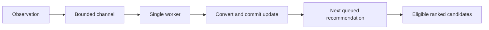

# SHOW ME WHAT YOU GOT: From Behaviour to Recommendations in C#

In [Part 1](/blog/show-me-what-you-got-streaming-recommendations), we looked at how to characterise an entity. We chose observations, encoded the relationships we cared about, and used vectors and centroids to summarise what we had seen. That entity could be a shopper, a service or a device.

Now we can ask the next question: **given what we know about this entity, what should we recommend?**

The optional [Part 1.5: How Do I Vectorise Almost Anything?](/blog/show-me-what-you-got-part1-5-questions-as-coordinates) explains how decision models turn questions about text, images and sound into explicit semantic coordinates. The retrieval ideas here apply to those characterisations as well as measured features.

A shopper has compared walking boots around £100. We have a catalogue of available products. How do we turn that characterisation into a useful list? How do we respect their budget, combine price with other signals, and react when their behaviour changes?

We will follow those questions through a working C# relevance engine. The interesting calculations are small enough to inspect. We can work out what they do, run the examples, and see where their usefulness ends.

The shop gives us familiar examples. Its operations monitor uses the same engine to recommend diagnostic actions from service measurements. Each domain supplies the meaning of its observations and candidates; the reusable machinery maintains evidence and determines what is relevant now.

<datetime class="hidden">2026-10-23T12:00</datetime>
<!-- category -- AI,Architecture,Machine Learning,Recommendations,Behavioural Inference,C#,SQLite -->

[TOC]

# We Have a Representation. What Can We Do With It?

The console sample has six products, including these:

| Product | Category | Price | Available |
|---------|----------|------:|-----------|
| Walking boots | Outdoors | £100 | Yes |
| Waterproof jacket | Outdoors | £110 | Yes |
| Lightweight tent | Outdoors | £250 | Yes |
| Headphones | Electronics | £105 | Yes |
| Kettle | Home | £35 | Yes |
| Sold-out boots | Outdoors | £99 | No |

Suppose the shopper has compared the walking boots. We have some evidence of interest in outdoor products around £100. That is a useful starting characterisation, with two quite different aspects: category and price.

We keep those aspects separate. The price point uses a simple conversion:

```yaml
price:
  path: price
  converter: formula
  expression: "x / 200"
  metric: l2
  displays: Price affinity inferred from the products receiving attention.
```

The £100 boots become `[0.5]`. The £110 jacket becomes `[0.55]`. Dividing every price by the same positive constant preserves their order and relative distances while giving the coordinates a documented scale.

With only the boots comparison in our summary, the entity's price point is also `[0.5]`. How close are the candidates?

| Candidate | Price coordinate | Distance from `[0.5]` |
|-----------|-----------------:|----------------------:|
| Walking boots | 0.500 | 0.000 |
| Sold-out boots | 0.495 | 0.005 |
| Headphones | 0.525 | 0.025 |
| Waterproof jacket | 0.550 | 0.050 |

This is L2, or Euclidean, distance. In one dimension it is the absolute difference. The general calculation in `VectorMath.Distance` accumulates squared coordinate differences and takes their square root:

```csharp
for (var i = 0; i < a.Length; i++)
{
    var x = (double)a[i];
    var y = (double)b[i];
    squared += (x - y) * (x - y);
}

// The l2 branch returns Math.Sqrt(squared).
```

That little loop gives the representation something practical to do. We can compare candidates with the entity's current state.

It also immediately exposes a limitation. The sold-out boots are close, and the headphones are closer in price than the jacket. Price similarity says nothing about availability or whether headphones are useful for a walking trip.

> **Representation aside: comparable numbers need comparable meanings.** The price summary and product prices use the same conversion. We can compare them directly. A centroid of browsing behaviours cannot automatically be compared with product-description embeddings, even if both contain 384 numbers. Those are different spaces unless we provide a meaningful bridge.

# Relevant to Whom, and Eligible for What?

Suppose the shopper explicitly sets a maximum price of £120 and is browsing the outdoors area.

Those requirements are stronger than an inferred preference. The tent is unavailable to this decision because of the budget; the headphones belong outside this surface. The sold-out boots fail availability.

We express the surface's rules in a **placement**:

```yaml
outdoors:
  heads: {category: 1, price: 1}
  where: {available: true, category: outdoors}
```

A placement is simply a named recommendation surface. Its mandatory rules combine with the constraints supplied by the caller:

```csharp
var result = await relevance.RecommendAsync(
    "session-42", "outdoors",
    Filter.Lte("price", 120), count: 3);
```

Inside the engine, the placement filter and caller filter become one conjunction:

```csharp
var eligibility = Filter.All(
    new[] { area.BuildFilter(), filter }.OfType<Filter>().ToArray());
```

`All` means AND. Both rules must hold. A good colour match cannot override the budget.

The important ordering appears in the retrieval call:

```csharp
var neighbors = tx.Nearest(
    definition.Id, query, eligibility, definition.CandidateLimit);
```

The provider selects eligible candidates **before** limiting the nearest-neighbour result.

> **Terminology break: top-K.** K is the number of results we keep. Top-10 means the ten highest-ranked results under a particular rule. Here, each retrieval source has a bounded candidate window before the final list is assembled.

Why does the filter order matter? Imagine we retrieve the two closest products on price first. They are the walking boots and the sold-out boots. Filtering afterwards leaves one result, even though the jacket was a valid second choice.

Filtering before the limit finds the nearest *eligible* products. The console example returns the walking boots and waterproof jacket; asking for three does not manufacture a third suitable product.

# Several Useful Opinions, One List

Price gives us one opinion. Category supplies another.

The category converter uses an explicit vocabulary:

```yaml
category:
  path: category
  converter: categorical
  categories: [outdoors, electronics, home]
  metric: cosine
```

Outdoors becomes `[1, 0, 0]`, electronics `[0, 1, 0]`, and home `[0, 0, 1]`. A session interested in several categories can accumulate a distribution across those coordinates.

Each configured point produces an independent candidate ranking. We call that ranking source a **head**. There is no requirement for a neural network behind the term.

Consider the three eligible products between £100 and £120 on the general home placement. With the boots as the current interest, the rankings are:

| Candidate | Category rank | Price rank |
|-----------|--------------:|-----------:|
| Walking boots | 1 | 1 |
| Waterproof jacket | 2 | 3 |
| Headphones | 3 | 2 |

The boots and jacket have equal category distance, so the implementation's ordinal candidate-ID ordering breaks that tie. Headphones win the second price position but have a different category.

We need a rule for combining those opinions. Adding their raw distances would mix quantities whose scales and interpretations differ. The interactive demo also has measured colour, which introduces another distance altogether.

The baseline uses **weighted reciprocal rank fusion**, or RRF. The entire scoring rule is this line:

```csharp
entry.Reasons.Sum(r => r.Weight / (definition.RrfConstant + r.Rank))
```

Each head contributes its weight divided by a constant plus the candidate's rank. With equal weights of 1 and a constant of 60:

```text
boots       = 1 / 61 + 1 / 61 = 0.032787
jacket      = 1 / 62 + 1 / 63 = 0.032002
headphones  = 1 / 63 + 1 / 62 = 0.032002
```

The boots win. The jacket and headphones tie under this policy. That is a useful result to inspect: equal weights have made their opposing strengths balance. Changing the category weight changes that preference explicitly.

The constant moderates how strongly differences near the top affect the combined score. Only candidates within a head's retrieval window contribute to that head, so the fused result is bounded by the retrieved pool. It is not an exhaustive ranking over every candidate in the database.

[RRF's original paper](https://cormack.uwaterloo.ca/cormacksigir09-rrf.pdf) describes the rank-combination method. Here it gives us a small, inspectable way to combine different representations.

> **Score aside: 0.03 does not mean a 3% purchase probability.** An RRF score orders candidates. A cosine distance measures alignment in one representation. Neither acquires probabilistic meaning because the number looks like a probability.

The engine returns each contribution with its head name, rank, weight and original distance. The demo can show how an item reached the list. Those are explanations of the calculation, not claims about the shopper's private motives.

# The Shopper Does Something New

So far, our characterisation has stayed fixed. Now the shopper compares a jacket and adds it to their basket.

The sample begins with a simple event policy:

```yaml
weights: {view: 1, compare: 2, cart: 3, purchase: 4, cancel: 0}
```

A basket addition contributes more positive affinity than a view. These are our chosen starting weights. They are not universal measurements of how much interest each action implies.

For each point, the engine retains a weighted vector sum and its total supporting weight, called **mass**. The centroid is sum divided by mass.

Before adding new evidence, we reduce the influence of the old evidence according to elapsed time:

\[
 d = 2^{-\Delta t/h}, \qquad
 S' = dS + wx, \qquad
 M' = dM + w, \qquad
 \mu' = S'/M'
\]

Here, \(h\) is the half-life, \(\Delta t\) is elapsed time in the same units, \(w\) is the event weight, and \(x\) is the observation's vector.

The arithmetic in `Observe` is similarly small. First, decay the existing summary:

```csharp
for (var i = 0; i < summary.Sum.Length; i++)
    summary.Sum[i] *= decay;

summary.Mass *= decay;
```

Then add the new positive evidence:

```csharp
for (var i = 0; i < vector.Values.Length; i++)
    summary.Sum[i] += weight * vector.Values[i];

summary.Mass += weight;
```

Take the boots comparison at £100, with weight 2. Its price coordinate is 0.5, so the initial sum is 1 and mass is 2.

After one half-life, the sum is 0.5 and mass is 1. A basket addition for the £110 jacket contributes `3 × 0.55 = 1.65` to the sum and 3 to the mass:

```text
new sum   = 0.5 + 1.65 = 2.15
new mass  = 1 + 3      = 4
new mean  = 2.15 / 4   = 0.5375
```

Under our price conversion, that corresponds to £107.50. The summary has moved towards the newer, stronger evidence. We did not replay the full history to calculate it.

The work depends on the number of coordinates, rather than the number of events that originally contributed to the sum.

> **Statistics aside: this is not a fixed-alpha EWMA.** Both approaches update summaries incrementally, but this implementation keeps time-decayed sums and mass. The influence of the new event depends on its weight and the evidence still retained.

A removal or cancellation with weight zero can still update the event-state sequence. It does not add positive product affinity. It also does not subtract a previous basket addition. Negative preference needs its own defined policy; arbitrary negative weights can destroy the meaning of a positive weighted mean.

# What If We Know Almost Nothing?

A fresh session has no personal evidence. An abandoned session eventually has too little fresh evidence to justify its old recommendations.

The engine checks decayed mass before using a point:

```csharp
var mass = summary.Mass * Decay(now - state.At);
if (mass < definition.MinEvidence) continue;
```

Why keep mass separately? If sum and mass both halve, their quotient stays in the same place. A stale centroid can still point confidently towards yesterday's interest unless we inspect the evidence supporting it.

When there are no usable ranked results, the current fallback is deliberately explicit:

```csharp
items = tx.Eligible(definition.Id, eligibility, count)
    .Select(c => new Recommendation(
        c.Id, 0, c.Data, Array.Empty<Contribution>()))
    .ToArray();
```

Eligible candidates return in ordinal ID order with zero scores and no personal reasons. This is a deterministic baseline, not a popularity model. A host could introduce an editorial or popularity fallback later.

The interactive demo's fresh-visit control makes this easy to see. Start a session, inspect the initial list, then compare a few products and inspect the contributing heads.

The baseline also keeps one summary per point. A shopper browsing boots and a birthday present can produce an average between interests. Part 1 explained why several centroids may help; this implementation has not yet added interest discovery and routing. Keeping that limitation visible gives us a baseline against which to measure the extension.

# The Same Reasoning Applies to a Service

Now open the operations side of the demo. The entity is a service rather than a shopper, and observations describe measurement windows:

| Role | Shopper | Service |
|------|---------|---------|
| Entity | Current session | Monitored service |
| Observation | Product interaction | Measurement window |
| Representation | Category, price and colour interest | Latency, errors, retries and queue depth |
| Candidates | Products | Diagnostic actions |
| Recommendation | Product worth showing | Action worth considering |

The important difference is where observation vectors come from.

A product event references a candidate whose vectors are already stored:

```csharp
await relevance.SaveAsync("events", new
{
    id = eventId,
    subject = sessionId,
    candidate = productId,
    type = "compare"
});
```

The telemetry stream instead uses `point_source: input`. Its converters read measurements from the incoming observation itself:

```yaml
telemetry:
  kind: observation
  point_source: input
  weights: {sample: 1}
```

For example, the console diagnostic configuration converts latency from milliseconds to seconds and queue size to hundreds of items. These are documented coordinates for comparisons, not semantic embeddings of log prose.

The candidates also need a meaningful representation. The console sample supplies an `inspect-queue` candidate with a reference condition: elevated latency, errors, retries and queue depth. The interactive demo supplies three prototypes associated with different diagnostic actions.

We are matching the current service profile against those conditions. The association between a condition and an action is domain knowledge supplied by the sample. A vector containing the words “inspect database” would not create that association for us.

In the interactive demo, ordinary shop HTTP requests provide latency/status measurements. Labelled synthetic traces supply retry storms, database slowness, queue pressure and recovery. The state labels come from transparent thresholds, rather than automatically discovered communities. Ordinary HTTP logs enter a separate bounded monitor queue; replay controls wait for their sample observations to finish processing.

Replay a retry storm and inspect the candidate contributions. Then replay recovery. The same summary, distance and rank-fusion machinery is being used with different inputs.

This follows the [behavioural inference pattern](/blog/behavioural-inference-systems-blog): accumulate partial evidence, maintain an interpretation, and use it for a bounded decision.

> **Diagnostic aside: a relevant action is still a candidate.** A prototype match does not prove a root cause or show that executing the action will improve the system. The application decides which handlers are allowed and whether to apply one.

# Can We Predict Where This Behaviour Is Going?

Matching asks what resembles the current situation. Prediction asks what tends to follow it.

That requires additional evidence. The distance from a service profile to an action prototype does not establish an outage probability. We need observed relationships between state and subsequent outcomes.

The baseline uses first-order Markov transitions, following the approach discussed in [Stylo.Bot's transition modelling](/blog/botdetection-part2-signature-pipeline-and-stylobot-architecture#novel-bit-2-markov-style-transition-modeling).

A **first-order** model uses the current state to estimate the next one. For shopping, states include view, comparison, cart and the destinations purchase/cancel. For operations, they include healthy, degraded and the destinations outage/recovered.

The console diagnostic sample constructs four independent synthetic journeys:

| Observed transition | Count |
|---------------------|------:|
| Degraded → outage | 3 |
| Degraded → recovered | 1 |

With smoothing disabled for this teaching example, the outgoing proportions are 3/4 and 1/4. For a currently degraded entity, that produces 75% outage and 25% recovery in this tiny model. These are synthetic proportions, not measured production accuracy.

Longer journeys need more than one update. `MarkovDestinationPredictor` maintains probability mass across states and propagates it for the configured horizon. The key operation is:

```csharp
var total = count + definition.Smoothing * definition.States.Count;
foreach (var target in definition.States)
    next[target] += mass *
        (row.GetValueOrDefault(target) + definition.Smoothing) / total;
```

For each currently possible state, distribute its mass among possible next states according to the outgoing transition estimates. Repeat for the chosen number of steps.

**Smoothing** adds a small pseudo-count to possible transitions. It avoids treating an unobserved transition as impossible merely because the dataset is small. That is a modelling assumption, so the configuration makes it visible.

Destination states are **absorbing** during the forecast: once probability reaches purchase, cancel, outage or recovery, it stays assigned to that destination for the remaining steps.

Sparse rows take a different path:

```csharp
if (count < definition.MinTransitions)
{
    remaining += mass;
    continue;
}
```

That mass becomes unresolved. So does mass still in an intermediate state at the end of the horizon. We preserve it rather than redistributing it over the named outcomes.

> **Probability aside: eight events is not eight minutes.** The baseline horizon counts transitions. A result must retain its horizon, observation time, support and unresolved mass to be interpretable. A count of supporting observations is not a confidence interval.

Transition counts are pooled across entities within the configured engine identity and remain cumulative while the model record is active. The latest state begins a forecast, but the model does not retain the entire path or distinguish every kind of degraded service.

This gives us a useful statistical baseline. Richer states, elapsed-time models, trajectories and calibrated predictors can be compared against it. There is no need to infer probability from geometry to make the first implementation work.

# Let Outcomes Inform the Next Ranking

We can also use observed outcomes to adjust how strongly ranking heads contribute.

Keep two kinds of weights separate. **Event weights** determine how an observation updates an entity's profile. **Head weights** determine how rankings combine for a placement.

The current implementation stores positive and negative outcome credit for each placement/head. At recommendation time it adjusts the configured base weight:

```csharp
var weight = baseWeight *
    (0.5 + (1 + evidence.Positive) /
        (2 + evidence.Positive + evidence.Negative));
```

With no outcome evidence, the multiplier is 1. Positive credit increases it; negative credit reduces it. The smoothing terms prevent an empty history from producing an extreme weight.

Feedback allocates credit among heads that supported the selected candidate, with more credit for better ranks. Old credit is reduced by a factor of 0.99 on subsequent credited updates, keeping its magnitude bounded. This is event-based reduction, separate from the elapsed-time decay of entity summaries.

This rule is an inspectable **reliability heuristic**. It does not establish the causal value of an individual head.

The application submits a final attributed outcome through the same ingestion method:

```csharp
await relevance.SaveAsync("outcomes", new
{
    id = feedbackId,
    recommendation = result.Id,
    candidate = selectedProductId,
    reward = 1.0
});
```

The engine checks that the retained decision returned that candidate, and accepts one final outcome per decision/candidate. A caller must still record whether the candidate was actually displayed and define its attribution window. Returning an item is not evidence that someone saw it.

Here is the next question: **did showing this product improve the outcome compared with showing another eligible product?**

The operations equivalent is just as interesting. The demo lets an explicitly chosen, allowed handler reduce the actual local shop API rate limit from 240 to 60 requests per minute. Its notebook records the preceding metrics and later observations. A reset restores the original limit.

Recovery after that action does not demonstrate that the action caused recovery. We could have changed nothing and recovered anyway.

Part 3 will address that comparison through a separate `.Learning` extension: record the context, actual exposure, available alternatives and selection probabilities, then evaluate interventions. The current feedback heuristic and before/after notebook are the starting point for that question.

# Make Streaming a Promise We Can Explain

All these calculations become useful when new evidence reaches the next decision promptly.

The caller's important sequence is small:

```csharp
await relevance.SaveAsync("events", interaction);
var result = await relevance.RecommendAsync(sessionId, "home");
```

An awaited save means conversion and the atomic update have completed. The subsequent awaited read sees that state. It does not require a separate flush method or a timer to refresh the model.



A bounded `Channel` feeds one `BackgroundService`. Updates and reads are serialized through the same worker in this first implementation.

> **Implementation aside: backpressure.** When the queue is full, producers asynchronously wait for room. That makes the cost of falling behind visible instead of allowing an unbounded pile of unfinished work to consume memory.

The subtle piece is completion. Queue admission is not the same as successfully updating state. In the worker, the caller's result is completed only after the action finishes:

```csharp
Completion.TrySetResult(await action(cancellationToken));
```

Failures propagate to that caller without terminating the reader. Cancellation can stop admission or work before commit; it cannot undo a committed update. A graceful shutdown closes admission and drains accepted work. An abrupt process termination can lose unacknowledged queued work.

Stable event IDs make retries practical. Deduplication and the state update share one transaction, so a failed update does not leave behind a token claiming it succeeded. Structured stream/event identities avoid ambiguous concatenations when IDs contain separators.

Out-of-order events are rejected per entity in this baseline. Retention and cardinality limits bound saved state. Those are explicit contracts, not incidental details to discover after a demo has been running for a week.

Serializing everything also creates a throughput limit. An expensive uncached converter can delay other work. Measure event-to-read freshness and queue delay before introducing more concurrency and a more complicated consistency model.

## A Small Storage Boundary

The core library knows the storage contract, not SQLite. The provider supplies atomic records, candidate upserts and filtered neighbour queries. A memory provider gives us a reference implementation; SQLite makes the sample persistent.

By default, SQLite calls a registered managed exact-distance function over ordinary vector BLOBs. An optional explicit `sqlite-vec` path uses native scalar distances. Both paths apply eligibility before the retrieval limit. These are exact scans, not approximate-neighbour indexes.

SQLite database I/O remains synchronous underneath the worker, as [Microsoft's documentation explains](https://learn.microsoft.com/en-us/dotnet/standard/data/sqlite/async). The async API gives callers queueing, conversion and completion semantics; it does not change the database driver's I/O model.

Configuration, representation and storage semantics are fingerprinted. The preview rejects incompatible reuse of an engine identity. Re-encode and replay under a new identity, or provide an explicit migration. Silently mixing coordinate systems would preserve the appearance of valid numbers while changing what their distances mean.

# Add Another Representation When It Earns Its Place

The interactive shop adds measured colour through the Oklab converter alongside category and price. The same rank-fusion operation can then combine three independent opinions.

That is the point of the converter boundary. An `IPointConverter` declares a registered name, semantic version and output dimension, and converts a selected property asynchronously. The engine validates the returned coordinates before storing them.

A numeric expression can be selected in configuration, but it is a bounded arithmetic grammar over `x`, not a scripting runtime. More involved transformations belong in registered C# converters whose meaning can be inspected and tested.

Optional text embeddings fit the same boundary. Encode a product description when the candidate changes, then reuse the stored vector when someone interacts with that product. There is no need to invoke the embedding model on every click.

The current demo runs without an embedding runtime. The researched small text baseline is [all-MiniLM-L6-v2](https://huggingface.co/sentence-transformers/all-MiniLM-L6-v2) through ONNX. [EmbeddingGemma 2](https://ai.google.dev/gemma/docs/embeddinggemma/model_card_2) is a candidate for the richer multilingual and image extension; a GGUF conversion exists, but the exact LLamaSharp backend still needs qualification.

Part 4 will explore images and multimodal representations. Separate image and text rankings can be fused even when their spaces differ. Direct text-to-image comparison needs compatible encoders and preprocessing from a shared space.

Revisit russet from Part 1. A word embedding, a measured swatch and a product photograph can preserve different valid relationships. Adding another vector is useful when those relationships help the decision, and we should measure whether they do.

Discovered communities and evidence-backed cluster descriptions can become further contributors. The baseline does not yet implement Leiden, multiple interest centroids or language-model cluster naming. Starting with the simpler statistics gives those additions something concrete to improve upon.

# What Has the Code Demonstrated?

The working implementation gives us several observable claims. Candidate comparisons follow the chosen representation. Eligibility survives ranking. New observations change the state used by later reads. Independent heads combine through a visible rule. Outcome estimates come from transition evidence and can abstain.

The tests make those contracts executable.

One test sets each head's candidate window to 1, observes an electronics product, and then asks for outdoors candidates costing at least £200. It must still return the eligible tent. That checks that filtering happens before truncation.

Another trains four synthetic journeys, three ending in purchase and one in cancellation, with smoothing disabled. The assertion is deliberately direct:

```csharp
Assert.Equal(0.75,
    prediction.Outcomes.Single(o => o.Destination == "purchase").Probability,
    10);
```

The worker test blocks conversion, submits a read, and verifies that neither completes until the conversion is released. It checks the completion contract rather than merely checking that a queue exists.

Memory and SQLite run the same provider-parity cases. HTTP tests exercise the shop, diagnostic scenarios, actual local rate limiting and reset.

Those checks establish correctness for the stated contract. They do not establish improved recommendation quality. For that, compare against simple baselines using time-ordered data, evaluate ranking relevance, and check destination calibration against later outcomes. Measure latency, memory and event-to-read delay separately.

A recommendation changing after a click proves responsiveness. A useful purchase or diagnostic decision is a further claim requiring evidence.

# Run the Examples

The interactive companion contains 84 generated products, a basket, category/budget controls, recommendation contributions and destination estimates. Its operations tab monitors structured measurements and provides labelled incident traces and explicit action controls.

From the repository root:

```sh
dotnet run --project Mostlylucid.Relevance.Demo
```

Open `http://127.0.0.1:5098`. SQLite files are created in the demo's ignored `App_Data` directory. To preserve an older preview database while trying a changed storage contract, set `Demo__DataPath` to a fresh directory.

The smaller console example runs both domains without the web UI:

```sh
dotnet run --project samples/RelevanceShop/RelevanceShop.csproj
```

These are .NET 10 preview projects. The library packages can be built locally; they have not been published to NuGet. [The sample source](https://github.com/scottgal/mostlylucidweb/tree/main/Mostlylucid.Relevance) includes the commented public API, [the SQLite provider](https://github.com/scottgal/mostlylucidweb/tree/main/Mostlylucid.Relevance.Sqlite) and [the runnable demo](https://github.com/scottgal/mostlylucidweb/tree/main/Mostlylucid.Relevance.Demo).

We can now use an entity's characterisation to match candidates, combine useful opinions and update the result as evidence arrives. The next question is whether choosing a particular candidate actually changes what happens.

That is Part 3: **Change the outcome.**
