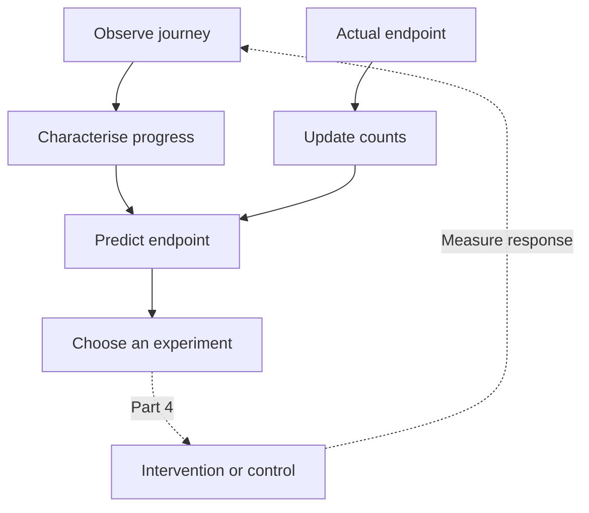

# SHOW ME WHAT YOU GOT (Part 3): Predict

In [Part 2](/blog/show-me-what-you-got-part2-building-relevance), we turned an entity's characterisation into recommendations. We could watch a session change, find eligible products, and explain which representations contributed to the ranking.

Now we want to use that history to answer a more useful business question: **where is this journey heading, and where might a change help?**

That is the point of prediction here. A retailer wants to help someone find a suitable product and complete a purchase. Marketing wants to know where a useful message or offer might improve the journey. A systems administrator wants to recognise a service heading towards failure early enough to do something about it.

Those disciplines already combine experience, observation and judgement. We are making part of that process explicit: record the journey, observe its endpoint, learn the relationships, and estimate what is likely to happen next. Then we can test a directed change and measure the response.

This article builds the prediction step. Part 4 adds **experimentation**: showing different products, testing a price or offer, changing a message, or applying an allowed operational action. Together, they make the learning loop visible.

The companion C# tool starts with an empty SQLite database, generates a substantial synthetic population, learns from its completed and partially observed journeys, then predicts outcomes for fresh users. The output below comes from running that code.

<datetime class="hidden">2026-10-24T10:00</datetime>
<!-- category -- AI,Architecture,Machine Learning,Recommendations,Behavioural Inference,C#,SQLite,DiSE -->

[TOC]

# From a Recommendation to an Expected Result

A ranking answers: which available products are relevant to this shopper?

A destination prediction answers: given this shopper's observed progress, how likely are purchase, cancellation or departure within a defined horizon?

We need both. Two people can be interested in the same products while being at different stages of deciding what to do. One has compared alternatives and is proceeding to checkout. Another has put something in a basket almost immediately and returned to browsing.

Their interest vectors can be very similar. Their likely next actions need not be.

The prediction gives us a baseline for choosing what to investigate. It can help identify a point where reassurance, a better comparison, a different product or a useful offer might change the result. Measuring whether that change actually helps is the next step.



The feedback arrow comes from **actual endpoints**. A predicted purchase does not count as a purchase and cannot train the system as one.

# Give the System Enough Experience

Six hand-written products are useful for explaining distance calculations. For learning from journeys, we want more variation and enough observations to support an estimate.

The new `predict` command uses [Bogus](https://github.com/bchavez/Bogus) for fake catalogue and user data, with a small C# simulator supplying behaviour and eventual outcomes:

```csharp
var fixture = FixtureGenerator.Generate(
    seed: 814,
    products: 240,
    training: 1000,
    holdout: 400);
```

Run it through the existing console sample:

```sh
dotnet run --project samples/RelevanceShop -- predict \
  --seed 814 --products 240 --train 1000 --test 400 \
  --output /tmp/relevance-predict-814
```

Use a new or empty output directory. The command writes the catalogue, users, complete fixture journeys, forecasts, evaluation report and exact console output there. By default it creates and cleans up its own fresh SQLite database. Supply `--database /tmp/relevance-predict.db` to keep a new database for inspection.

The checked-in [console output](https://github.com/scottgal/mostlylucidweb/blob/main/samples/RelevancePredict/artifacts/seed-814/output.txt) and [prediction report](https://github.com/scottgal/mostlylucidweb/blob/main/samples/RelevancePredict/artifacts/seed-814/report.json) contain the results used below.

The initial output is:

```text
SYNTHETIC FIXTURE bogus-shop-v2; seed=814; Bogus=35.6.5
products=240; training_visits=1000; later_holdout_visits=400
missing_descriptions=48; unavailable=28; neural_inference=none
```

There are three product categories, explicit prices, measured colour swatches and availability. Users have fake names, a preferred category and a budget. The simulator supplies several shopping patterns, including comparison, basket removal, checkout, purchase, cancellation and a recorded departure.

Some visits lose feedback before their endpoint. Those remain incomplete. The generator does not quietly turn them into cancellations.

Bogus uses local seeded randomness, and the simulation has its own random stream. Changing a generated description therefore does not silently change the purchase history. The fixture also has fixed timestamps and a fixed clock. With the pinned package, seed and fixture version, we can reproduce the examples.

> **Data aside: this is synthetic experience.** We are testing the learning mechanism against a controlled population, with labels supplied by the simulator. These are genuine program outputs, but the resulting percentages are not claims about a real retailer. Production events can enter through the same API when the application has defined its observations and outcomes.

# What Is a Journey Made Of?

The underlying event shape is small:

```csharp
await relevance.SaveAsync("events", new
{
    id = observation.Id,
    subject = observation.Subject,
    candidate = observation.Candidate,
    type = observation.Type,
    at = observation.At,
    state = encoder.Observe(observation.Type)
});
```

The product ID connects the observation to the representations we built in Part 2. A comparison contributes more to the interest summary than a view. Availability and budget still constrain recommendations.

The additional `state` describes the journey's progress. It is derived from what has happened **so far**.

Consider these three prefixes:

```text
view → compare → cart
view → cart → view
view → compare → cart → remove → compare → cart
```

They preserve distinctions a bag of product interactions can lose: how the person arrived at the basket, whether they returned to browsing, and whether they removed something before coming back.

The sample keeps a little prefix memory:

```csharp
private int comparisons;
private bool cartSeen;
private bool removed;
```

The interesting part of the encoder is the mapping:

```csharp
"view" => cartSeen ? "post_cart_browsing" : "browsing",
"compare" => removed ? "reconsidering"
    : comparisons > 1 ? "repeated_comparison" : "comparing",
"cart" => removed ? "returning_cart"
    : comparisons > 1 ? "research_cart"
    : comparisons > 0 ? "considered_cart" : "impulsive_cart"
```

Before this switch, a comparison increments `comparisons` and a removal sets `removed`. After a cart event, `cartSeen` becomes true. The full encoder is in [FixtureGenerator.cs](https://github.com/scottgal/mostlylucidweb/blob/main/samples/RelevancePredict/FixtureGenerator.cs).

These names are our explicit representation of progress. `considered_cart` means a cart addition after comparison. It does not mean the user is certain to buy. The relationship with purchase is something the system learns from subsequent events.

This follows [Part 1.5](/blog/show-me-what-you-got-part1-5-questions-as-coordinates): decide which distinctions matter, then produce a usable characterisation. Here a few exact observations provide the features. A decision model could contribute an interpreted feature where ordinary event data is insufficient.

> **ML aside: what is a state?** It is a summary of the context we choose to retain. This is a first-order Markov model: the supplied state determines the estimated next-state distribution. Including some prefix memory lets that state distinguish useful trajectories without storing the whole path inside the predictor.

The simulator's hidden intent settings are not passed to this encoder. Neither are the user's future actions or final outcome. New users are characterised through the same observations as historical users.

# Define the Destinations

An outcome needs a concrete meaning. In this example:

| Destination | Meaning in the fixture |
|-------------|------------------------|
| `purchase` | A purchase event was recorded for this episode. |
| `cancel` | An explicit cancellation ended the episode. |
| `leave` | The simulator recorded the episode closing without purchase. |

A missing event is none of these. In a real shop, “the episode has closed” needs an application definition, such as a measured session window. A person might return later, so a session outcome and a customer's eventual outcome are different targets.

The predictor's configuration includes:

```yaml
destinations:
  states: [browsing, post_cart_browsing, comparing, repeated_comparison,
           considered_cart, research_cart, impulsive_cart, returning_cart,
           cart_removed, reconsidering, checkout, purchase, cancel, leave]
  outcomes: [purchase, cancel, leave]
  horizon_events: 4
  min_transitions: 20
  smoothing: 0
```

The states define the vocabulary. The transition counts and resulting probabilities start empty.

The horizon asks about destinations **within the next four observed transitions**. It does not mean four minutes, and it does not claim to predict a purchase within 24 hours. A timed email campaign needs a clock-based measurement window as part of its experiment definition.

The minimum support requires twenty outgoing observations before a state can propagate probability. This run uses zero smoothing so each displayed transition has an observation behind it. The engine also supports explicit pseudo-count smoothing when that is appropriate for the application.

# Which Destinations Do We Want?

Defining an endpoint tells us what to predict. We also need to say **what result we are trying to improve**.

Purchase, cancellation and departure are observations. Their desirability is an application decision. A shop might want completed, profitable purchases; an operations team might want sustained recovery while preserving throughput. More basket additions or lower latency are useful signals, but neither necessarily achieves those goals.

We can express a simple preference using a **utility**: a numeric value assigned to an outcome. For illustration:

| Destination | Example utility |
|-------------|----------------:|
| `purchase` | 1.0 |
| `cancel` | -0.5 |
| `leave` | 0.0 |

These are chosen teaching values, not learned probabilities or a claim about the cost of a cancellation. Another application can value the same destinations differently.

Combining a forecast with those values gives an expected utility:

```text
Expected utility = sum of P(destination | observed state) × utility(destination)
```

For a forecast whose destination probabilities account for all the mass, the application-side calculation is small:

```csharp
var utility = new Dictionary<string, double>
{
    ["purchase"] = 1.0,
    ["cancel"] = -0.5,
    ["leave"] = 0.0
};

var expectedUtility = prediction.Outcomes.Sum(
    outcome => outcome.Probability * utility[outcome.Destination]);
```

This is a way to interpret `PredictAsync` output, not another field in the predictor's YAML. Changing the objective should not rewrite what the system believes will happen. Keep the probabilities available so we can explain the trade-off.

> **Uncertainty aside:** unresolved probability is not a destination with a utility of zero. If the horizon ends or evidence is insufficient, some value remains unknown. Report that missing mass alongside the estimate; do not turn an incomplete forecast into an apparently complete business score.

Expected utility describes the current forecast. It does not yet tell us which action will improve it. Part 4 will compare the expected value **under each intervention** with the control, including intervention costs. A discount might increase purchase probability while reducing profit. A connection limit might reduce errors while rejecting too much useful traffic.

That means defining the objective, measurement window and constraints before the experiment, and recording their version with each decision. The target is an improvement in observed results, rather than a higher forecast or a convenient proxy such as clicks.

## Intervene Before an Undesirable Destination

The useful prediction may be a warning about something we want to prevent:

- **System degradation:** latency is increasing, errors are becoming more frequent, and the queue is growing. The forecast suggests a higher chance of a sustained service-level breach or outage. An allowed intervention might reduce consumer concurrency or change a connection limit. Success means sustained recovery with acceptable throughput, measured against the alternative.
- **Basket abandonment:** someone repeatedly compares products, removes items and stops progressing through checkout. The forecast suggests the basket may be abandoned. We could test clearer delivery costs or a useful product comparison before offering a discount. Success means more completed, profitable purchases within the chosen window.
- **Payment cancellation:** someone returns repeatedly from payment to checkout. If the application exposes suitable events, we can estimate the risk of an explicit cancellation and test clearer payment guidance or an alternative available payment method. Measure completion, cancellation and the cost of the change.

These are possible integrations, rather than additional outcomes implemented in this fixture. Rising latency and repeated checkout visits are observations; a sustained breach or an explicit cancellation is a defined result. Basket abandonment needs its own closing window, rather than treating a quiet moment as a confirmed departure. The sample's `cancel` is a generic episode cancellation, not a separately modelled payment state.

The aim is to spot a trajectory early enough to change it. A warning identifies where an intervention may be useful; the experiment establishes whether that intervention actually prevents the unwanted outcome.

# This Is What Training Does

Suppose a historical user moves from `checkout` to `purchase`. The engine increments that connection:

```csharp
row[next] = row.GetValueOrDefault(next) + 1;
model.Counts[previous] = row;
```

That is the update in [RelevanceEngine.cs](https://github.com/scottgal/mostlylucidweb/blob/main/Mostlylucid.Relevance/RelevanceEngine.cs). The state transition and its deduplication record are committed together. Retrying the same event does not count it twice.

After enough observations, divide each outgoing count by the row total:

```text
P(next state | current state) = transition count / total outgoing count
```

The run's learned checkout row contains:

| Next state | Observed transitions |
|------------|---------------------:|
| Purchase | 306 |
| Cancel | 24 |
| Leave | 18 |
| **Total** | **348** |

These are observed departures from checkout. A visit that reached checkout without reporting an exit contributes no invented result.

So the estimated purchase probability from checkout is `306 / 348`, approximately **87.9%**.

Nothing supplied that percentage in configuration. Each observed endpoint changed the counts from which the percentage was estimated.

That is training in a form we can inspect directly. The observations provide examples. The endpoint supplies a label. The counts are learned parameters. New evidence changes those parameters, and the next inference uses the updated model.

There is no gradient calculation in this estimator. A later model might learn feature weights or neural network parameters by minimising prediction error. It would still need an input available at decision time, an observed target, an update rule and an honest evaluation on other journeys.

**Machine learning does not require a neural network.** This is a small online statistical model whose update happens as observations arrive.

# Watch a Fresh System Learn

Before any observations, the tool cannot characterise the new shopper:

```text
UNKNOWN purchase=0.0 % cancel=0.0 % leave=0.0 % unresolved=100.0 % support=0 status=no_state
```

After a first view, it has a state but no learned outgoing evidence. After three historical visits, support is still below the configured threshold:

```text
COLD purchase=0.0 % cancel=0.0 % leave=0.0 % unresolved=100.0 % support=0 status=insufficient_evidence
AFTER 3 VISITS purchase=0.0 % cancel=0.0 % leave=0.0 % unresolved=100.0 % support=3 status=insufficient_evidence
```

As the population supplies experience, that same observed state becomes usable:

```text
AFTER 100 VISITS purchase=39.2 % cancel=10.1 % leave=19.0 % unresolved=31.7 % support=99 status=estimated
AFTER 1000 VISITS purchase=40.1 % cancel=12.2 % leave=21.1 % unresolved=26.6 % support=975 status=estimated
SQLITE REOPEN probabilities_unchanged=true
```

The last line closes the training engine, opens the same SQLite database in a new engine and checks the forecast again. The learned model survives a restart; it is not an in-memory demonstration disguised as persistence.

Notice the unresolved probability. At the start of a visit, four transitions do not always carry the shopper to a destination. Some routes need more steps. Unsupported branches can also retain unresolved mass.

The predictor follows the possible routes, multiplying probabilities along each path and adding mass arriving at the same destination. A destination is **absorbing**: once mass reaches a recorded endpoint, it stays there for the rest of the forecast.

We retain unresolved mass rather than rescaling the named outcomes to add up to 100%. Otherwise we would make an incompletely resolved forecast appear more certain.

The engine performs these updates through the same bounded channel and hosted worker as Part 2. Awaiting `SaveAsync` means the update has completed before the subsequent `PredictAsync` read. There is no scheduled rebuild between a new outcome and a new estimate.

## One More Outcome, One More Update

The demo also takes a new shopper at checkout, records an actual cancellation, and forecasts the next shopper arriving at checkout. This runs against the persistent live model, separately from the frozen evaluation model.

```text
OBSERVED status=observed_destination cancel=100.0 %
OUTCOME UPDATE checkout_purchase=87.9 % -> 87.7 % support=348->349 retry_duplicate=true
```

The first line reports the result we now know. The second shows what was learned for the next user. The purchase numerator stays at 306, while total outgoing observations rise from 348 to 349. The new forecast uses `306 / 349`.

A transport retry of the cancellation is recognised as a duplicate, so it does not train the connection a second time.

That is the training loop directly: an observation changes a learned parameter, and a later prediction changes as a result. With enough experience, the relationships can become useful inputs to deciding which journey to investigate or improve.

# Fresh Users, Different Trajectories

Now introduce three fresh shoppers. For this controlled comparison they interact with the **same product**, giving the matcher the same location to work from. Their paths differ.

The new prefixes are:

- After comparison: `view → compare → cart`.
- Direct addition: `view → cart`.
- After removal and return: `view → compare → cart → remove → compare → cart`.

They map to `considered_cart`, `impulsive_cart` and `returning_cart`, respectively. The actual predictions are:

| Cart arrival | Purchase | Cancel | Leave |
|--------------|---------:|-------:|------:|
| After comparison | 87.9% | 6.9% | 5.2% |
| Direct addition | 18.3% | 27.2% | 54.5% |
| After removal and return | 33.2% | 30.6% | 36.2% |

Their supporting transition counts are 357, 336 and 229. These forecasts have zero unresolved mass within the configured horizon. They describe different learned route distributions, not different meanings assigned to the same distance score.

The product picks remain the same:

```text
PICKS considered budget=£191 p-0001:0.04098, p-0007:0.03771, p-0058:0.03768
PICKS impulsive budget=£191 p-0001:0.04098, p-0007:0.03771, p-0058:0.03768
PICKS returning budget=£191 p-0001:0.04098, p-0007:0.03771, p-0058:0.03768
```

That is useful. We know which products fit the observed interest, and we have a separate estimate of how the journey tends to end. The application can return both alongside an explanation of the evidence.

An 87.9% purchase forecast does not tell us that this person needs an offer. They may be likely to buy already. An 18.3% forecast does not tell us that an offer would work either. The person could be browsing for a future purchase, comparing elsewhere or simply uninterested.

What it gives us is a set of contexts in which to test useful changes. We can start asking which intervention improves the result for each kind of journey.

> **Support aside:** 357 is an outgoing transition count, not a confidence interval or a claim about 357 independent customers. A model can learn several transitions from one episode. Keep episode identities for evaluation and experimental assignment.

# Test the Predictions on Later Users

We need to check forecasts before treating them as useful inputs to a decision.

The sample has an earlier training population and a separate, later population of 400 visits. For the evaluation, we freeze the learned transition counts and predict each later user's outcome at their **first cart addition**.

That landmark matters. It makes the comparison about the same point in a journey, rather than mixing predictions made after a first view with predictions made just before purchase.

The evaluator first captures all forecasts. Only then does it inspect the future labels. Held-out outcomes never enter its population model.

The core's `IDestinationPredictor` hook makes this small:

```csharp
return baseline.PredictAsync(
    context with { Transitions = frozen },
    cancellationToken);
```

The held-out engine has its own subject states and product catalogue. Its ordinary saves can characterise each prefix, while the predictor uses the fixed training counts. This prevents evaluation traffic from silently changing the model being measured.

The output accounts for every visit:

```text
HOLDOUT landmark=first_cart horizon=4_events scored=349 censored=27 without_cart=24
BRIER lower_is_better model=0.4750 training_prior=0.6234
```

Twenty-four visits never reached the landmark. Twenty-seven reached it but did not provide an outcome or enough subsequent observations to score the four-event target. The remaining 349 support this evaluation. An observed run of four non-terminal transitions can be scored as unresolved; an observation stream that simply stops early cannot.

The baseline predicts the same outcome distribution for every first-cart visit, using the training population's frequencies. Our learned state model improves the Brier score from **0.6234 to 0.4750** on this held-out fixture.

The multiclass Brier score sums squared errors across the possible outcomes, including unresolved, and averages them across the scored episodes. We use the version ranging from zero to two. Lower is better. The [scikit-learn model evaluation documentation](https://scikit-learn.org/stable/modules/model_evaluation.html#brier-score-loss) explains this convention.

We also check whether groups of similar purchase forecasts match their observed frequencies:

| Predicted purchase band | Visits | Mean forecast | Observed purchase frequency |
|-------------------------|-------:|--------------:|----------------------------:|
| 0–20% | 119 | 18.3% | 16.8% |
| 20–40% | 91 | 33.2% | 37.4% |
| 80–100% | 139 | 87.9% | 87.1% |

This is a **reliability check**. If we repeatedly predict about 80%, roughly eight out of ten comparable observations should reach the stated target. A lower overall Brier score alone does not establish calibration; it combines several properties of the forecasts. The [calibration documentation](https://scikit-learn.org/stable/modules/calibration.html) makes that distinction clearly.

The returned `IsCalibrated` flag remains false. We have evaluated this version against synthetic holdout data; we have not fitted a separate calibrator or established reliability on a real shop. The tests also check improvement over the population prior across three independently seeded fixtures, rather than depending entirely on the article's one run.

# Where an LLM Helps Generate the Demo

Bogus and explicit simulation rules give us enough data to exercise the learning system. A local LLM can make the catalogue more readable without becoming part of the prediction hot path.

The optional helper asks Ollama for display copy for existing product IDs:

```sh
python3 samples/RelevancePredict/generate-copy.py \
  /tmp/relevance-predict-814/catalogue.json \
  /tmp/product-copy.json
```

The script requires an installed local model. It requests short names and purpose descriptions, validates the response structure, and records the model and prompt version. The [Ollama structured-output API](https://docs.ollama.com/capabilities/structured-outputs) supports JSON responses and schema-constrained generation.

A shortened version of the prompt is:

```text
Write useful, plain display copy for these fictional demo products.
Return products containing only id, name and description.
Preserve the supplied IDs and product kinds.
Do not invent materials, dimensions, performance, certifications or prices.
```

The import envelope is:

```json
{
  "model": "the-model-that-produced-the-copy",
  "promptVersion": "catalogue-copy-v1",
  "products": [
    {
      "id": "p-0001",
      "name": "A short product name",
      "description": "A short description of its intended use."
    }
  ]
}
```

Import a reviewed, frozen response with:

```sh
dotnet run --project samples/RelevanceShop -- predict \
  --copy /tmp/product-copy.json \
  --output /tmp/relevance-predict-with-copy
```

The importer rejects unknown IDs, duplicate entries and extra fields. The LLM cannot change prices, availability, categories, observations or outcome labels through this interface. The host supplies provenance; the model does not certify itself.

Names and descriptions are metadata in this configuration. Changing them does not change the learned transition counts or product vectors. A later text converter could make description content a retrieval feature, with its own version and evaluation.

The [sample source](https://github.com/scottgal/mostlylucidweb/tree/main/samples/RelevancePredict) includes a frozen local-model response and the actual output used here. Keeping the generated response gives us an exact replay artifact even if an LLM runtime changes later.

> **Part 4 aside: feedback can improve the catalogue too.** A pattern of questions, missing descriptions or poorly performing journeys can suggest a content experiment: clarify the product copy, supply a missing specification, test a different image, or investigate a pricing hypothesis. We can feed those observations back to retail and marketing, then compare the change with a control. Missing data is a reason to investigate; it does not by itself prove that filling a field, lowering a price or rewriting a paragraph will improve conversion.

# The Same Loop Applies to Operations

The operations monitor in Part 2 already has a corresponding structure: a service supplies observations, the engine characterises the situation, and allowed diagnostic actions are candidates.

Destination prediction adds the expected route towards recovery, continuing degradation or outage. A telemetry sample can move a service between observed states, and a later recovery or outage updates the learned transition model through the same ingestion mechanism.

The organisation supplies the target and the state meanings. A service whose error rate is rising while its queue drains is not necessarily on the same trajectory as one whose queue and retry rate are both accelerating. Preserve the distinctions relevant to the action you might take.

Then the practical question is familiar: would reducing an allowed connection limit help this kind of incident? Would a different retry policy improve recovery? We can record the context, make a bounded change, and measure the response against an alternative.

That is the same directed learning loop as a different product, a special offer or a timed email. The outcomes and costs differ; the need for observations, baselines and measured responses remains.

# A Small, Direct Version of DiSE

This is a more accessible entry into the ideas I explored in [Directed Synthetic Evolution](/blog/dise-architecture-overview): **perceive, evaluate, mutate, select**.

Here we can see the learned state rather than asking a large model to explain what it might have learned. A new observation updates a small table. A fresh forecast uses that table. A held-out journey lets us compare the forecast with an observed endpoint.

When we introduce a directed change, the system gains another relationship to learn: what happened when this allowed action was applied in this context?

A more elaborate model can eventually learn that relationship from the same recorded experience. Training still needs examples, outcomes, an update rule and evaluation. The simple estimator makes those responsibilities visible before we put them inside a model whose parameters are harder to inspect.

# Next: Experiment With the Journey

We now have a working loop from observations to destination forecasts, with support, persistence and measured performance on fresh synthetic users.

Part 4 will add the experiment around the intervention: assignment to a product, offer, message, price or allowed operational action; actual exposure; the response window; and a comparison with the control or another eligible treatment.

We will be able to ask both questions:

```text
What is likely to happen along this journey?
What changes when we apply this intervention?
```

The first gives us a useful baseline. The second is how we learn to change the result.
