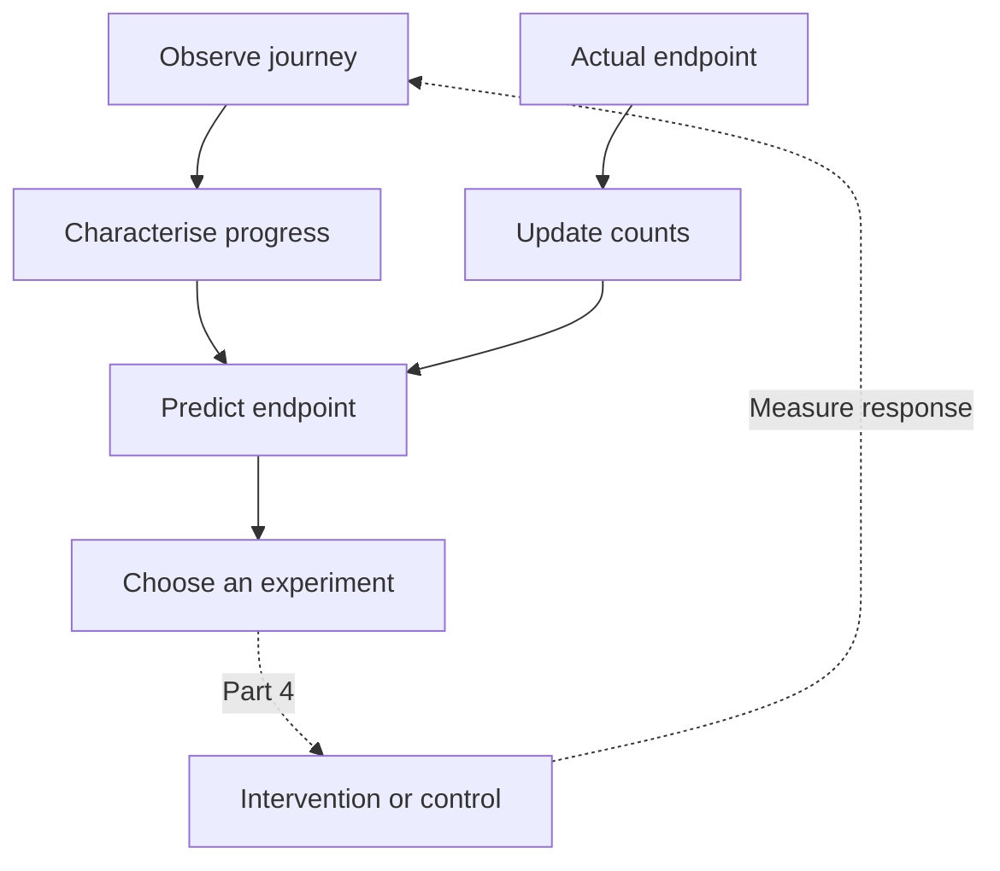

# SHOW ME WHAT YOU GOT (Part 3): Predict

In [Part 2](/blog/show-me-what-you-got-part2-building-relevance), we turned an entity's characterisation into recommendations. We could watch a session change, find eligible products, and explain which representations contributed to the ranking.

Now we want to use that history to answer a more useful business question: **where is this journey heading, and where might a change help?**

A retailer might want to recognise a faltering purchase journey; a systems administrator might want to spot a service approaching failure. We make part of that judgement explicit: record the journey, observe its endpoint, learn the relationship, then estimate what is likely to happen for the next journey.

This article builds the prediction step. Part 4 adds **experimentation**: showing different products, testing a price or offer, changing a message, or applying an allowed operational action. Together, they make the learning loop visible.

The companion C# tool starts with an empty SQLite database, generates a substantial synthetic population, learns from completed journeys, retains unfinished journeys without inventing outcomes, then predicts outcomes for fresh users. The output below comes from running that code.

<datetime class="hidden">2026-10-24T10:00</datetime>
<!-- category -- AI,Architecture,Machine Learning,Recommendations,Behavioural Inference,C#,SQLite,DiSE -->

[TOC]

# From a Recommendation to an Expected Result

A ranking answers: which available products are relevant to this shopper?

A destination prediction answers: given this shopper's observed progress, how likely are purchase, cancellation or departure within a defined horizon?

We need both. Two people can be interested in the same products while being at different stages of deciding what to do. One has compared alternatives and is proceeding to checkout. Another has put something in a basket almost immediately and returned to browsing.

Their interest vectors can be very similar. Their likely next actions need not be.

The interactive replay follows **24 timestamped behavioural trajectories** together. The heads track smoothed behavioural centroids; the trails preserve their routes. **Separate tracks** adds fixed display lanes to distinguish overlapping paths. Turn it off to inspect the exact two-coordinate projection; the forecasts always use the original vectors. The right-hand panel shows the actual C# forecast, velocity, acceleration, observation time and deadline.

<iframe class="article-explainer" src="/interactive/explainers/index.html?v=20261024-temporal&amp;view=prediction&amp;embed=1" title="24 timestamped behavioural trajectories, predictions and learned normal references" width="100%" height="1500" loading="lazy" style="border:0;border-radius:12px;"></iframe>

[Open the temporal replay](/interactive/explainers/index.html?view=prediction). Use **Compare direction** or **Compare pace**, and switch **Traffic** between shoppers and service incidents. The replay uses recorded UTC times. Its playback speed is separate from the forecast horizon.

The display is a fixed view of two explicit feature coordinates, with small presentation offsets to keep users selectable. It is not a learned embedding projection, and screen distance does not supply the outcome probabilities. Those come from the frozen temporal model trained on 600 earlier episodes per domain. An incomplete visit stops at its last observation without an invented endpoint.



The feedback arrow comes from **actual endpoints**. A predicted purchase does not count as a purchase and cannot train the system as one.

# Position Is Not a Trajectory

Two shoppers can supply the same current behavioural vector while moving in opposite directions. A service can report 500 ms latency while recovering, or report the same latency while deteriorating. Position alone loses that distinction.

The `predict-time` command runs the temporal example used by the visualiser:

```sh
dotnet run --project samples/RelevanceShop -- predict-time \
  --output /tmp/relevance-predict-time-814
```

It starts with fresh SQLite storage, learns from 600 earlier episodes per domain, and forecasts fresh journeys. The [captured output](https://github.com/scottgal/mostlylucidweb/blob/main/samples/RelevancePredict/artifacts/seed-814/temporal-output.txt) comes from the [C# temporal demo](https://github.com/scottgal/mostlylucidweb/blob/main/samples/RelevancePredict/TemporalPredictionDemo.cs).

At their comparison landmarks, A, B and C have the same observed shopping vector: `[0.500, 0.200]`. Their categorical state is also the same, `observing`. Their histories differ:

| Visit | First-coordinate velocity | Elapsed journey time | Purchase within 60s |
|-------|--------------------------:|---------------------:|--------------------:|
| A: moving forward | +0.01499/s | 20s | 85.5% |
| B: moving back | -0.01499/s | 20s | 22.0% |
| C: same route, slower | +0.00250/s | 120s | 0.0% |

A's purchase/cancel/leave distribution is **85.5% / 7.5% / 7.0%**. B's is **22.0% / 37.5% / 40.5%**. C has 100% unresolved mass: matched historical visits reached their endpoints outside this particular 60-second window. That is different from an unsupported forecast; C's estimate has 56 matched episode landmarks.

Use **Compare direction** to highlight A and B together, or **Compare pace** for A and C. The other 22 tracks stay visible. Each comparison pins the visits at their own recorded landmarks, rather than pretending they reached that position at the same clock time.

> **Representation aside:** these are normalised observations supplied by the simulator, not an LLM's purchase-intent score. Their meaning and scale are modelling choices, as in [Part 1's measured features](/blog/show-me-what-you-got-streaming-recommendations#turning-features-into-a-vector). [Part 1.5](/blog/show-me-what-you-got-part1-5-questions-as-coordinates) adds interpreted coordinates when ordinary measurements are insufficient. The operational example uses latency in seconds and error fraction. Converters let another application supply its own dimensions.

# Define the Destinations

An outcome needs a concrete meaning. In this example:

| Destination | Meaning in the fixture |
|-------------|------------------------|
| `purchase` | A purchase event was recorded for this episode. |
| `cancel` | An explicit cancellation ended the episode. |
| `leave` | The simulator recorded the episode closing without purchase. |

A missing event is none of these. In a real shop, “the episode has closed” needs an application definition, such as a measured session window. A person might return later, so a session outcome and a customer's eventual outcome are different targets.

The temporal example asks whether one of these endpoints arrives **within 60 seconds of the latest observation**. We need that definition before we can label examples or judge a forecast. The smaller state-only example later uses a different window: four observed transitions.

# Measure Movement in Actual Time

We keep a moving average of the observations so one noisy event does not replace everything we know. When a new observation arrives, move the current summary partway towards it. The half-life controls how quickly the summary follows new evidence.

For one coordinate, the update is ordinary C#:

```csharp
var elapsedSeconds = (observedAt - previousObservedAt).TotalSeconds;
var fractionToMove = 1 - Math.Pow(0.5, elapsedSeconds / halfLifeSeconds);

var newCentroid = previousCentroid
    + fractionToMove * (observation - previousCentroid);
```

`observation - previousCentroid` is the gap between the new reading and our current summary. Multiply that gap by `fractionToMove`, then add the result to the old summary. If the summary is `0.2`, the new observation is `0.6`, and the fraction is `0.5`, the updated summary is `0.4`: halfway between them.

With a two-second half-life, a two-second gap gives a fraction of `0.5`. A four-second gap gives `0.75`. The longer the gap, the less of the previous summary we retain when the next measurement arrives.

The equations express those same two lines. Alpha is `fractionToMove`; delta t is `elapsedSeconds`; h is `halfLifeSeconds`:

$$
\alpha(\Delta t)=1-2^{-\Delta t/h}
$$

Mu is the centroid, x is the observation, and the subscripts distinguish the new value from the previous one:

$$
\mu_t=\mu_{t-1}+\alpha(\Delta t)(x_t-\mu_{t-1})
$$

> **Reading the notation:** a subscript `t` means “at this observation”; `t−1` means “at the previous observation”. They play the same role as `newCentroid` and `previousCentroid` in the code. There is no additional operation hidden in the Greek letters.

The centroid is a smoothed characterisation, so it can lag the latest observation slightly; equal raw input vectors need not give exactly equal smoothed centroids.

## Velocity: How Fast Is the Summary Moving?

Subtract the previous position from the new one and divide by the time between them:

```csharp
var velocityPerSecond = (newCentroid - previousCentroid) / elapsedSeconds;
```

A coordinate moving from `0.3` to `0.5` in ten seconds has a velocity of `0.02` coordinate units per second. Covering the same distance in one second gives `0.2`. The direction is the same, but the pace is very different. A negative value means movement towards smaller values on that coordinate.

The equation says exactly that. The numerator is the change in centroid; the denominator is elapsed seconds:

$$
v_t=\frac{\mu_t-\mu_{t-1}}{\Delta t}
$$

## Acceleration: Is That Movement Speeding Up or Slowing Down?

Now apply the same idea to velocity. Compare the new rate with the previous rate and divide by the time separating those estimates:

```csharp
var midpointGapSeconds = (elapsedSeconds + previousIntervalSeconds) / 2;
var accelerationPerSecondSquared =
    (velocityPerSecond - previousVelocityPerSecond) / midpointGapSeconds;
```

Each velocity describes movement across an interval, so we treat it as an estimate at that interval's midpoint. If both intervals last ten seconds, their midpoints are ten seconds apart. If they last two and eight seconds, their midpoints are five seconds apart. That is what the first line calculates.

For a latency coordinate, positive velocity means latency is rising. Positive acceleration means that rise is becoming faster; negative acceleration means the velocity is decreasing. We need both signs to distinguish worsening behaviour, a slowdown in that worsening, and recovery.

The implementation applies these operations to every coordinate in the vector. Velocity has coordinate units per second; acceleration has coordinate units per second squared. Three observations are needed before both are available.

Part 2's [decayed sum and mass](/blog/show-me-what-you-got-part2-building-relevance#the-shopper-does-something-new) retain the weight of the interaction evidence. This temporal update instead uses elapsed time to choose how far the live position moves. They share the idea of fading history, but are different summaries for different jobs.

These scalar snippets unpack the vector operations in [TrajectoryPrediction.cs](https://github.com/scottgal/mostlylucidweb/blob/main/Mostlylucid.Relevance/TrajectoryPrediction.cs). The tests include an irregularly sampled quadratic trajectory, so changing the sampling intervals cannot quietly change the units.

The engine rejects equal or out-of-order timestamps in temporal mode. A sufficiently long gap resets derivative history and pending landmarks. We do not draw a line across an unobserved interval and call it measured velocity.

# Time Has Three Different Jobs

The temporal configuration separates three timescales:

| Setting | Demo value | Meaning |
|---------|-----------:|---------|
| Behavioural centroid half-life | 2 seconds | How quickly current characterisation adapts |
| Forecast horizon | 60 seconds | When the predicted destination must be reached |
| Normal-reference half-life | 24 hours | How slowly qualified normal experience fades |

Playback speed is a fourth, purely visual setting. At 30×, one screen second represents thirty seconds of recorded observations. It does not change the model or its horizon.

The configuration is explicit:

```yaml
trajectory:
  points: [behaviour]
  horizon_seconds: 60
  half_life_seconds: 2
  velocity_scale: 0.01
  acceleration_scale: 0.002
  elapsed_scale_seconds: 60
  baseline_states: [healthy]
  baseline_half_life_seconds: 86400
```

The `baseline_states` entries apply to the service example. Shopping prediction uses the same temporal machinery without declaring a healthy-service reference.

A clock reading alone is not a new behavioural observation. If idle time matters, the application must measure it; the engine does not infer zero velocity merely because no event arrived.

A forecast is anchored at its returned `ObservedAt`, with a `HorizonSeconds` value. In temporal mode `HorizonEvents` is zero. If the window has already expired when `PredictAsync` is called, the engine abstains with `stale_trajectory`. The visualiser labels a recorded forecast whose window has elapsed, rather than presenting it as a fresh prediction.

# How Those Features Become a Forecast

The predictor matches an explicitly scaled context containing:

```text
centroid coordinates
velocity coordinates
acceleration coordinates
elapsed seconds since the continuous episode began
```

It groups similar contexts into bounded feature cells, maintaining a centroid and outcome counts for each cell. This uses configured bins and incremental statistics; it is not claiming to discover neural embeddings or Leiden communities.

When an actual endpoint arrives, the first motion-ready landmark for each observed state contributes one example. If the endpoint was reached within 60 seconds of that landmark, its destination count increases. If the observed first endpoint came later, the within-window unresolved count increases. A visit that stops producing feedback supplies neither an invented endpoint nor a failed purchase label.

At prediction time, eligible nearby contexts supply a reference population. The **observed destination frequencies** in that population supply the probabilities. Geometric closeness selects relevant experience; it is not itself renamed a probability. Minimum support and distance bounds allow the engine to abstain. Context capacity is bounded, and updates happen through the existing asynchronous channel and save transaction.

> **In plain English:** find completed journeys that looked like this one, including how quickly they were changing. Count where those journeys ended within the forecast window. If 80 out of 100 comparable journeys reached purchase in time, the purchase estimate is 80%. The engine checks that there are enough comparable examples before returning an estimate.

The `IDestinationPredictor` hook keeps this estimator replaceable. The state-only example below shows the counting mechanism without the motion features; another estimator could use a trained model over the same recorded evidence.

# Normal Behaviour Gives Drift a Reference

For incident analysis, movement needs a reference. Five hundred milliseconds of latency is a different observation for a service normally running at 100 ms than for one normally running at 600 ms.

Switch the visualiser's **Traffic** selector to **Service incidents**. The hollow marker shows the learned normal centroid. Its reference is built from explicitly qualified `healthy` observations, using a slow, time-decayed mean and variance. The live centroid adapts on the faster two-second timescale.

The application supplies a reference group such as a service class. We keep unrelated systems separate. Incident observations still update their live trajectory, but they do not update the healthy reference. Otherwise an outage could gradually teach the detector that failing is normal.

The sample's reference is approximately **100 ms latency and 1% error fraction**. Two services then reach the same current observation, **500 ms and 5% errors**, with different motion:

| Service | Latency movement | Outage within 60s | Recovery within 60s |
|---------|------------------|-----------------:|-------------------:|
| A | Increasing | 76.0% | 24.0% |
| B | Decreasing | 22.6% | 77.4% |

A's first-coordinate velocity corresponds to roughly 15 ms more latency per second; B's corresponds to roughly 15 ms less.

The reference centroid stays at approximately `[0.1000, 0.0100]` while those incident tracks move. Variability supplies a scale for reporting deviation from normal, with a positive variance floor for nearly constant signals.

That deviation is a distance, not an outage probability. The destination forecast comes from learned outcomes of comparable trajectories. The engine can therefore report a substantial departure from normal while still withholding a destination forecast if it lacks enough motion or outcome evidence.

> **Normality aside:** `healthy` is an admission rule, not a label the predictor awards itself. It might come from verified operating periods or an application policy. The reference needs sufficient effective mass; old or missing normal evidence cannot justify a confident drift score. A legitimate new operating regime needs deliberate admission, rather than silently accepting an incident into the reference.

# Which Destinations Do We Want?

Defining an endpoint tells us what to predict. We also need to say **what result we are trying to improve**.

Purchase, cancellation and departure are observations. Their desirability is an application decision. A shop might want completed, profitable purchases; an operations team might want sustained recovery while preserving throughput. More basket additions or lower latency are useful signals, but neither necessarily achieves those goals.

We can express a simple preference using a **utility**: a numeric value assigned to an outcome. For illustration:

| Destination | Example utility |
|-------------|----------------:|
| `purchase` | 1.0 |
| `cancel` | -0.5 |
| `leave` | 0.0 |

These are chosen teaching values, not learned probabilities or a claim about the cost of a cancellation. Another application can value the same destinations differently.

Combining a forecast with those values gives an expected utility. In plain English, multiply each possible result's value by its chance of happening, then add the contributions. This is an average value across possible futures, rather than a promise about this particular visit:

```text
Expected utility = sum of P(destination | observed state) × utility(destination)
```

For a forecast whose destination probabilities account for all the mass, the application-side calculation is small:

```csharp
var utility = new Dictionary<string, double>
{
    ["purchase"] = 1.0,
    ["cancel"] = -0.5,
    ["leave"] = 0.0
};

var expectedUtility = prediction.Outcomes.Sum(
    outcome => outcome.Probability * utility[outcome.Destination]);
```

For example, a complete forecast of 80% purchase, 10% cancellation and 10% departure gives `0.8 × 1 + 0.1 × -0.5 + 0.1 × 0 = 0.75`. The code multiplies `Probability` by the corresponding dictionary value, then `Sum` adds those contributions.

This is a way to interpret `PredictAsync` output, not another field in the predictor's YAML. Changing the objective should not rewrite what the system believes will happen. Keep the probabilities available so we can explain the trade-off.

> **Uncertainty aside:** unresolved probability is not a destination with a utility of zero. If the horizon ends or evidence is insufficient, some value remains unknown. Report that missing mass alongside the estimate; do not turn an incomplete forecast into an apparently complete business score.

Expected utility describes the current forecast. It does not yet tell us which action will improve it. Part 4 will compare the expected value **under each intervention** with the control, including intervention costs. A discount might increase purchase probability while reducing profit. A connection limit might reduce errors while rejecting too much useful traffic.

That means defining the objective, measurement window and constraints before the experiment, and recording their version with each decision. The target is an improvement in observed results, rather than a higher forecast or a convenient proxy such as clicks.

## Choose a Target We Can Actually Observe

A retail integration could define basket abandonment or payment cancellation as undesirable destinations. An operations integration could define sustained degradation or an outage. Each needs an observable result and a closing window: a quiet basket is not yet abandonment, and rising latency is not itself a confirmed outage.

These are possible extensions, rather than extra labels implemented in the fixture. The shop's `cancel` remains a generic episode cancellation. [Part 2's service example](/blog/show-me-what-you-got-part2-building-relevance#the-same-reasoning-applies-to-a-service) supplies measurements and allowed diagnostic candidates; the prediction adds an estimate of where that measured behaviour leads. Part 4 tests which allowed change helps.

# Check the Temporal Forecasts on Later Episodes

Each domain has 600 training episodes and a separate later population of 300 visits. A frozen outcome model predicts at the first motion-ready landmark, before future labels are revealed. Missing feedback is excluded from scoring, not counted as a bad outcome. Normal references use earlier qualified observations.

The actual run reports:

| Domain | Scored | Censored | Model Brier | Training-only prior |
|--------|-------:|---------:|------------:|--------------------:|
| Shopping | 270 | 30 | 0.3405 | 0.7197 |
| Operations | 264 | 36 | 0.2180 | 0.6657 |

Lower Brier scores are better. Both compare with a prior for the **same time-defined target**. These are controlled simulator results, with uncalibrated estimates, rather than production performance or intervention uplift.

This estimator learns from completed episodes. If feedback disappears selectively, the resulting reference population can be biased. A production application may need a censoring-aware estimator. Keeping the estimator replaceable does not remove that modelling responsibility.

# A Smaller Worked Example: Learning From State Counts

The temporal example is the main implementation in this article. The repository also includes a smaller state-only predictor that makes the learning mechanism especially easy to inspect: count observed transitions, turn those counts into probabilities, then update them when a real outcome arrives.

This second example uses a separate Bogus fixture and a **four-event horizon**, rather than the temporal example's 60-second horizon. Its results are not a head-to-head benchmark against the temporal model. Read it to follow training one count at a time, or continue to [the experimentation handoff](#next-experiment-with-the-journey).

## Generate a Reproducible Population

The `predict` command uses [Bogus](https://github.com/bchavez/Bogus) for fake catalogue and user data, with a small C# simulator supplying behaviour and eventual outcomes:

```csharp
var fixture = FixtureGenerator.Generate(
    seed: 814,
    products: 240,
    training: 1000,
    holdout: 400);
```

Run it through the existing console sample:

```sh
dotnet run --project samples/RelevanceShop -- predict \
  --seed 814 --products 240 --train 1000 --test 400 \
  --output /tmp/relevance-predict-814
```

Use a new or empty output directory. The command writes the catalogue, users, complete fixture journeys, forecasts, evaluation report and exact console output there. By default it creates and cleans up its own fresh SQLite database. Supply `--database /tmp/relevance-predict.db` to keep a new database for inspection.

The checked-in [console output](https://github.com/scottgal/mostlylucidweb/blob/main/samples/RelevancePredict/artifacts/seed-814/output.txt) and [prediction report](https://github.com/scottgal/mostlylucidweb/blob/main/samples/RelevancePredict/artifacts/seed-814/report.json) contain the results used below.

The initial output is:

```text
SYNTHETIC FIXTURE bogus-shop-v2; seed=814; Bogus=35.6.5
products=240; training_visits=1000; later_holdout_visits=400
missing_descriptions=48; unavailable=28; neural_inference=none
```

There are three product categories, explicit prices, measured colour swatches and availability. Users have fake names, a preferred category and a budget. The simulator supplies several shopping patterns, including comparison, basket removal, checkout, purchase, cancellation and a recorded departure.

Some visits lose feedback before their endpoint. Those remain incomplete. The generator does not quietly turn them into cancellations.

Bogus uses local seeded randomness, and the simulation has its own random stream. Changing a generated description therefore does not silently change the purchase history. The fixture also has fixed timestamps and a fixed clock. With the pinned package, seed and fixture version, we can reproduce the examples.

> **Data aside: this is synthetic experience.** We are testing the learning mechanism against a controlled population, with labels supplied by the simulator. These are genuine program outputs, but the resulting percentages are not claims about a real retailer. Production events can enter through the same API when the application has defined its observations and outcomes.

## Characterise the Journey Prefix

The underlying event shape is small:

```csharp
await relevance.SaveAsync("events", new
{
    id = observation.Id,
    subject = observation.Subject,
    candidate = observation.Candidate,
    type = observation.Type,
    at = observation.At,
    state = encoder.Observe(observation.Type)
});
```

The product ID connects the observation to the representations we built in Part 2. A comparison contributes more to the interest summary than a view. Availability and budget still constrain recommendations.

The additional `state` describes the journey's progress. It is derived from what has happened **so far**.

Consider these three prefixes:

```text
view → compare → cart
view → cart → view
view → compare → cart → remove → compare → cart
```

They preserve distinctions a bag of product interactions can lose: how the person arrived at the basket, whether they returned to browsing, and whether they removed something before coming back.

The sample keeps a little prefix memory:

```csharp
private int comparisons;
private bool cartSeen;
private bool removed;
```

The interesting part of the encoder is the mapping:

```csharp
"view" => cartSeen ? "post_cart_browsing" : "browsing",
"compare" => removed ? "reconsidering"
    : comparisons > 1 ? "repeated_comparison" : "comparing",
"cart" => removed ? "returning_cart"
    : comparisons > 1 ? "research_cart"
    : comparisons > 0 ? "considered_cart" : "impulsive_cart"
```

Before this switch, a comparison increments `comparisons` and a removal sets `removed`. After a cart event, `cartSeen` becomes true. The full encoder is in [FixtureGenerator.cs](https://github.com/scottgal/mostlylucidweb/blob/main/samples/RelevancePredict/FixtureGenerator.cs).

These names are our explicit representation of progress. `considered_cart` means a cart addition after comparison. It does not mean the user is certain to buy. The relationship with purchase is something the system learns from subsequent events.

This follows [Part 1.5](/blog/show-me-what-you-got-part1-5-questions-as-coordinates): decide which distinctions matter, then produce a usable characterisation. Here a few exact observations provide the features. A decision model could contribute an interpreted feature where ordinary event data is insufficient.

> **ML aside: what is a state?** It is a summary of the context we choose to retain. This is a first-order Markov model: the supplied state determines the estimated next-state distribution. Including some prefix memory lets that state distinguish useful trajectories without storing the whole path inside the predictor.

The simulator's hidden intent settings are not passed to this encoder. Neither are the user's future actions or final outcome. New users are characterised through the same observations as historical users.

## Configure an Event-Count Horizon

The state-only configuration includes:

```yaml
destinations:
  states: [browsing, post_cart_browsing, comparing, repeated_comparison,
           considered_cart, research_cart, impulsive_cart, returning_cart,
           cart_removed, reconsidering, checkout, purchase, cancel, leave]
  outcomes: [purchase, cancel, leave]
  horizon_events: 4
  min_transitions: 20
  smoothing: 0
```

The states define the vocabulary. The transition counts and resulting probabilities start empty.

The horizon asks about destinations **within the next four observed transitions**. It does not mean four minutes, and it does not claim to predict a purchase within 24 hours. A timed email campaign needs a clock-based measurement window as part of its experiment definition.

The minimum support requires twenty outgoing observations before a state can propagate probability. This run uses zero smoothing so each displayed transition has an observation behind it. The engine also supports explicit pseudo-count smoothing when that is appropriate for the application.

## The State Baseline Learns Transition Counts

Suppose a historical user moves from `checkout` to `purchase`. The engine increments that connection:

```csharp
row[next] = row.GetValueOrDefault(next) + 1;
model.Counts[previous] = row;
```

That is the update in [RelevanceEngine.cs](https://github.com/scottgal/mostlylucidweb/blob/main/Mostlylucid.Relevance/RelevanceEngine.cs). The state transition and its deduplication record are committed together. Retrying the same event does not count it twice.

After enough observations, divide each outgoing count by the row total:

```text
P(next state | current state) = transition count / total outgoing count
```

Read the vertical bar as “given”: the chance of the next state, given the state we are in now. In C#, the count-to-probability step is:

```csharp
var totalOutgoing = row.Values.Sum();
var nextStateProbability = row[nextState] / totalOutgoing;
```

For a supported row, this asks “of all the recorded exits from here, what fraction went there?” The counts are doubles in this model, so the division retains the fractional result.

The run's learned checkout row contains:

| Next state | Observed transitions |
|------------|---------------------:|
| Purchase | 306 |
| Cancel | 24 |
| Leave | 18 |
| **Total** | **348** |

These are observed departures from checkout. A visit that reached checkout without reporting an exit contributes no invented result.

So the estimated purchase probability from checkout is `306 / 348`, approximately **87.9%**.

Nothing supplied that percentage in configuration. Each observed endpoint changed the counts from which the percentage was estimated.

That is training in a form we can inspect directly. The observations provide examples. The endpoint supplies a label. The counts are learned parameters. New evidence changes those parameters, and the next inference uses the updated model.

There is no gradient calculation in this estimator. A later model might learn feature weights or neural network parameters by minimising prediction error. It would still need an input available at decision time, an observed target, an update rule and an honest evaluation on other journeys.

**Machine learning does not require a neural network.** This is a small online statistical model whose update happens as observations arrive.

## Watch a Fresh System Learn

Before any observations, the tool cannot characterise the new shopper:

```text
UNKNOWN purchase=0.0 % cancel=0.0 % leave=0.0 % unresolved=100.0 % support=0 status=no_state
```

After a first view, it has a state but no learned outgoing evidence. After three historical visits, support is still below the configured threshold:

```text
COLD purchase=0.0 % cancel=0.0 % leave=0.0 % unresolved=100.0 % support=0 status=insufficient_evidence
AFTER 3 VISITS purchase=0.0 % cancel=0.0 % leave=0.0 % unresolved=100.0 % support=3 status=insufficient_evidence
```

As the population supplies experience, that same observed state becomes usable:

```text
AFTER 100 VISITS purchase=39.2 % cancel=10.1 % leave=19.0 % unresolved=31.7 % support=99 status=estimated
AFTER 1000 VISITS purchase=40.1 % cancel=12.2 % leave=21.1 % unresolved=26.6 % support=975 status=estimated
SQLITE REOPEN probabilities_unchanged=true
```

The last line closes the training engine, opens the same SQLite database in a new engine and checks the forecast again. The learned model survives a restart; it is not an in-memory demonstration disguised as persistence.

Notice the unresolved probability. At the start of a visit, four transitions do not always carry the shopper to a destination. Some routes need more steps. Unsupported branches can also retain unresolved mass.

The predictor follows the possible routes, multiplying probabilities along each path and adding mass arriving at the same destination. For one branch, the bookkeeping is:

```csharp
var branchMass = currentMass * transitionProbability;
nextMass[nextState] = nextMass.GetValueOrDefault(nextState) + branchMass;
```

If 50% of the forecast reaches a state and 80% of those routes go to purchase, that branch contributes `0.5 × 0.8 = 0.4`, or 40 percentage points, to purchase. Other branches can add their own contributions. A destination is **absorbing**: once mass reaches a recorded endpoint, it stays there for the rest of the forecast.

We retain unresolved mass rather than rescaling the named outcomes to add up to 100%. Otherwise we would make an incompletely resolved forecast appear more certain.

The [streaming completion contract from Part 2](/blog/show-me-what-you-got-part2-building-relevance#make-streaming-a-promise-we-can-explain) still applies: an awaited save completes before the next queued prediction read. No scheduled rebuild sits between the new outcome and that estimate.

### One More Outcome, One More Update

The demo also takes a new shopper at checkout, records an actual cancellation, and forecasts the next shopper arriving at checkout. This runs against the persistent live model, separately from the frozen evaluation model.

```text
OBSERVED status=observed_destination cancel=100.0 %
OUTCOME UPDATE checkout_purchase=87.9 % -> 87.7 % support=348->349 retry_duplicate=true
```

The first line reports the result we now know. The second shows what was learned for the next user. The purchase numerator stays at 306, while total outgoing observations rise from 348 to 349. The new forecast uses `306 / 349`.

A transport retry of the cancellation is recognised as a duplicate, so it does not train the connection a second time.

That is the training loop directly: an observation changes a learned parameter, and a later prediction changes as a result. With enough experience, the relationships can become useful inputs to deciding which journey to investigate or improve.

## State-Only Forecasts for Fresh Users

Now introduce three fresh shoppers. For this controlled comparison they interact with the **same product**, giving the matcher the same location to work from. Their paths differ.

The new prefixes are:

- After comparison: `view → compare → cart`.
- Direct addition: `view → cart`.
- After removal and return: `view → compare → cart → remove → compare → cart`.

They map to `considered_cart`, `impulsive_cart` and `returning_cart`, respectively. The actual predictions are:

| Cart arrival | Purchase | Cancel | Leave |
|--------------|---------:|-------:|------:|
| After comparison | 87.9% | 6.9% | 5.2% |
| Direct addition | 18.3% | 27.2% | 54.5% |
| After removal and return | 33.2% | 30.6% | 36.2% |

Their supporting transition counts are 357, 336 and 229. These forecasts have zero unresolved mass within the configured horizon. They describe different learned route distributions, not different meanings assigned to the same distance score.

> **State aside:** this simpler first-order baseline gives the same forecast to users with the same encoded state and population model. Prefix memory distinguishes `considered_cart` from `impulsive_cart`. The temporal estimator above goes further: even with the same categorical state, it conditions on measured centroid motion and elapsed time. Neither estimator receives a user's future endpoint as an input.

The product picks remain the same:

```text
PICKS considered budget=£191 p-0001:0.04098, p-0007:0.03771, p-0058:0.03768
PICKS impulsive budget=£191 p-0001:0.04098, p-0007:0.03771, p-0058:0.03768
PICKS returning budget=£191 p-0001:0.04098, p-0007:0.03771, p-0058:0.03768
```

The [candidate-ranking calculation from Part 2](/blog/show-me-what-you-got-part2-building-relevance#several-useful-opinions-one-list) is unchanged. The added result is the forecast for each journey, which the application can return alongside those candidates.

An 87.9% purchase forecast does not tell us that this person needs an offer. They may be likely to buy already. An 18.3% forecast does not tell us that an offer would work either. The person could be browsing for a future purchase, comparing elsewhere or simply uninterested.

What it gives us is a set of contexts in which to test useful changes. We can start asking which intervention improves the result for each kind of journey.

> **Support aside:** 357 is an outgoing transition count, not a confidence interval or a claim about 357 independent customers. A model can learn several transitions from one episode. Keep episode identities for evaluation and experimental assignment.

## Test the Predictions on Later Users

We need to check forecasts before treating them as useful inputs to a decision.

The sample has an earlier training population and a separate, later population of 400 visits. For the evaluation, we freeze the learned transition counts and predict each later user's outcome at their **first cart addition**.

That landmark matters. It makes the comparison about the same point in a journey, rather than mixing predictions made after a first view with predictions made just before purchase.

The evaluator first captures all forecasts. Only then does it inspect the future labels. Held-out outcomes never enter its population model.

The core's `IDestinationPredictor` hook makes this small:

```csharp
return baseline.PredictAsync(
    context with { Transitions = frozen },
    cancellationToken);
```

The held-out engine has its own subject states and product catalogue. Its ordinary saves can characterise each prefix, while the predictor uses the fixed training counts. This prevents evaluation traffic from silently changing the model being measured.

The output accounts for every visit:

```text
HOLDOUT landmark=first_cart horizon=4_events scored=349 censored=27 without_cart=24
BRIER lower_is_better model=0.4750 training_prior=0.6234
```

Twenty-four visits never reached the landmark. Twenty-seven reached it but did not provide an outcome or enough subsequent observations to score the four-event target. The remaining 349 support this evaluation. An observed run of four non-terminal transitions can be scored as unresolved; an observation stream that simply stops early cannot.

The baseline predicts the same outcome distribution for every first-cart visit, using the training population's frequencies. Our learned state model improves the Brier score from **0.6234 to 0.4750** on this held-out fixture.

The multiclass Brier score measures how far the forecast was from the result we observed. Give the outcome that happened a target of `1`, and every other outcome a target of `0`. Subtract each target from its forecast probability, square the difference, and add the results:

```csharp
var episodeError = probabilities.Sum(entry =>
{
    var target = entry.Key == actualOutcome ? 1.0 : 0.0;
    var error = entry.Value - target;
    return error * error;
});
totalEpisodeError += episodeError;
var brierScore = totalEpisodeError / scoredEpisodes;
```

Here, `probabilities` includes the unresolved category, and `totalEpisodeError` accumulates `episodeError` across the scored visits. An 80% purchase / 20% leave forecast followed by a purchase scores `(0.8 - 1)² + (0.2 - 0)² = 0.08`; if the visitor leaves, it scores `1.28`. Squaring makes a confidently wrong forecast more costly. Average those episode errors to assess the whole set of forecasts. We use the version ranging from zero to two. Lower is better. The [scikit-learn model evaluation documentation](https://scikit-learn.org/stable/modules/model_evaluation.html#brier-score-loss) explains this convention.

We also check whether groups of similar purchase forecasts match their observed frequencies:

| Predicted purchase band | Visits | Mean forecast | Observed purchase frequency |
|-------------------------|-------:|--------------:|----------------------------:|
| 0–20% | 119 | 18.3% | 16.8% |
| 20–40% | 91 | 33.2% | 37.4% |
| 80–100% | 139 | 87.9% | 87.1% |

This is a **reliability check**. If we repeatedly predict about 80%, roughly eight out of ten comparable observations should reach the stated target. A lower overall Brier score alone does not establish calibration; it combines several properties of the forecasts. The [calibration documentation](https://scikit-learn.org/stable/modules/calibration.html) makes that distinction clearly.

The returned `IsCalibrated` flag remains false. We have evaluated this version against synthetic holdout data; we have not fitted a separate calibrator or established reliability on a real shop. The tests also check improvement over the population prior across three independently seeded fixtures, rather than depending entirely on the article's one run.

# Optional: Give the Generated Catalogue Readable Copy

Bogus and explicit simulation rules give us enough data to exercise the learning system. A local LLM can make the catalogue more readable without becoming part of the prediction hot path.

The optional helper asks Ollama for display copy for existing product IDs:

```sh
python3 samples/RelevancePredict/generate-copy.py \
  /tmp/relevance-predict-814/catalogue.json \
  /tmp/product-copy.json
```

The script requires an installed local model. It requests short names and purpose descriptions, validates the response structure, and records the model and prompt version. The [Ollama structured-output API](https://docs.ollama.com/capabilities/structured-outputs) supports JSON responses and schema-constrained generation.

A shortened version of the prompt is:

```text
Write useful, plain display copy for these fictional demo products.
Return products containing only id, name and description.
Preserve the supplied IDs and product kinds.
Do not invent materials, dimensions, performance, certifications or prices.
```

The [sample README](https://github.com/scottgal/mostlylucidweb/tree/main/samples/RelevancePredict#optional-local-llm-display-copy) documents the response envelope and provenance fields. Freeze the generated response before importing it.

Import a reviewed, frozen response with:

```sh
dotnet run --project samples/RelevanceShop -- predict \
  --copy /tmp/product-copy.json \
  --output /tmp/relevance-predict-with-copy
```

The importer rejects unknown IDs, duplicate entries and extra fields. The LLM cannot change prices, availability, categories, observations or outcome labels through this interface. The host supplies provenance; the model does not certify itself.

Here the LLM changes display copy, not the prediction inputs or labels. [Part 1.5](/blog/show-me-what-you-got-part1-5-questions-as-coordinates) covers models that actually produce feature coordinates; this helper has a deliberately smaller role.

The [sample source](https://github.com/scottgal/mostlylucidweb/tree/main/samples/RelevancePredict) includes a frozen local-model response and the actual output used here. Keeping the generated response gives us an exact replay artifact even if an LLM runtime changes later.

> **Part 4 aside: feedback can improve the catalogue too.** A pattern of questions, missing descriptions or poorly performing journeys can suggest a content experiment: clarify the product copy, supply a missing specification, test a different image, or investigate a pricing hypothesis. We can feed those observations back to retail and marketing, then compare the change with a control. Missing data is a reason to investigate; it does not by itself prove that filling a field, lowering a price or rewriting a paragraph will improve conversion.

# Next: Experiment With the Journey

We now have observed trajectories, destination forecasts, normal references and a way to evaluate later journeys. A forecast identifies where a change may be worth investigating. It cannot establish that a discount, different message or connection limit will improve the result.

This follows the **perceive, evaluate, mutate, select** loop from [Directed Synthetic Evolution](/blog/dise-architecture-overview). This article makes the prediction and evaluation steps visible. Part 4 adds the directed change and tests its effect: assignment to an allowed intervention, actual exposure, a response window and comparison with a control or another eligible treatment. Costs and constraints remain part of the objective.

The same questions apply to a product, special offer, timed email or operational action:

```text
What is likely to happen along this journey?
What changes when we apply this intervention?
```

The series progresses from understanding the data, through understanding the behaviour, to testing how we can change the outcome. The predictions give us the baseline for that experiment.
