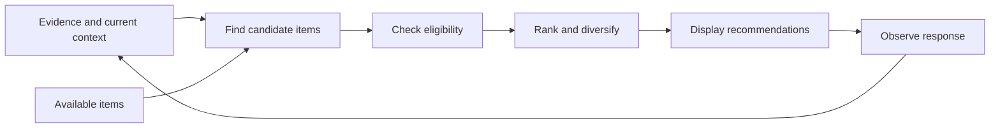
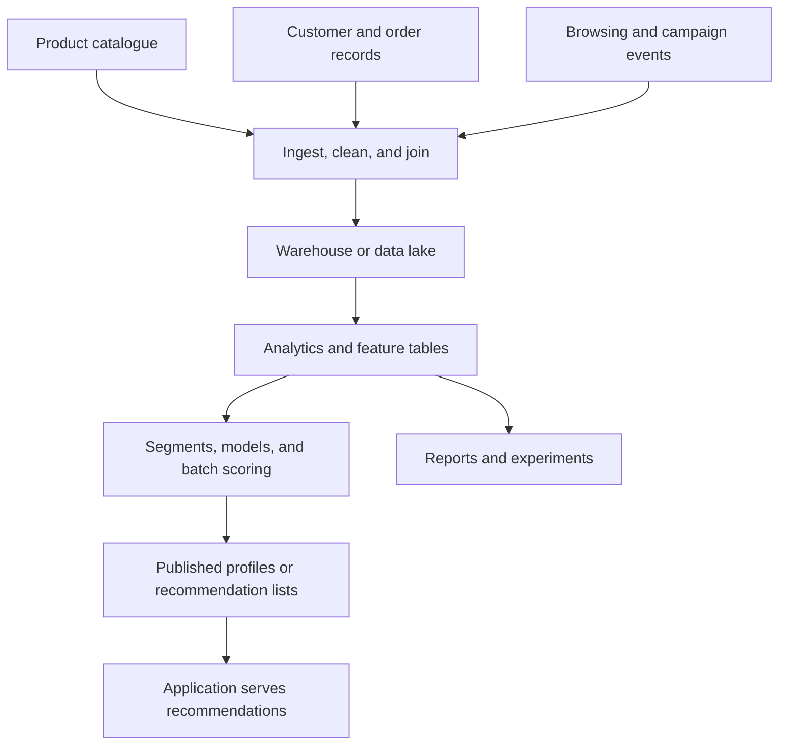

# SHOW ME WHAT YOU GOT: A Primer on Recommendation Systems in an AI World

You buy a kettle, and the shop spends the next fortnight recommending kettles. You browse a birthday present, and suddenly your entire personality is scented candles. Meanwhile, the thing you actually came back to find is three pages down.

Recommendation systems are supposed to help us choose. To understand why they sometimes get that so wrong, we need to understand what they observe, what they remember, and how they turn that evidence into a list of things to show us.

Shopping is a familiar example of a broader problem. A failing distributed system also presents choices: inspect database waits, compare recent deployments, or trace a slow dependency. As evidence arrives, which diagnostic action is relevant changes. The candidates are actions rather than products, but we still need to represent the current situation, find useful matches, and rank them against an objective.

**The architecture we're building towards is a general-purpose relevance engine.** Given evolving evidence, a set of candidates, and a defined objective, it determines what is relevant now. Recommendation is one application. The reusable machinery is evidence accumulation, live state, matching, and constrained selection; each domain supplies the meaning of its signals and candidates.

This primer explains those pieces: collaborative filtering, embeddings, vectors, centroids, retrieval, ranking, and **streaming recommendation**. The central idea is a space in which positions represent relationships. Once we can place items and observations in an appropriate space, we can find neighbours, summarise interests, and track how behaviour changes while someone is still browsing.

<datetime class="hidden">2026-10-22T12:00</datetime>
<!-- category -- AI,Architecture,Machine Learning,Recommendations,Behavioural Inference,StyloBot,C# -->

# Introduction

For a recommendation system, relevance becomes a deceptively simple question:

> Given what we know now, which available things should we show next?

Those things might be products, articles, videos, jobs, or suggested actions in an application. The inputs might be explicit preferences, a search query, previous purchases, or a few interactions during the current session.

You do not need a chatbot to do this. You need a way to represent the evidence, find plausible candidates, and put them in a useful order.

The same separation matters for diagnostic actions. Ranking "inspect connection-pool saturation" as useful does not execute it, establish the root cause, or authorise a production change. Relevance selects what deserves attention; application policy governs what happens next.

**The basic loop:**

1. Observe something useful.
2. Update what the system knows about the current situation.
3. Find relevant candidates.
4. Apply constraints and rank them.
5. Observe what happens next.

The timing matters. A recommendation made from yesterday's profile can miss what someone is trying to do this afternoon. A system that updates during the session can respond to the product they just opened or the filter they just changed.

The approach has two useful capabilities: **streaming updates** keep the current state responsive, while new signal contributors let us extend what the system observes and learn which evidence matters.

Together, these support an **emergent streaming recommender**. Patterns are discovered from observations, given readable names, and used to inform recommendations. Reusable embedding models and small LLMs help us represent and interpret those patterns without naming every audience segment in advance.

We'll use a shop to make the mechanics concrete. Keep the diagnostic example in mind: the important question is which parts of this machinery depend on selling products, and which parts apply wherever new evidence changes what is worth considering next.

This is a standalone introduction. If you've read my [RAG primer](/blog/rag-primer), some of the vector machinery will be familiar. If you've read the [behavioural inference article](/blog/behavioural-inference-systems-blog) or the [Stylo.Bot articles](/blog/stylobot-fingerprint), you'll recognise the wider pattern: accumulate partial evidence over time, then use it to make a bounded decision.

[TOC]

# What Is a Recommendation System?

Imagine a bookshop assistant. You tell them you enjoyed a particular novel. They might suggest another book by the same author, something with similar themes, or a book that other readers of that novel enjoyed.

Those are different ways of finding a recommendation. The assistant also checks whether the book is in stock, remembers that you asked for a paperback, and avoids offering the book already in your hand.

Software has to make those steps explicit.



**Candidate generation** finds a manageable pool of plausible items. **Ranking** decides their order. **Eligibility** determines what can be offered at all.

A waterproof jacket might be a strong match for someone browsing hiking equipment. It still should not appear as an available purchase if their size is out of stock.

## Recommendation, Search, and Prediction

These overlap, but they ask different questions:

| System | Question | Example |
|--------|----------|---------|
| Search | What matches this explicit request? | "Waterproof walking boots under £120" |
| Recommendation | What might be useful in this context? | Boots related to the products currently being compared |
| Classification | Which known kind of behaviour does this resemble? | A session mostly exploring outdoor equipment |
| Prediction | What outcome is likely next? | Which item the visitor may add to their basket |

Search gives us a query. Recommendation often has to construct one from behaviour.

A recommendation can rank usefulness without predicting a purchase. Those are different objectives, even when both produce a numerical score.

# The Warehouse-and-Analytics Approach

Before looking at algorithms, it helps to picture the infrastructure that often surrounded them. In a warehouse-centred personalisation system, a substantial part of the work happened before a recommendation reached the website.

The organisation collected product metadata, purchase records, browsing events, campaign responses, and customer attributes. Data pipelines cleaned and joined those sources. Analysts defined useful measures and audiences. Models or rules turned the resulting features into recommendations, which were published somewhere the application could read quickly.

AWS's [Customer 360 architecture](https://docs.aws.amazon.com/whitepapers/latest/build-e2e-data-driven-applications/data-driven-architectural-patterns.html) illustrates that broad integration pattern: consolidate sources, construct customer profiles, perform analysis, and feed recommendations or next actions into applications. It includes near-real-time components too; a warehouse does not dictate a single processing schedule.

## First, Describe Everything

A shop might maintain data such as:

| Data | Examples | Purpose |
|------|----------|---------|
| Product metadata | Category, brand, material, price band, intended use | Describe and filter items |
| Customer attributes | Account history, loyalty tier, stated preferences | Describe the customer |
| Interaction history | Views, searches, purchases, campaign clicks | Record what happened |
| Derived analytics | Spend over 90 days, category affinity, purchase frequency | Summarise the history |
| Audience definitions | Frequent outdoor buyers, lapsed customers | Turn measures into groups for action |

These are illustrative fields, not requirements of every recommender. Collaborative filtering, for example, can learn useful relationships from interactions without an elaborate product taxonomy.

> **ML aside: a feature is an input.** "Price" is a product attribute; "number of times the visitor lowered the price filter" is a behavioural feature. Feature engineering means choosing and calculating the inputs that might help a decision. A signal is a particular piece of evidence supplied to the system.

Still, the metadata-heavy version has a familiar maintenance problem. Someone has to decide which attributes exist, make sure suppliers populate them consistently, and resolve whether "rainwear", "waterproof clothing", and "wet-weather gear" refer to the same thing.

Someone also has to decide what "interested in outdoor products" means. Three views this month? One purchase this year? A threshold over a category-affinity score? The representation and the audience definitions become things teams must maintain.

## Then, Build the Processing Pipeline

**ETL** means extract, transform, load: collect data from source systems, reshape it, and put it in an analytical store. **ELT** loads it first and performs transformations there. Either way, joins and transformations turn operational records into features that an analytical model can use.



This is an illustrative batch-oriented arrangement. AWS's [batch recommendation pipeline example](https://aws.amazon.com/blogs/machine-learning/create-a-batch-recommendation-pipeline-using-amazon-personalize-with-no-code/) provides a concrete implementation using data preparation, model training, batch inference, and workflow orchestration.

That separation buys us something valuable: expensive joins and calculations can run without making someone wait at the checkout. Historical data supports reporting, experimentation, and learning patterns that no single session could reveal.

## A Fast Response Can Still Use Old Evidence

Imagine an hourly or nightly profile refresh. At 10:00, a visitor starts comparing walking boots. At 10:03, they add a pair to their basket. The application can fetch its existing recommendation list in milliseconds, but that list may still reflect yesterday's interests.

**Serving latency and evidence freshness are different measurements.** A fast lookup does not tell us when the underlying interpretation last changed.

Precomputation also need not mean serving one fixed list. A system can use the current product or basket to select precomputed related items, then apply current filters. Adobe's [recommendation algorithm documentation](https://experienceleague.adobe.com/en/docs/target/using/recommendations/criteria/recommendations-algorithms) describes this split between offline computation and serving-time keys and filtering.

## What Changes in the Approach Here?

We move a useful part of the interpretation into the running system. An observation updates compact live state; new signal contributors can add evidence; the decision policy can learn which contributions help for a particular context and objective.

Nor is this a claim that older systems were all nightly batch jobs. Netflix's [2013 architecture article](https://netflixtechblog.com/system-architectures-for-personalization-and-recommendation-e081aa94b5d8) already distinguishes offline, nearline, and online computation and explains how to combine them. The trade-off remains relevant: do expensive shared work separately while keeping current-context decisions responsive.

For our small application, the important consequence is that a complete warehouse, a permanent customer profile, and a manually designed audience taxonomy need not be prerequisites for useful adaptive recommendations. We can start with the catalogue, observations, and bounded state, then add historical analysis where it earns its cost.

# The Main Ways to Recommend Things

That is the surrounding infrastructure. Now let's look at the different ways a recommender can choose its candidates.

## Popularity and Rules

"Best sellers this week" is a recommender. So is "show accessories compatible with the selected camera".

Popularity gives us a useful starting point when we know little about the visitor. Rules express things the system must honour: compatibility, availability, delivery region, or an explicit budget.

These are useful components even in a system with sophisticated machine learning. They also make good baselines. If the clever model cannot improve on a relevant best-seller list, we need to know that.

## Content-Based Recommendation

Content-based recommendation uses the properties of the items themselves.

If you browse lightweight hiking boots, the system looks for products with related descriptions, attributes, or tags. This can work with a new product before anyone has bought it, provided we have enough descriptive information.

The representation might be hand-built features such as category, weight, and material. It might be a learned text embedding. Often it is a combination.

Its limitation is that resemblance does not cover every useful relationship. Another pair of boots may be an alternative. Socks may be a complement. Those are different recommendations.

## Collaborative Filtering

Collaborative filtering uses patterns in people's interactions.

If people who engage with item A also tend to engage with item B, that relationship can provide evidence for recommending B. The items need not have similar descriptions.

A camera and a memory card are a good example: the relationship can emerge from how people use or buy them together.

Amazon's [2003 item-to-item collaborative filtering paper](https://ieeexplore.ieee.org/document/1167344) describes building recommendations around relationships between items. This also matters historically: real-time recommendation existed well before today's language models.

Collaborative approaches need interaction evidence. A new item with no history is harder to place, and a frequently shown item has more opportunities to collect interactions than one nobody sees.

> **ML aside: the cold start.** A new visitor has no history; a new product has no interactions. Both are cold-start problems. They need different fallbacks: product descriptions can help place a new item, while an explicit preference or the first few actions can help with a new visitor.

## Latent Factors and Learned Embeddings

Instead of retaining an enormous table of every possible user-item relationship, a model can learn compact vectors for users and items. A scoring operation, often a dot product, estimates how well they fit.

The dimensions are **latent factors**: numerical patterns learned from the data. [Matrix Factorization Techniques for Recommender Systems](https://doi.org/10.1109/MC.2009.263) explains this family of methods and how it incorporates interaction evidence.

> **ML aside: "latent" means inferred.** We did not give the model a column named "likes rainy weekends outdoors". It learned patterns that help explain interactions. Those patterns may combine several human concepts, so an individual coordinate does not necessarily have a tidy name.

Text embeddings are another kind of learned representation. Their training objective differs: similarity in language is useful evidence, but it is not automatically the same as purchasing behaviour.

## Hybrid Systems

A hybrid combines several sources of evidence. It might retrieve candidates from a content index, add items suggested by interaction patterns, and include popular products when personal evidence is weak.

The ranking stage then weighs those candidates against the current context.

| Approach | Main evidence | Useful strength | Common limitation |
|----------|---------------|-----------------|-------------------|
| Popularity | Aggregate activity | Works with little personal history | Misses individual intent |
| Content-based | Item properties | Can place new descriptive items | Similarity misses some useful relationships |
| Collaborative | Interaction patterns | Finds relationships beyond descriptions | Needs sufficient interaction evidence |
| Hybrid | Several sources | Covers more situations | Requires clear combination and evaluation |

**Streaming is a separate choice.** It describes how incoming evidence updates the system. A content-based or collaborative recommender can incorporate streaming updates; a hybrid can combine live state with models trained offline.

# What Is a Vector, Actually?

A vector is an ordered list of numbers.

```text
[0.21, -0.45, 0.08, 0.73, ...]
```

Those numbers become useful when we define what produced them and how to compare them.

An **embedding** represents something as a position in a chosen multidimensional space. The useful part is the arrangement: the relationships between positions encode something we care about, such as similarity of meaning or similarity of behaviour.

Think of a map. A coordinate is useful because it lets you locate one place relative to others. With embeddings, the space might arrange descriptions of walking boots near descriptions of hiking footwear, with coffee makers in another neighbourhood. We can then ask which items lie near a query or a summary of someone's interests.

Unlike a geographical map, the axes need not have familiar names. A learned representation spreads information across many coordinates. Its training objective determines which relationships the geometry is encouraged to preserve.

This is why "turn text into numbers" only tells half the story. Arbitrarily assigning each product a number would also produce numbers. An embedding is useful when its structure supports the comparisons we want to make.

For this article, there are two ways to construct the space worth separating.

## Measured Behavioural Features

We can build a vector directly from observations:

```text
[views per minute, fraction of visits to comparison pages, basket additions]
```

Each position has an explicit meaning. Building that vector requires a few choices about units, scales, and missing values.

This is the kind of feature engineering you encounter in behavioural classification. My [Behaviour, Not Identity article](/blog/stylobot-fingerprint) develops that idea for web traffic.

## Turning Features into a Vector

Start by deciding what one vector describes. For example, take the last five minutes of one browsing session. Within that window, suppose we observed ten product views, four comparison actions, three price-filter changes, at least one basket addition, and a mean observed dwell time of 30 seconds.

Choose a fixed order and calculate a number for each position:

| Position | Feature | Example transformation | Value |
|----------|---------|------------------------|-------|
| 1 | Views per minute | Divide by 20 and cap at 1 | `0.10` |
| 2 | Comparisons per product view | Divide 4 by 10 | `0.40` |
| 3 | Price-filter changes | Divide by 5 and cap at 1 | `0.60` |
| 4 | Any basket addition | Yes = 1, no = 0 | `1.00` |
| 5 | Mean observed dwell time | Divide seconds by 120 and cap at 1 | `0.25` |

That gives us:

```text
session behaviour = [0.10, 0.40, 0.60, 1.00, 0.25]
```

No language-model call was needed. We measured events and encoded them. The divisors are illustrative engineering choices, not learned constants or recommended defaults. Comparisons per view can exceed one, so its cap or treatment also needs defining for real traffic.

**Feature scaling** gives inputs usable numerical ranges. Without it, dwell time measured in seconds could dominate a feature expressed as a fraction merely because its numbers are larger. Scaling does not establish which feature is most predictive; that is a separate question for weighting and evaluation.

The order, window, units, and transformations are the vector's schema. Position 2 must mean the same thing in every vector we compare. Missing observations also need an explicit policy: an unmeasured dwell time is different from a measured zero. We might exclude that comparison, impute a value and retain a missing-value indicator, or keep the feature in a separate contributor.

Categories need an encoding too. For an unordered category, assigning `mobile = 1`, `desktop = 2`, and `tablet = 3` invents a numerical ordering. A **one-hot encoding** gives each category a position: mobile becomes `[1, 0, 0]`, desktop `[0, 1, 0]`, and tablet `[0, 0, 1]`. That represents membership; it does not discover that two categories are more alike than a third.

These summaries also discard event order. **Markov-style transition features would be a natural first implementation for capturing it**, using the same approach described in [Stylo.Bot's transition modelling](/blog/botdetection-part2-signature-pipeline-and-stylobot-architecture#novel-bit-2-markov-style-transition-modeling).

Choose a small set of event states, such as view, compare, change filter, and add to basket. Count consecutive transitions and turn each row of counts into a distribution over what happened next:

```text
P(add to basket | compare)
    = count(compare → add to basket) / count(all transitions out of compare)
```

Those transition frequencies can become vector features alongside activity rates and interest summaries. Updating the counts only requires the previous state and the new event. Keep support counts too: one observed transition is much weaker evidence than hundreds, and an unseen source state needs a fallback rather than division by zero.

> **ML aside: the Markov assumption.** A first-order model estimates the next state from the current one. It captures local order, but does not preserve the entire journey. If the previous two actions matter, we can define a richer state or use a higher-order or learned sequence model.

That gives us an incremental, inspectable starting point before reaching for a sequence encoder. The important choice is what information the representation should preserve.

## Semantic Embeddings

A text embedding model transforms something, such as a product description, into a position in a learned space:

```text
"Lightweight waterproof boots for muddy walking trails"
    ↓ embedding model
[0.21, -0.45, 0.08, 0.73, ...]
```

For a semantic similarity model, related descriptions should occupy similar positions. That gives us a way to retrieve by meaning, including when two descriptions use different words.

> **Where BERT and RAG fit.** [Sentence-BERT](https://aclanthology.org/D19-1410/) adapts Google's BERT to produce sentence vectors suitable for similarity comparisons. Facebook AI's original [RAG work](https://arxiv.org/abs/2005.11401) combines vector-based passage retrieval with generation. Our connection is the retrieval geometry: use a representation to find related candidates. The recommender can display those candidates without generating an answer.

A live interest vector can be constructed by combining the embeddings of items the visitor engages with. That gives us a content-based query built from behaviour.

**The coordinate system must match.** Two models producing 384 numbers do not necessarily produce comparable vectors. Model version, preprocessing, pooling, and normalisation belong to the representation's definition. A jointly trained pair of encoders can also be compatible, as in dense retrieval, without being identical encoders.

Measured behavioural features and semantic embeddings describe different things. We can combine their scores through policy, or deliberately learn a shared representation. We cannot assume their raw coordinates are interchangeable.

## Colour or Root Vegetable

Colour makes the distinction concrete. [Russet means a reddish-brown colour](https://dictionary.cambridge.org/dictionary/english/russet), so there is a linguistic relationship to both red and brown. A text embedding model may capture that relationship from its training. It does not follow that its distance between "russet" and "red" measures how similar two fabrics will look.

We have several possible questions, each needing a different representation:

| Question | Useful representation |
|----------|-----------------------|
| Does this product belong in the red filter? | A defined catalogue colour family |
| Which swatches look similar? | Measured colour coordinates and a colour-distance measure |
| Does "warm autumnal reddish-brown" describe this product? | A semantic text embedding |
| Is this visitor increasingly exploring warm colours? | A behavioural summary of colour interactions |

For catalogue membership, we can map supplier labels to canonical families and encode those categories. Russet might belong to a reddish-brown family, with membership in red or brown filters determined by the catalogue policy. One-hot colour categories make different families distinct, but do not encode shade similarity.

For visual similarity, use an actual swatch or measured colour. RGB already supplies three coordinates, but ordinary distance in RGB does not reliably track perceived differences. Spaces such as **Oklab** aim for approximate perceptual uniformity, making distance more useful for comparing shades. The [W3C colour specification](https://www.w3.org/TR/css-color-4/#ok-lab) explains that representation. A supplier's "russet" label alone does not uniquely determine the product's swatch.

> **A colour space is already a useful example of the idea.** A shade has coordinates, and a suitable distance tells us something about its relationship to another shade. We did not need a text embedding model to create that numerical representation.

Text embeddings fit when the relationship is linguistic, but language brings ambiguity. "Russet" also appears in potato varieties such as [Russet Burbank](https://www.epg.ab.ca/varieties/). Depending on the model and its training, the bare word might sit near "potato" or "baking" as well as colour terms. A perfectly reasonable association for potatoes could give us a useless jacket recommendation.

"Colour: russet, a reddish-brown shade" supplies context that identifies the intended sense. "Russet potato suitable for baking" supplies a different context. Short queries can still work well with a suitably trained retrieval model; [Sentence Transformers distinguishes short-query retrieval from matching texts of similar length](https://www.sbert.net/examples/sentence_transformer/applications/semantic-search/README.html). The issue is the intended meaning and the model's task, rather than length alone.

**Representation is a modelling decision.** We choose which aspect of an observation to preserve and which relationships should matter. An embedding model, a colour space, and a transition matrix each encode different evidence. Their value depends on the question we need to answer.

> **The same observation can support several valid interpretations, but only some are relevant to the decision we're making.**

The same issue appears in [semantic ledgers and document extraction](/blog/live-semantic-ledgers-learning-document-templates): a correctly parsed address can be the correspondence address when we need the property address. In [behavioural inference](/blog/behavioural-inference-systems-blog), an observed action can support several possible explanations. In each case, we retain the observation, its context, and the evidence connecting it to the role or decision we care about.

Trusting any one representation as a complete account of the situation can hide important distinctions. Combining contributors gives us a way to preserve those distinctions and resolve conflicting evidence through policy. Several vectors derived from the same ambiguous word can also repeat the same mistake, so adding representations only helps when they contribute useful information.

## How Do We Measure Similarity?

Cosine similarity measures how closely two vectors point in the same direction:

```text
cosine(a, b) = dot(a, b) / (length(a) * length(b))
```

If both vectors have been normalised to length one, this reduces to their dot product.

> **ML aside: normalising a vector.** Here, it means rescaling the whole vector to length one while preserving its direction. That differs from scaling individual features. A dot product multiplies corresponding coordinates and adds the results; with unit-length vectors, it gives us the cosine score directly.

A higher cosine score means closer alignment in that representation. A score of `0.9` does **not** mean a 90% chance of buying something. Nor does it guarantee that items are interchangeable or compatible. The interpretation depends on the representation and its purpose.

Cosine is one choice, not a rule for every vector. The colour example needs a colour-distance measure; a behavioural space needs a metric that respects its feature scales and meaning. Normalising everything indiscriminately can discard magnitude that matters, such as overall activity or colour lightness.

For a small catalogue, comparing a query with every item may be sufficient. Larger catalogues can use an **approximate nearest-neighbour index**: a structure that searches for likely close matches without comparing every item. It reduces search work in exchange for potentially missing some of the true nearest neighbours.

A vector database is one way to manage this. It is not what makes recommendation possible: the important operation is retrieving candidates by an appropriate similarity measure.

# What Is a Centroid?

A centroid is an average position.

If several vectors describe items someone has shown interest in, their average gives us a compact summary of that interest. With different weights for different interactions, it becomes a **weighted centroid**.

Let's use an intentionally tiny, invented two-dimensional space:

```text
Trail shoes A:     [1.0, 0.0]
Trail shoes B:     [0.8, 0.6]
Headphones:        [0.0, 1.0]
```

These are teaching values, not actual model output. Both shoe vectors are closer to each other than either is to the headphones.

Suppose someone views shoes A twice, with weight `1` per view, then adds shoes B to their basket, with weight `3`:

```text
weighted sum = 1 × [1, 0] + 1 × [1, 0] + 3 × [0.8, 0.6]
             = [4.4, 1.8]

total weight = 5
centroid     = [4.4, 1.8] / 5
             = [0.88, 0.36]
```

That centroid summarises the observed interest. With an appropriate comparison metric, it can become the starting point for matching candidates in Part 2. The choice of weights is our starting policy, not a universal truth about how much a basket addition means.

## A Centroid Is Not a Cluster

Clustering assigns observations to groups. A centroid summarises a group that has already been chosen.

One session can maintain a centroid without running K-means over the whole customer population. If we want emergent audience segments, a separate clustering process can discover groups of similar profiles and calculate their centroids.

This is where segmentation and recommendation meet:

- Segmentation asks which observed behaviours belong together.
- Recommendation uses the current evidence to retrieve and order candidates.

A segment can contribute evidence, but a visitor need not wait for a population-wide clustering pass before receiving a recommendation.

## Why One Average Can Mislead

Someone can shop for walking boots and a birthday present in the same session. Averaging all those interactions may produce a point between the interests that represents neither well.

One response is to retain several interest summaries, each with its own weight and freshness. [MIND (2019)](https://arxiv.org/abs/1904.08030) explores multiple user-interest vectors with a learned routing mechanism. A simpler implementation can maintain a small bounded set of centroids and use thresholds to decide which one an interaction should update.

More centroids are not automatically better. We need enough evidence to support them, a limit on how many survive, and rules for merging or expiring them.

We can now describe an interest as a position, summarise it, and keep separate interests apart. The next question is how to update those summaries as new events arrive. We can also ask whether similar summaries form shared communities.

# What Makes This Streaming?

We can now characterise an entity: choose observations, turn them into useful coordinates, and retain a compact summary. A session, service or device can have a changing position in its own behavioural space.

In a streaming system, new observations can update that representation while the entity is still active. A shopper's latest comparison can influence their current interest summary; rising errors can change how we characterise a service.

```text
new observation → update the entity's representation → reconsider what is relevant
```

A pretrained embedding model can stay fixed while this state changes. Encoding an item's description and updating a visitor's current interests are separate jobs. If a product already has a stored representation, clicking it can reuse that representation.

> **ML aside: adaptation has several meanings.** Updating a summary changes the state we hold about an entity. Training changes a model's parameters. A streaming recommender can adapt its state without waiting for another model-training run.

Recent evidence may deserve more influence than old evidence. A **half-life** describes how quickly an observation's weight fades: after one half-life it has half its original weight. We also need to decide when evidence is too old or weak to use. A centroid's direction alone cannot tell us that.

Streaming does not remove catalogue preparation, community discovery or evaluation. It lets the immediate decision use fresh evidence without waiting for those wider processes to finish again. The update rule, freshness guarantee and retrieval process are the practical questions for [Part 2](/blog/show-me-what-you-got-part2-building-relevance).

# From Web Traffic to Any Observation Stream

We can now return to the broader architecture from the opening. Stylo.Bot classifies web traffic observed over time. Its inputs are evidence about requests and client behaviour. The more general pattern is:

```text
observations → features → evolving state → comparison → decision
```

The stream does not have to consist of web requests.

| Domain | Observations | Possible output |
|--------|--------------|-----------------|
| Ecommerce | Views, filters, comparisons, basket events | Relevant products |
| Publishing | Reads, searches, saves, topic feedback | Articles to explore |
| Applications | Feature use, navigation, completed tasks | Relevant help or next actions |
| Distributed systems | Latency, errors, traces, deployment events | Next diagnostic actions |
| Devices | Measurements and operating events | State classification or maintenance candidates |

Each domain supplies its own feature extraction, grouping key, and decision policy. A grouping key might identify a session, device, account, or workflow. The reusable part is the processing pattern, not a universal embedding in which all traffic already has meaning.

My [behavioural inference article](/blog/behavioural-inference-systems-blog) describes the wider argument. [Learning to Get Faster](/blog/stylobot-release-learning) explores incremental statistics in Stylo.Bot, and [The Compression Property](/blog/stylobot-release-compression-property) explains how summaries retain useful evidence without retaining every observation at full detail.

Stylo.Bot also performs asynchronous absorption and consolidation. Reusing the principle does not require copying its exact timing or detection policy into recommendation.

## Matching Is Easier Than Predicting the Future

A nearest-centroid classifier can say that current behaviour resembles a known pattern. A matcher can find items near the current interest state.

To predict an outcome, we need evidence relating state to what happened next. One simple starting point could retain transition counts between defined states; another could train a model against later interactions.

Movement through a vector space can supply features for those models. Extrapolating that movement alone does not establish that someone will purchase a particular product. Any claimed probability needs evaluation and, where appropriate, calibration.

This distinction keeps the architecture useful: matching can deliver value before we build a reliable next-action predictor.

# Emergent Recommendation: Discover the Patterns

An evolving representation gives us a picture of one session. The behavioural inference pattern also lets us discover recurring relationships across sessions, without defining every audience segment in advance.

This is the connection to the Leiden techniques in [Stylo.Bot](/blog/stylobot-fingerprint). Represent observed sessions as behavioural vectors, connect sufficiently similar neighbours, and use [Leiden community detection](https://arxiv.org/abs/1810.08473) to discover communities in that graph.

```text
Observed sessions → behavioural vectors → similarity graph
                                              ↓
                                       Leiden communities
                                              ↓
                                  representative behavioural patterns
```

> **ML aside: a graph is a set of connections.** Each session is a node; an edge connects sessions we consider similar. An edge weight records the strength of that connection. A community is a group with a useful pattern of connections; Leiden discovers such groups.

Leiden operates on the graph. We calculate centroids or select representative members after discovering the communities. A community with an irregular shape may need several representatives rather than one average.

For example, a community might contain sessions that compare several alternatives, repeatedly narrow the price range, and then select a mid-priced item. Another might contain sessions that quickly choose a product and move on to accessories. Those descriptions come from inspecting the evidence; they are interpretations of discovered patterns, not labels we had to assign beforehand.

**The recommendation emerges when we connect a behavioural pattern to useful item or outcome evidence.** For a live session resembling the first community, we might retrieve alternatives that similar sessions found useful. For the second, compatibility-aware accessories might be better candidates. We still need evidence to support those choices and evaluation to establish that they help.

The behavioural centroid itself is not a product query in a text embedding space. The bridge is an association: community membership links to observed item interactions, outcomes, or a separate summary of product interests.

There are two timescales here. Community discovery refreshes the shared reference patterns. Streaming updates move a live session relative to those patterns as events arrive. A recommendation can use the latest available communities without waiting for Leiden to run again, and direct interest matching remains available when no community fits well.

"Emergent" still involves design choices: features, neighbour selection, edge weights, and Leiden's resolution setting, which controls the granularity of the grouping, affect what communities appear. It means the memberships arise from observed relationships, rather than a manually enumerated list of audience rules.

That deserves a later article of its own: building the graph, maintaining useful representatives, and testing whether community evidence improves recommendations beyond the simpler streaming baseline.

## Describing Discovered Patterns with a Small LLM

We can also give a discovered cluster a short name and a small description explaining why that name fits: what behaviour the cluster represents and which observed properties distinguish it. A small local LLM can be suitable for this bounded task: it receives computed values and an explanation of what each property displays. Model choice still needs testing against representative clusters.

An unexplained centroid such as `[0.72, 2.4, ...]` gives the model little to work with. Instead, supply named features, units, sample support, and a baseline for comparison. For learned embeddings whose coordinates have no explicit meaning, use representative members and their observable properties rather than inventing names for latent dimensions.

Here is an illustrative prompt:

```text
Give this discovered cluster a short, readable name.
Write a brief description explaining why the name fits the observed behaviour
and what the cluster represents.
Use each property's meaning, value, and baseline to explain the differences.
Describe observed actions; do not infer demographics, motives, or causes.
If the supplied evidence is insufficient, say so in the description.
Return JSON with exactly two fields:
name: 2–5 words.
description: 1–2 sentences grounded in the supplied properties.
```

The input could be this small JSON document. These are teaching values, not measured results:

```json
{
  "cluster_id": "cluster-17",
  "cluster_version": 7,
  "session_count": 200,
  "observation_window": "last 24 hours",
  "baseline_population": "all observed sessions in the same window",
  "features": [
    {
      "id": "comparison_share",
      "value": 0.72,
      "baseline": 0.18,
      "unit": "mean fraction per session",
      "displays": "Fraction of product views with at least one comparison action. Higher means more comparison activity."
    },
    {
      "id": "price_narrowing_count",
      "value": 2.4,
      "baseline": 0.6,
      "unit": "mean count per session",
      "displays": "Number of times the visitor lowered the maximum price filter during the session."
    }
  ]
}
```

For example, a grounded response would be:

```json
{
  "name": "Compare and narrow",
  "description": "The name reflects two behaviours that occur more frequently in this cluster than in baseline sessions: product comparison and lowering the maximum price filter."
}
```

The statistics discovered the pattern; the LLM supplied a name and an interpretation people can read. Validate the response structure and claims against the supplied evidence. Retain the name and description with their cluster version, supporting values, and model version, and refresh them when the underlying pattern materially changes. This can happen outside the live recommendation path.

That description adds a **semantic annotation** to the behavioural graph. If we also retain explicit relationships between clusters, observations, candidates, and outcomes, we move towards a dynamic knowledge graph grounded in the behavioural substrate. The generated description remains an interpretation linked to evidence. It does not become a new observation simply because it is stored in the graph.

This follows the signal-and-evidence approach in [Behavioural Inference](/blog/behavioural-inference-systems-blog) and [Constrained Fuzzy MoM](/blog/constrained-mom-mixture-of-models): computed properties carry the evidence, while a bounded model helps interpret it.

# What the Representation Cannot Tell Us

A gift purchase does not establish an enduring preference. An accidental click is weak evidence. Many repeated observations can reinforce a mistaken interpretation rather than make it correct. Retain context, distinguish explicit constraints from inferred preferences, and let evidence expire.

The system also influences what it observes. Products shown more often have more opportunities to receive clicks. Without exposure information, we cannot distinguish an ignored product from one the shopper never saw. This becomes central when we learn from interventions in Part 3.

A useful representation preserves relationships relevant to the decision. To assess it, compare against a simpler baseline and remove individual signals to see what changes. That removal is an **ablation study**. Adding a vector or discovering a cluster does not by itself demonstrate improved recommendations.

[Constrained Fuzzy MoM](/blog/constrained-mom-mixture-of-models) describes contracts for multiple evidence contributors. [Constrained Fuzziness](/blog/constrained-fuzziness-pattern) explains why inferred relevance remains subject to explicit budget, availability and compatibility constraints. Part 2 will make that distinction concrete with eligible candidates and ranked results.

# Why This Is Interesting Now

A small application can use pretrained representations without training a language model from scratch, then use a bounded local model to describe patterns discovered in its own traffic. That reduces the work needed to experiment with richer evidence and make the results inspectable.

The practical opportunity is to start small, add contributors, measure their effect, and retain useful discoveries. Streaming recommendation and community detection have long histories; the combination with reusable models makes this an interesting time to build on the [behavioural inference approach](/blog/behavioural-inference-systems-blog).

# Next: From Characterisation to Recommendation

We now have the ingredients to characterise an entity: observations, representations that preserve useful relationships, and summaries of its behaviour. We have also seen why the meaning of those coordinates matters more than the technology that produced them.

The next question is how to use that characterisation. Given this session's interests, which available products should we recommend? Given this service's current state, which diagnostic action is worth considering?

[Part 2: From Behaviour to Recommendations in C#](/blog/show-me-what-you-got-part2-building-relevance) follows that path from an entity's representation to candidate matching, combined rankings and destination estimates. Short extracts from the working Relevance engine make each concept concrete: the calculation that updates a summary, the comparison that finds a neighbour, and the ranking rule that combines different signals.

The companion shop and operations monitor give us examples we can run and inspect as we go. They use the same statistical machinery with different observations and candidates. Part 3 will ask whether choosing a particular candidate changes the outcome; Part 4 will add richer representations, including images.
