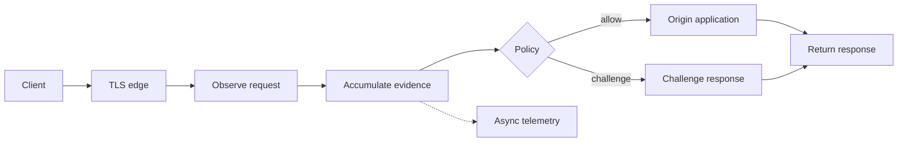

# Site Update: Showing the Moving Parts with Pele and deck.gl

I've been writing about systems whose interesting behaviour happens over time. A shopper compares something, adds it to their basket, then disappears. A gateway observes a request, accumulates evidence, and decides whether the origin application should ever see it.

A static diagram can show the components. It struggles to show what changed, what the system knows at that moment, and why the next decision follows.

So I've added two interactive explainers to the site: a vector-space explorer for the [recommendation primer](/blog/show-me-what-you-got-streaming-recommendations), and a request replay for the [Stylo.Bot gateway article](/blog/botdetection-part3-as-simple-as-possible).

They use two different tools: **deck.gl** for positions and distances, and **Pele** for a Mermaid-authored process diagram. Both share playback controls and an evidence inspector. You can pause, step backwards, change the inputs, and inspect the numbers behind the picture.

<datetime class="hidden">2026-10-23T20:00</datetime>
<!-- category -- Site Updates,JavaScript,Visualization,Mermaid,Pele,deck.gl,StyloBot,Recommendations -->

[TOC]

# Why I Wanted These

The recommendation series introduces quite a few mathematical ideas: vectors, centroids, distances, weights, decay, and eventually outcome prediction. Code gives readers something concrete to examine, but it still helps to *see* the relationship.

Take a weighted centroid. We can write out the sum, divide by the total weight, and explain that a basket addition might count more than a product view. A small interactive display lets you increase that weight and watch the summary move towards the basket item. The calculation becomes something you can question.

Time decay provides an even better example. If every observation loses the same proportion of its weight during an idle period, the average stays where it is. The **amount of supporting evidence** falls. Moving the dot towards the origin would teach the wrong thing.

The proxy articles have a different problem. Boxes labelled client, gateway and application don't quite explain what a protective reverse proxy does. The useful question is: **has this request reached my application yet?** A challenge response can come from the gateway while the origin remains untouched.

Those are the moments I wanted the site to show.

# Watch Evidence Become a Recommendation

[Open the vector explorer](/interactive/explainers/?view=vectors).


<iframe class="article-explainer" src="/interactive/explainers/?view=vectors&amp;embed=1" title="Interactive vector and centroid explorer" width="100%" height="1100" loading="lazy" style="border:0;border-radius:12px;"></iframe>

Start with **Next**. Each step adds an observation to a small synthetic session. The display shows the current summary, the remaining evidence mass, and the nearest eligible candidates.

There are a few useful experiments:

- Increase the basket event's weight and watch the summary move towards that observation.
- Change the memory half-life to alter how much earlier observations contribute.
- Wait 30 minutes. The supporting mass decays while the average stays in place. After enough idle periods, the example abstains from personal ranking.
- Lower the budget or choose a category. Ineligible candidates fade, and the list is recalculated from the eligible population.
- Switch to 3D to see the third coordinate. Select a candidate to inspect its actual values.

The filters matter. Retrieving four neighbours and then removing unavailable products can leave you with an empty list even when other suitable products exist. Here, eligibility is checked **before** selecting the nearest four.

## What the Picture Actually Represents

This first view uses three explicit teaching features: outdoors, electronics and home affinity. There is no embedding model hidden behind it. The coloured populations are generated examples, not clusters discovered by Leiden or another clustering algorithm.

The 2D view shows two coordinates. Ranking uses all three. That means two points can look close on the page while differing along the omitted dimension. The inspector and 3D view make that limitation visible.

> **A plot is a view of a representation.** For a real high-dimensional embedding, a PCA, UMAP or t-SNE projection would introduce further choices and distortions. A gap on the screen would need careful interpretation. This example starts with literal coordinates so we can examine the arithmetic first.

This is also why I chose [deck.gl's OrthographicView](https://deck.gl/docs/api-reference/core/orthographic-view) for the initial view and [OrbitView](https://deck.gl/docs/api-reference/core/orbit-view) for the optional 3D view. They let us work with non-geographic coordinates. Scatterplot, line and path layers show the candidates, nearest matches and changing summary without introducing React into the site.

The rendering code receives the results of a small, pure replay function. Scrubbing backwards recomputes the same state from the same observations. It doesn't try to reverse an animation or undo floating-point updates.

The central calculation is deliberately ordinary:

```javascript
// Decay the accumulated evidence, then add this observation.
const decay = 2 ** (-elapsedMinutes / halfLife);
mass *= decay;
sum = sum.map(value => value * decay);

mass += weight;
sum = sum.map((value, i) => value + weight * observation[i]);
const mean = sum.map(value => value / mass);
```

That gives us a position and its supporting mass. Mass is useful bookkeeping; it is **not a calibrated probability** that someone will buy a product. The visualisation doesn't manufacture that claim.

# Follow a Request Through the Proxy

[Open the proxy explorer](/interactive/explainers/?view=proxy).


<iframe class="article-explainer" src="/interactive/explainers/?view=proxy&amp;embed=1" title="Interactive protective proxy request replay" width="100%" height="1100" loading="lazy" style="border:0;border-radius:12px;"></iframe>

The second view answers a different question: **where does the request actually go?**

Choose an ordinary browser or a known crawler, then step through the allowed path. Next, choose an unfamiliar client or a scripted burst. The replay follows the challenge path and shows that the origin wasn't reached.

The evidence panel changes as observations become available. The ledger records the stages already visited. You can select an applicable diagram node to jump to that stage and inspect its explanation.

This is a teaching trace with synthetic evidence. It doesn't reproduce every Stylo.Bot detector or run a live gateway inside the browser. Its job is to explain the boundary between observation, policy and forwarding.

There are two architectural details I particularly wanted to preserve:

1. **TLS has a termination point.** This example puts a TLS edge before the gateway. The gateway receives readable HTTP from that edge. Being transparent to application code doesn't make arbitrary encrypted traffic readable.
2. **Background work has a separate branch.** Telemetry appears off the request path. The teaching replay gives it an inspection step, but that doesn't mean a production response must wait for every background update.

A successful challenge followed by a retry would be another request. This replay stops at the response to the request we're examining.

# Pele: Keep the Diagram Source, Add a Renderer Choice

I wanted to retain Mermaid's useful authoring model: a few lines of text that live alongside the article. Pele accepts Mermaid-style source and produces SVG, with its own layout and CSS-variable theming. Its [API](https://pele.run/api) offers synchronous rendering; its [theming documentation](https://pele.run/theming) describes the variables used to style the result.

The proxy topology is still readable text:



The interactive view renders the topology once for its current layout. Playback changes node highlighting and the accompanying evidence. It doesn't ask the layout engine to rearrange the graph at every step. On a narrow screen, the layout switches to a vertical flow.

Pele compatibility still needs some care. Its SVG classes and layouts differ from Mermaid's, and Mermaid theme variables don't automatically become Pele themes. Its [compatibility notes](https://pele.run/compatibility) also document differences around HTML labels and click callbacks. The explainer owns its node interactions explicitly.

I haven't changed the renderer for every existing diagram on the site. The new view gives us a concrete place to use Pele while ordinary Mermaid fences keep their established rendering path.

## Updating My Mermaid Enhancements Package

The site already uses my [Mermaid enhancements package](https://github.com/scottgal/mostlylucidweb/tree/main/mostlylucid-mermaid) for zoom controls, fullscreen inspection, exports and theme switching. Those controls mostly operate on SVG, so they can be useful with Pele too.

I've added an opt-in renderer adapter. The host supplies Pele's rendering function, which avoids making Pele a compulsory dependency for everyone using the enhancements:

```javascript
import {render} from 'pele';
import {
    configure,
    createPeleRenderer,
    initMermaid
} from '@mostlylucid/mermaid-enhancements';
import '@mostlylucid/mermaid-enhancements/styles.css';

configure({
    renderer: createPeleRenderer((source, options) => render(source, options))
});

await initMermaid();
```

**This adapter is in the repository source for the next package release. It isn't part of the published 1.0.0 npm package.** The site builds against that local source.

The enhancements also preserve computed SVG colours when creating a fullscreen or export copy. That's useful when colours come from CSS variables on a themed container: moving a bare clone elsewhere in the document can otherwise change its appearance.

# Fixing Diagrams That Steal Touch Scrolling

There was a reported annoyance with touch-enabled devices: scrolling through an article could unexpectedly start moving or zooming a Mermaid diagram.

Investigation found two problems. A click on the SVG enabled pan and zoom, including the click generated by a touch tap. The disable handler also called `enablePan(false)`. In the installed `svg-pan-zoom` API, `enablePan()` doesn't take a boolean; that call enables panning.

The fix makes gesture ownership explicit:

```javascript
// Reading mode: a finger swipe belongs to the page.
instance.disablePan();
instance.disableZoom();
instance.disableMouseWheelZoom();
svg.style.touchAction = 'pan-y pinch-zoom';

// The toolbar can explicitly enable diagram interaction.
// Disabling it calls disablePan(), rather than enablePan(false).
```

Tapping the diagram no longer arms pan and zoom. The toolbar button does. Disabling it returns gesture control to the page. The vector explorer uses the same explicit interaction choice.

In the browser touch-emulation check, a finger swipe scrolled the page by 251 pixels while the diagram's transform remained unchanged. There are regression tests for the tap and enable/disable behaviour too. That's a useful check of the reported failure, although it doesn't cover every physical device and browser combination.

# Keeping These Useful Inside Articles

The explainers have their own JavaScript entry point. A normal article doesn't load the deck.gl explainer bundle unless it includes the explainer page. The embedded versions are lazy-loaded, same-origin iframes, with a small source-checked message handler that adjusts their height as the content changes.

That height adjustment matters on mobile. An article reader shouldn't have to fight a scrolling viewport inside another scrolling page.

There are full-page links, screenshots, step descriptions and a data table alongside the graphical views. The vector view has an SVG fallback when WebGL is unavailable. Playback starts when requested, and animation respects reduced-motion preferences.

The standalone bundle is still a meaningful download. These examples don't establish a performance benchmark for either renderer; I wanted an explanation readers can inspect before making claims about scale.

The next useful applications are already in the writing: showing how a bank of decision questions produces the coordinates in [Part 1.5](/blog/show-me-what-you-got-part1-5-questions-as-coordinates), or following competing interventions through the later recommendation examples. Each needs a display that makes its particular decision easier to understand.

The implementation lives in the [explainer modules](https://github.com/scottgal/mostlylucidweb/tree/main/Mostlylucid/src/js/explainers), with the [standalone page](https://github.com/scottgal/mostlylucidweb/tree/main/Mostlylucid/wwwroot/interactive/explainers) and the [renderer adapter](https://github.com/scottgal/mostlylucidweb/blob/main/mostlylucid-mermaid/src/renderers.ts) alongside it.
