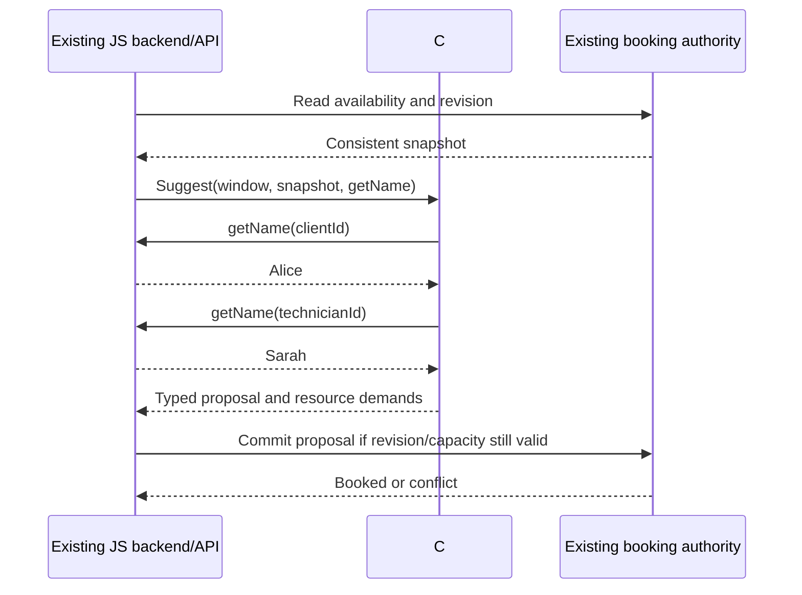

# Let's Talk About It: Practical Bidirectional Native .NET<->Node Interop

<datetime class="hidden">2026-11-13T12:00</datetime>
<!-- category -- .NET, C#, JavaScript, Node.js, Interop, Native AOT, WebAssembly, Packing, gRPC -->

Node API for .NET lets JavaScript and C# call each other within the same process. A Node application can load a managed assembly, pass a JavaScript function to C#, and receive a result that includes further calls back into JavaScript. A .NET application can also host Node and use its modules, APIs and event loop.

That becomes interesting when the two languages already own different parts of an application. Our JavaScript calendar app has a booking API and knows the customers and staff. Our C# [Mostlylucid.Packing](https://github.com/scottgal/mostlylucid.packing) library can find feasible appointments. We want to connect them while keeping the existing API responsible for the data.

The interesting decisions are who hosts the runtimes, how objects and callbacks travel between them, and what happens when a call becomes asynchronous or fails. Deployment changes the choices again: loading a managed assembly, shipping a native npm addon and running .NET in a browser each have different requirements. The [companion code](https://github.com/scottgal/mostlylucidweb/tree/main/samples/NodePacking) contains the complete examples; the snippets here connect those choices to the implementation.

[TOC]

## The host determines how the integration works

| Host | How the other language runs | Our example |
| --- | --- | --- |
| Node application | `node-api-dotnet` hosts .NET and loads an exported assembly | JS calls C#, which calls a supplied JS function |
| .NET application | `libnode` hosts Node on an environment thread | C# imports a JS module and awaits its API |
| Node with a Native AOT addon | Node loads a compiled `.node` library | A packaged C# function calls a JS name provider |
| Browser application | The .NET WebAssembly runtime loads browser-compatible .NET code | A separate recipe using browser imports and exports |

The first two are in-process integrations. Both runtimes still exist, with their own object lifetimes and garbage collectors. Native AOT changes how C# is compiled and distributed. Browser WebAssembly uses another interop API and runtime target.

## Keeping the application's existing API

The existing API already has the responsibilities the scheduler needs to work with:

| Operation | Behaviour |
| --- | --- |
| `readWindow(start, end)` | Asynchronously read a consistent availability snapshot and revision |
| `getName(id)` | Return a name from application data already loaded in memory |
| `tryBook(candidateId, version, commandId, demands)` | Atomically validate and commit a server-held proposal |

Alice wants gels, Beth wants a pedicure, and they want to start together. The scheduler knows the service stages and resource qualifications. The application supplies current bookings and names.

A request crosses the language boundary more than once, while the booking authority stays where it was:



The names are held only by the JS API. The scheduler receives a callback that can read them. That makes the two-way interaction visible: JS enters C#, C# calls JS, and execution returns to the original JS call.

## JavaScript callbacks inside a C# API

The C# interface expresses that relationship directly:

```csharp
public AppSuggestion Suggest(
    ScheduleWindow window,
    AvailabilityInput input,
    Func<string, string> getName)
```

`ScheduleWindow` has `Start` and `End` strings. `AvailabilityInput` contains the snapshot revision and resource/grid cells. Both are exported structs, passed by value. `AppSuggestion` and its nested appointment classes are exported result types.

In [AutoScheduler.cs](https://github.com/scottgal/mostlylucidweb/blob/main/samples/NodePacking/AppScheduler/AutoScheduler.cs), the method first computes a match. While projecting each appointment into the result, it calls the supplied function:

```csharp
ClientName = getName(appointment.ClientId),
TechnicianName = getName(appointment.Resources["technician"]),
```

From the C# method's point of view, these are ordinary delegate invocations. Node API for .NET adapts the JavaScript function into that delegate. Applying `[JSExport]` to the public class and contract types lets the source generator produce the bindings and TypeScript declarations. See Microsoft's [module workflow](https://microsoft.github.io/node-api-dotnet/scenarios/js-dotnet-module.html).

The callback is synchronous because its contract returns `string`. It reads a preloaded map in the fixture. If names come from a database or HTTP API, batch-load them before entering the scheduler, or design an asynchronous callback and return type. Passing an `async` function to this synchronous delegate returns a Promise where a string is expected; the sample tests that this fails.

The synchronous signature also rules out blocking on an asynchronous lookup with `.Result` or `.Wait()`. The JavaScript thread may be the thread that needs to run the continuation, so the wait can prevent the operation from completing.

## A .NET assembly becomes a Node module

The Node package `node-api-dotnet` hosts .NET within the Node process. The loader in [auto-scheduling.mjs](https://github.com/scottgal/mostlylucidweb/blob/main/samples/NodePacking/auto-scheduling.mjs) imports it and loads our exported assembly:

```javascript
import dotnet from 'node-api-dotnet/net10.0';
const { AutoScheduler } = dotnet.require(assemblyPath);
const engine = new AutoScheduler();
```

`assemblyPath` is an absolute filesystem path to `AppScheduler.dll`; the sample resolves it relative to `import.meta.url`. This is an exported module, so we use `dotnet.require()`. For arbitrary managed assemblies accessed through their .NET namespaces, use `dotnet.load()` instead. The [JS API reference](https://microsoft.github.io/node-api-dotnet/reference/js/) describes the distinction.

Once the module is loaded, the application can supply its existing lookup function:

```javascript
const snapshot = await api.readWindow(start, end);
const proposal = engine.suggest(
    { start, end },
    snapshot,
    id => api.getName(id)
);
```

The `await` finishes the application read before C# starts searching. The function remains a JavaScript function: there is no JSON representation of it and no RPC endpoint for name lookups. Calls to `getName` happen while `suggest` is executing.

The wrapper materializes the returned properties into ordinary JS data once. This avoids repeatedly reading managed getters while building the HTTP response. It also prevents a managed object's prototype properties from disappearing when the HTTP layer serializes it. JSON at that later browser boundary is separate from serialization between Node and C#.

The returned proposal contains IDs for the application to act on and names obtained through those callbacks:

```text
Alice: gels with Sarah
Beth: pedicure with Anna
```

In your existing calendar UI, turn the returned appointments into `title`, `start` and `end` event objects. The supplied [calendar adapter](https://github.com/scottgal/mostlylucidweb/blob/main/samples/NodePacking/calendar-events.mjs) demonstrates that mapping. A FullCalendar app can add the returned array with `calendar.addEventSource(events)` using its documented [event-source API](https://fullcalendar.io/docs/Calendar-addEventSource).

## Typed objects still need a marshalling design

The main API passes typed objects directly. Structs are copied by value. Exported classes are wrappers around managed objects, so a property read can call a .NET getter. Our JS wrapper reads the result once into data suitable for the existing web app.

The generated declarations describe those fields and callback signatures. The loader itself returns `any`; connect the module/wrapper to its generated declaration file when using TypeScript. Declarations do not validate data arriving from an HTTP request.

Two preview issues affected this example:

- The generator failed on the nested appointment-array result when represented as a struct. Exported result classes worked. Primitive snapshot arrays kept the input conversion straightforward.
- Struct declarations contain an unresolved `ValueType` base. Our consumer type check uses `skipLibCheck` for declaration internals, while still checking consumer arguments and fields. It does not certify the entire generated declaration output.

Strings still need conversion and copied objects still allocate. Avoid a call for every capacity cell or a getter inside a tight UI loop. Read availability in bulk and pass the snapshot once. The name callback demonstrates re-entry over preloaded data; it is not a reason to perform one database query per displayed field.

Use explicit timestamp offsets. The fixture's slots and revisions fit safely in JavaScript numbers; IDs or counters requiring the full 64-bit integer range need an agreed string or BigInt mapping.

## Booking state still belongs to the application

The scheduler needs a consistent view of availability, but it has no reason to own the booking database. A snapshot gives C# the input for one calculation while the application keeps responsibility for changes.

The current packing API expects an `ICalendarStore`, so the example supplies a per-call, read-only adapter. Its read returns the snapshot received from JavaScript. Its write methods throw `NotSupportedException`, directing commits back to the application API. There is no C# SQLite connection on this integration path.

`AvailabilityInput` uses equal-length arrays for resource IDs, grid slots, capacities and used units. Row `i` across those arrays represents one resource/time cell. Primitive arrays avoid the preview generator's nested-struct-array issue. The conversion is kept in an adapter; an existing API can continue returning its own event or resource schema.

The fixture's catalog and service rules are fixed C# configuration, with stable resource IDs exposed to the JS fixture. A real integration should load or map the application's catalog at startup and include eligibility/configuration changes in its revision policy. Names and booking state continue to come from the existing API.

### A computed result can already be stale

A suggestion can become stale before the user accepts it. The Node wrapper retains the proposal's resource demands on the server and exposes only its display fields and candidate ID to the browser.

When the user accepts, the wrapper calls:

```javascript
return api.tryBook(
    candidateId,
    trusted.version,
    commandId,
    trusted.demands
);
```

The API must validate and write atomically. It cannot check availability, yield to another writer, then insert the booking unconditionally. In a durable implementation, the revision check, capacity check, booking write and idempotency record belong in the same transaction or equivalent conditional operation.

The fixture implements a conservative revision check: any intervening booking causes `SnapshotChanged`. A production API might use resource-scoped versions or recheck the entire demand set instead. The returned snapshot revision is evidence of the read, not a lock.

The JS fixture has no `await` between its validation and state update, which makes that sequence indivisible on its one event loop. That does not provide transaction safety across processes or machines. Replace it with the existing API's atomic booking operation.

Use the same command ID when retrying an operation. The API returns the stored reply for an identical retry and rejects reuse of that ID with different input. Keep the server's retained demands; don't accept edited demands from the browser.

### The lifetime of a proposal

Each scheduling flow retains its latest offer. A new search replaces it. Scope that flow to an authenticated booking workflow, and add bounded expiry/cleanup for server-held proposals in an application. The native engine itself retains no reservation state.

The fixture assumes Alice is allowed to book for Beth. Caller authorization remains the application's responsibility. Its snapshot adapter also needs the application's existing commitments, holds and capacities; a calendar's visible rectangles alone won't provide equipment usage or service-reset requirements.

## When the .NET application is the host

The same separation works when C# is the application entry point. Instead of loading a DLL into Node, the .NET application embeds Node and calls the existing JavaScript API. The API still owns reservation state; hosting it from C# does not require moving that state into a .NET store.

### The runtime brings an event loop

The [EmbeddedNode project](https://github.com/scottgal/mostlylucidweb/blob/main/samples/NodePacking/EmbeddedNode/EmbeddedNode.csproj) references `Microsoft.JavaScript.LibNode` `20.1800.203`. That is the native runtime pairing tested here with `Microsoft.JavaScript.NodeApi` `0.9.36`.

Hosting Node means taking responsibility for its platform and environment:

```csharp
using var platform = new NodeEmbeddingPlatform(new NodeEmbeddingPlatformSettings
{
    LibNodePath = nativePath
});
using var runtime = platform.CreateThreadRuntime(AppContext.BaseDirectory,
    new NodeEmbeddingRuntimeSettings
    {
        MainScript = "globalThis.require = require('module').createRequire(process.execPath);"
    });
```

`nativePath` selects the packaged `libnode.dll`, `libnode.dylib` or `libnode.so` for the target runtime identifier. The complete program handles both the `runtimes/<rid>/native` layout and a flattened publish directory. A single process has one Node platform; the thread runtime supplies the environment and event loop.

The bootstrap creates a CommonJS `require` for module loading. The base directory is the compiled application's output directory. Copy your JS files there and place any required `node_modules` where Node can resolve them. The project marks the two `.cjs` files with `CopyToOutputDirectory`.

A generic installed `node` executable or shared `libnode` is not automatically a replacement for the package's embedding build. Microsoft's [embedding path remains experimental](https://microsoft.github.io/node-api-dotnet/scenarios/dotnet-js.html), and the managed/native versions must be compatible.

### Promises connect the APIs

[ExistingCalendarApi.cs](https://github.com/scottgal/mostlylucidweb/blob/main/samples/NodePacking/EmbeddedNode/ExistingCalendarApi.cs) wraps the JS module behind typed C# methods. Its constructor creates the application API and retains it with a `JSReference`.

With the JS API wrapped behind C# methods, the application can compose its asynchronous reads and writes with the scheduler:

```csharp
var snapshot = await runtime.RunAsync(() => api.ReadWindowAsync(window));
var offer = runtime.Run(() => engine.Suggest(window, snapshot, api.GetName));
var booked = await runtime.RunAsync(() =>
    api.TryBookAsync(offer, Guid.NewGuid().ToString()));
```

The first call enters JS, invokes `readWindow`, awaits its Promise and copies the resulting arrays into `AvailabilityInput`. The second runs the C# search; `api.GetName` calls JS while constructing the result. The last sends the proposed demands back to JS for an authoritative commit.

The adapter is where a JavaScript Promise becomes something C# can await:

```csharp
var promise = (JSPromise)_api.GetValue()
    .CallMethod("readWindow", window.Start, window.End);
return await promise.AsTask(ReadSnapshot);
```

`ReadSnapshot` copies the fields into typed .NET arrays in the adapter. The Promise result is read while execution is on the JS context. The returned snapshot contains .NET strings, arrays and numbers, so the caller can use it after the JS call finishes.

### Values belong to a JavaScript environment

Create, access and convert `JSValue`, `JSObject` and `JSArray` values within `runtime.Run` or `RunAsync`. Do not keep a raw `JSValue` from a callback and access it later on a thread-pool thread.

The API object must survive several calls, so the adapter holds a `JSReference`. Each operation retrieves its value inside the JS runtime. During shutdown, the program disposes that reference on the JS thread, then disposes the runtime and platform. This is the lifetime pattern described in the library's [threading and async guidance](https://microsoft.github.io/node-api-dotnet/features/js-threading-async.html).

The C# search in this example runs on the embedded JS thread because it calls JS for names. For heavier computation, split the flow: copy the snapshot to managed data, compute away from the JS thread, then return to that thread for callbacks or result conversion. Moving a delegate to `Task.Run` does not make its JS handles safe to access there.

### A JavaScript return value might be a Promise

The shared [formatter module](https://github.com/scottgal/mostlylucidweb/blob/main/samples/NodePacking/format-booking.cjs) shows what changes when an existing JavaScript function becomes asynchronous. It reads an offer object and uses Node built-ins:

```javascript
exports.formatAsync = async offer => {
    await delay(1);
    return exports.format(offer);
};
```

`delay` is `setTimeout` from `node:timers/promises`. The synchronous `format` function formats the time and reads `clientName` and `technicianName`, falling back to IDs for the older benchmark fixture.

The C# adapter constructs a `JSObject` with the offer fields and a `JSArray` of appointments. Calling the module directly then takes one line:

```csharp
return (string)module.CallMethod("format", value);
```

There is no JSON string in this path. The [BookingFormatter adapter](https://github.com/scottgal/mostlylucidweb/blob/main/samples/NodePacking/EmbeddedNode/BookingFormatter.cs) is where the field copies happen.

For an async JS function, its result is a Promise, not the final string:

```csharp
var promise = (JSPromise)module.CallMethod("formatAsync", ToJS(offer));
return await promise.AsTask<string>(value => (string)value);
```

The caller creates the formatter inside `runtime.RunAsync`, where its module value is valid for the call. This returns a managed `Task<string>`. The conversion finishes on the JS context before the string leaves it. We test that the asynchronous result matches the synchronous result.

Making a method async does not offload CPU work. The delay above gives Node's event loop actual asynchronous work to complete. A busy JavaScript loop inside `formatAsync` would still block that event loop.

## Exceptions cross the boundary too

A thrown JavaScript error arrives in C# as `JSException`. A rejected Promise converted with `AsTask` faults the Task with the same exception type:

```csharp
try
{
    await runtime.RunAsync(() =>
        new BookingFormatter(runtime.Import(modulePath)).FormatAsync(offer));
}
catch (JSException error)
{
    Console.Error.WriteLine(error.Message);
}
```

In the other direction, a thrown C# exception arrives in JavaScript as an `Error`. The tests exercise invalid C# input, a JS name callback that throws, an invalid synchronous formatter call, and a rejected formatter Promise. They also make a valid call afterwards to check that ordinary call failures haven't made the environment unusable.

The cross-language checks in `npm run test:interop` exercise both synchronous throws and Promise rejections:

```text
PASS: C# called JavaScript for availability and names.
PASS: Existing JavaScript API committed the booking.
PASS: JavaScript Promise awaited as a C# Task.
PASS: JavaScript throw arrived as JSException in C#.
PASS: JavaScript Promise rejection arrived as JSException in C#.
```

Expected booking conflicts remain normal results such as `SnapshotChanged`; malformed input and programming errors throw. Handle those separately so an unavailable slot doesn't become an unexplained server error. See the library's [exception mapping](https://microsoft.github.io/node-api-dotnet/reference/exceptions.html).

## Native AOT changes what npm has to ship

A managed assembly needs .NET installed beside Node. Native AOT can compile an exported C# library into a `.node` addon, which Node loads directly. The application still owns bookings through its JS API.

The [NativeAddon project](https://github.com/scottgal/mostlylucidweb/tree/main/samples/NodePacking/NativeAddon) is a tested packaging proof. It exports this function:

```csharp
[JSExport]
public static string DescribeAppointment(string clientId, string serviceId,
    string technicianId, Func<string, string> getName)
    => $"{getName(clientId)}: {serviceId} with {getName(technicianId)}";
```

This keeps the two-way callback in the package: Node calls native C#, which calls the supplied JS function for names. It deliberately exports a small helper, not the full scheduler.

The build still starts with an exported C# method, but these properties change its output:

```xml
<PublishAot>true</PublishAot>
<PublishNodeModule>true</PublishNodeModule>
<PackNpmPackage>true</PackNpmPackage>
```

The project directs publish output into `native/<rid>` and tarballs into `pkg`. Its [package.json](https://github.com/scottgal/mostlylucidweb/blob/main/samples/NodePacking/NativeAddon/package.json) includes the loader, declarations and `.node` binaries. The CommonJS loader selects a runtime identifier from Node's platform and architecture, including a separate Linux musl path.

The macOS ARM64 build and package test used:

```shell
dotnet publish NativeAddon -c Release -r osx-arm64
node NativeAddon/test.cjs
```

Publishing also runs `npm pack`. Install the generated tarball into a separate Node project:

```shell
npm install /absolute/path/to/NativeAddon/pkg/mostlylucid-native-interop-demo-0.1.0.tgz
```

To the consuming Node app, the installed package exposes a function:

```javascript
const { describeAppointment } = require('@mostlylucid/native-interop-demo');
const text = describeAppointment('alice', 'gels', 'sarah', id => api.getName(id));
```

I tested the installed tarball as well as the local output. It contains four files, including an approximately 1.7 MB `.node` binary, and has no `node-api-dotnet` npm runtime dependency. The package is a private demo and was not published to a registry.

For a distributable release, build each supported RID on an appropriate runner, collect the binaries, then pack the complete platform set. The example tarball contains only macOS ARM64. Test glibc and musl separately on Linux. A platform-specific addon isn't made portable by putting it in an npm tarball. Microsoft's [Native AOT module guide](https://microsoft.github.io/node-api-dotnet/scenarios/js-aot-module.html) covers the build model.

The project pins runtime/compiler `10.0.14` because the SDK's older default produced an advisory warning during publishing. Keep the compiler/runtime patch level in the release process. The build warning links to the [runtime advisory](https://github.com/advisories/GHSA-p3jp-9v83-76w9).

### The scheduler's remaining AOT work

The packing core currently uses reflection-based `System.Text.Json` calls to construct canonical definitions, query keys and candidate IDs. Those calls need an AOT-safe implementation or preserved metadata, followed by a published-artifact test. Removing JSON from the language boundary didn't remove the core library's internal serialization.

The small addon verifies packaging, native loading and callbacks. It does not establish Native AOT compatibility of `AutoScheduler`, and no AOT scheduling performance is claimed. Keep that work separate from the already-tested managed integration.

## WebAssembly moves the host into the browser

Moving the same functionality into a browser changes the integration boundary. The .NET browser interop route uses `System.Runtime.InteropServices.JavaScript`. A browser cannot load the `.node` binary above; it needs browser-compatible .NET code and the generated WebAssembly runtime assets.

The [WasmSketch](https://github.com/scottgal/mostlylucidweb/tree/main/samples/NodePacking/WasmSketch) shows the corresponding two-way helper:

```csharp
[JSImport("getName", "calendarApi")]
private static partial string GetName(string id);

[JSExport]
public static string DescribeAppointment(string clientId, string serviceId, string technicianId)
    => $"{GetName(clientId)}: {serviceId} with {GetName(technicianId)}";
```

The containing class is `static partial`. These attributes come from the BCL browser interop namespace. The JS host registers its existing name lookup and obtains the .NET exports:

```javascript
const runtime = await dotnet.create();
runtime.setModuleImports('calendarApi', { getName });
const exports = await runtime.getAssemblyExports(runtime.getConfig().mainAssemblyName);
const text = exports.BrowserInterop.DescribeAppointment('alice', 'gels', 'sarah');
```

Microsoft's [browser app guide](https://learn.microsoft.com/en-us/aspnet/core/client-side/dotnet-interop/wasm-browser-app?view=aspnetcore-10.0) provides the tools and template for that host:

```shell
dotnet workload install wasm-tools
dotnet new install Microsoft.NET.Runtime.WebAssembly.Templates
dotnet new wasmbrowser -n BrowserInteropDemo
```

The sketch provides overlay C# and JS files for that template. Publish the browser project and serve its complete generated asset directory beside the JS loader. An npm package could distribute that loader and asset directory for your app's build to copy into its public assets. Preserve the runtime files and URL relationships; copying only a `.wasm` file is insufficient.

Browser WebAssembly AOT uses its own `RunAOTCompilation` publish setting and toolchain. It is distinct from the Native AOT `PublishAot` setting used for `.node`. The [WebAssembly AOT guidance](https://learn.microsoft.com/en-us/aspnet/core/blazor/webassembly-build-tools-and-aot?view=aspnetcore-10.0) explains the performance/download-size tradeoff.

For browser-side scheduling, the app would fetch a snapshot, compute suggestions locally and send the accepted proposal to its existing server API. The server still authorizes and atomically validates the booking. It must rebuild or verify the service/resource demands, including qualifications and duration, before writing. Browser-computed demands are untrusted input. A Web Worker could keep heavy computation off the calendar's UI thread, with snapshots and results transferred as messages.

The browser adapter, packing-core compatibility and download/startup cost need validation. `wasm-tools` was not installed in this environment, so the sketch was not built or executed. It is a documented next step, not a published WASM scheduler or a performance result.

## Where the integration can go wrong

| Symptom | Check or fix |
| --- | --- |
| `ERR_PACKAGE_PATH_NOT_EXPORTED` for `net10.0.js` | Use `node-api-dotnet/net10.0` with the pinned `0.9.36` package |
| Cannot find the managed module | Build first and resolve the DLL with an absolute filesystem path |
| A dependency DLL is missing | Copy the module's managed dependencies; the sample enables `CopyLocalLockFileAssemblies` |
| `Class not registered for JS export` | Export the DTO classes as well as the service class |
| JS properties vanish in an HTTP JSON response | Materialize the managed wrapper's fields into JS data |
| A callback reports that a string was expected | Check for an `async` callback passed to `Func<string,string>` |
| A JS handle fails after an `await` or on another thread | Convert inside the environment callback or retain a `JSReference` and access it through the runtime |
| Embedded Node cannot resolve a module | Check the output directory, `.cjs`/ESM choice and `node_modules` location |
| Search finds nothing although the UI looks empty | Include client capacity cells, equipment and the full reset footprint in the snapshot |
| A proposal fails after a successful search | Refresh the snapshot; the write API must recheck current state |
| A failed request is retried as a duplicate booking | Reuse the original command ID and enforce idempotency in the write API |

C# and JavaScript can each re-enter the other. Keep the callback contract small, avoid blocking waits and decide who owns long-lived callbacks. This sample uses the name callback only during a synchronous search and awaits API Promises through the runtime. Request cancellation and durable network retries need their own API contract; cancelling a wait is not a transaction rollback.

## What the measurements tell us

The following measurements are retained from the original standalone fixture: Node calling a managed C# scheduler with its in-memory SQLite test store, using typed objects, JSON or gRPC. They do not measure the new application's API read, JS name callbacks, commit transaction, Native AOT helper or browser code.

That separation matters. The numbers compare language/transport boundaries around one workload; they aren't a latency prediction for the complete integration above.

### Typed objects, JSON and the gRPC boundary

Removing JSON serialization replaces it with object marshalling and property access. To measure those costs, the [benchmark harness](https://github.com/scottgal/mostlylucidweb/tree/main/samples/NodePacking/bench) now compares three paths:

- Typed objects in-process, including reading every returned field into the JS snapshot.
- JSON in-process, including C# serialization and JavaScript parsing.
- A gRPC sidecar, carrying that JSON response in a protobuf message.

All three call the same C# search and build the same result model. The old `FindTogetherJson` method remains only for the comparison and the sidecar adapter. This standalone fixture uses `FindTogether` for its typed path. The application's single-authority path above uses `AutoScheduler.Suggest` instead.

The benchmark reads the full result on every path. Timing only the creation of a managed object wrapper would leave out work the calendar app has to do later. The harness checks the returned candidate and assignments across all three paths, and each measured search performs the feasibility checks again.

#### Latency and sequential throughput

Measured on an Apple M5, macOS ARM64, 32 GiB RAM, Node `v22.15.0` and .NET SDK `10.0.201`. The sidecar uses `Grpc.AspNetCore` `2.85.0`; the Node client uses `@grpc/grpc-js` `1.14.7`. Both .NET hosts use workstation GC.

Each of three fresh-process trials warms up each operation with 200 calls, then measures 1,500 calls at concurrency one. The three modes rotate through the run order. Each table entry is the median of that statistic across the trials. `p50` is median call latency; `p95` is the time within which 95% of a trial's calls completed.

| Work per call | Path | p50 | p95 | Sequential calls/s |
| --- | --- | ---: | ---: | ---: |
| Echo a 1 KiB field | Typed objects + JS snapshot | 1.9 µs | 3.0 µs | 400,953 |
| Echo a 1 KiB field | JSON interop | 1.2 µs | 2.3 µs | 583,449 |
| Echo a 1 KiB field | gRPC + JSON response | 138.5 µs | 178.5 µs | 6,803 |
| Find the joint appointment | Typed objects + JS snapshot | 621.1 µs | 740.5 µs | 1,580 |
| Find the joint appointment | JSON interop | 574.8 µs | 779.2 µs | 1,678 |
| Find the joint appointment | gRPC + JSON response | 717.7 µs | 1100.2 µs | 1,252 |

**The typed search was slower at p50 in this fixture.** It took about 621 µs, compared with 575 µs through JSON and 718 µs through gRPC. Within paired trials, reading the typed result added roughly 33–87 µs over the JSON version. The typed p95 was lower in the aggregated table, so the measurements don't support a blanket claim that either in-process path wins at every percentile.

Class wrappers and the explicit JS snapshot explain why avoiding serialization needn't be a speedup. We read fields through the interop layer and create JS objects for the application. For this small payload, the JSON encoder/parser pair competes well with that work. A different payload, a different DTO shape or improved value-type marshalling could change the result; those need their own measurements.

The echo control passes a 1 KiB text field through each path. Its typed version uses a value struct, then reads the returned field. Its JSON version passes and parses a JSON string. Even here, direct marshalling has work to do: it reads and copies the object fields. Removing JSON alone doesn't make the boundary free.

The scheduler's response is 495 bytes when represented as JSON. That is a size comparison for the typed result, not a claim that the typed path sends a 495-byte wire message.

#### What is the gRPC overhead?

The gRPC service calls `FindTogetherJson` over a reused plaintext HTTP/2 connection on loopback TCP. The client follows the [channel-reuse guidance](https://learn.microsoft.com/en-us/aspnet/core/grpc/performance?view=aspnetcore-10.0), so connection establishment happens before the measured calls. There is no TLS, proxy or remote network in this test.

Across paired trials, its search p50 was about 119–282 µs higher than JSON interop and 32–221 µs higher than the typed path. That includes protobuf handling, HTTP/2, thread scheduling and JavaScript callback/Promise handling. A fully typed protobuf response would have different serialization costs. These numbers describe the adapter built here, rather than a fixed overhead for gRPC.

The differences are small for a single calendar-button click. They matter more when the app searches repeatedly as constraints change or makes many engine calls per request. Keep calls at the level of a scheduling operation rather than fetching individual values through an RPC API.

This was a development-machine run with natural garbage collection and other system activity. The calls/s column reports sequential throughput at concurrency one. Server capacity under concurrent load, reservation writes and write contention need separate tests.

#### Memory: count the whole arrangement

RSS is the resident memory reported for a process. It includes runtime code, libraries, buffers and retained allocator memory as well as managed heaps.

| Arrangement | Initialized RSS | RSS after workload |
| --- | ---: | ---: |
| Typed objects + JS snapshot | 107.1 MiB | 128.8 MiB |
| JSON interop | 107.3 MiB | 124.9 MiB |
| gRPC + JSON response, combined | 169.2 MiB | 236.3 MiB |

These are median snapshots after the first valid search and after the warmups and timed workloads. No forced V8 or .NET collection is performed. The baseline Node process was about 40 MiB RSS.

The typed path did not reduce RSS compared with JSON here. Removing text buffers can be offset by managed wrappers, copied objects and their lifetimes. An RSS snapshot cannot isolate the allocation cost of serialization.

For gRPC, the table adds the Node client's RSS to the sidecar's working set. Looking only at the client would hide most of the arrangement. Summed RSS can count shared pages more than once, and collection timing affects retained memory. These are not unique physical-memory, peak-memory or leak measurements.

The raw results retain each process's measurements separately. Containers, GC settings, load, payloads and a sidecar shared by several Node processes can change the comparison. Loading .NET inside Node still means running both V8 and the CLR, with their separate heaps and garbage collectors.

#### Synchronous calls still block Node's event loop

Both in-process search methods run synchronously on the calling Node thread. Returning a typed object doesn't change where the search runs. The gRPC client awaits a response while the work happens in the other process.

The harness schedules a 10 ms timer, then issues 100 searches. Additional timer delay was about **31–53 ms for typed objects**, **30–33 ms for JSON interop**, and **0–0.9 ms through gRPC**. The burst consumes the returned data, including the typed snapshot or JSON parse, but omits the latency loop's per-call assertions and timing.

That burst would also delay unrelated callbacks on the same Node thread. Bound the search work and measure event-loop delay alongside request latency. If the engine moves to a worker thread or an asynchronous API, decide which thread executes the work and owns its state. A Promise around a synchronous call still runs it on the current thread.

#### Running the comparison

```shell
npm run build:bench
npm run bench
npm run bench:summary
```

The runner starts and stops its own loopback sidecar, uses fresh clients, and checks result equivalence. [Raw results](https://github.com/scottgal/mostlylucidweb/blob/main/samples/NodePacking/bench/results.json) include trial values, environment details and hashes of the measured assemblies. `BENCH_TRIALS` and `BENCH_ITERATIONS` configure the run.

These measurements cover searches and a control call. They do not benchmark reservation writes, TLS, a remote service, Native AOT, concurrent users, the browser or the full stylo.bot engine.

## Trying the examples

The [companion sample](https://github.com/scottgal/mostlylucidweb/tree/main/samples/NodePacking) requires .NET 10 and Node 22. Keep the packing and web repositories beside each other:

```shell
git clone https://github.com/scottgal/mostlylucid.packing.git
git clone https://github.com/scottgal/mostlylucidweb.git
cd mostlylucidweb/samples/NodePacking
npm ci
npm run build:app
npm run app
npm run reverse
npm run test:interop
```

`npm run app` exercises the Node-hosted integration discussed above:

```text
Alice: gels with Sarah
Beth: pedicure with Anna
C# called JavaScript for names: true
Existing API booked: true
Retry returns same reservation: true
Existing API accepted stale offer: false
```

`npm run reverse` starts with C#. It imports the JavaScript API, reads a snapshot, asks JavaScript for names, commits the booking through that API and formats the result. `test:interop` also checks thrown JS errors and rejected Promises.

These paths use the JavaScript API as their reservation authority. The executable fixture uses an in-memory JavaScript implementation of that API. In your app, replace those methods with calls to the existing repository or service. It is not a supplied production database adapter.

The [README](https://github.com/scottgal/mostlylucidweb/blob/main/samples/NodePacking/README.md) explains the source-path override and the separate benchmark fixture. The examples in this article come from these projects.

## What has been verified

The managed integrations, synchronous callbacks, Promises, exception handling, single-authority booking flow and macOS ARM64 Native AOT npm helper were executed locally. The npm tarball was installed and called from a separate consumer. The tests cover stale proposals, command retries, callback failures, invalid snapshot input and JS-owned names.

The existing-calendar API remains an executable in-memory fixture to replace with your application's API. Its durable transaction, authentication and cancellation policy are integration work. The full scheduler's Native AOT port and the browser WebAssembly sketch are not validated releases.
