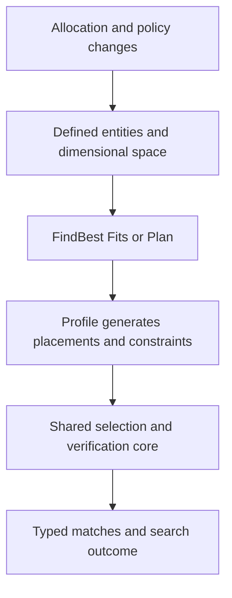

# mostlylucid.packing API guidance

`mostlylucid.packing` will provide defined dimensional spaces with a small search API. Define the entities, units, availability and rules once. Application calls then look like `rota.FindBest(from, to, size, restrictions)` or `warehouse.FindBest(from, to, size, restrictions)`.

This describes the proposed package API. The first standalone implementation is in [scottgal/mostlylucid.packing](https://github.com/scottgal/mostlylucid.packing), with a local checkout beside this repository. It implements typed calendar queries, fixed treatment stages, same-start grouped holds, SQLite persistence, basic rotas and bounded 3D packing. The standalone README documents the current callable API; calendar navigation, supplied-pool relevance ranking and SQLite viewport projections are now implemented. Broader string, spatial-view and tile-cache contracts below remain design guidance.

## Package and repository identity

The repository and primary NuGet package are `mostlylucid.packing`. Use `Mostlylucid.Packing` for the C# root namespace. The current repository owner and NuGet workflows suggest `scottgal/mostlylucid.packing` and the NuGet account `mostlylucid`; use those as the extraction defaults.

The primary package should contain the space definitions, typed requests and results, generators, feasibility checks, greedy strategy and incremental planning support. Use `mostlylucid.packing.sqlite` for the first database provider and `mostlylucid.packing.relevance` for the connection to Mostlylucid.Relevance. An optional `mostlylucid.packing.ortools` companion can supply CP-SAT through the same API. The repository can contain these projects and release them together.

## Define the space once

A space describes the coordinates in which placements can vary, the entities providing capacity, and the rules governing valid placements. Its definition also supplies ranking policy and a solver strategy. Each profile defines what its coordinates and size mean.

| Space | `from` and `to` | `size` | Typical restrictions |
| --- | --- | --- | --- |
| Linear | Scalar search bounds | Length | Clearance and allowed regions |
| Calendar | Dates delimiting a search window | Service duration | Service, client, equipment and accessibility |
| Rota | Dates delimiting a search window | Shift duration | Qualifications, location and employee eligibility |
| Spatial 3D | Minimum and maximum coordinates of a search region | Width, depth and height | Allowed rotations, clearance and container eligibility |
| Irregular spatial profile | Bounds of a search region | A shape with defined geometry | Orientations, spacing and collision policy |

Entity definitions carry stable IDs and typed domain data. A technician can supply time and qualifications. A station can supply seats. A physical container supplies a bounded region and a weight limit. An appointment placement can use several entities together.

Use typed metadata such as `BookingRequirements`, `ShiftRequirements` and `BoxRestrictions`. Named fields make units and validation discoverable in IntelliSense. Applications can supply their own metadata type through an adapter.

## Everyday calls

These call shapes illustrate the proposed facade. The concrete definitions will be supplied by the calendar, rota and spatial profiles.

```csharp
var rota = Pack.Rota(employees, rules: rotaRules);

var shift = rota.FindBest(
    from: mondayMorning,
    to: mondayEvening,
    size: TimeSpan.FromHours(4),
    restrictions: new ShiftRequirements
    {
        RequiredSkills = ["manicure"],
        LocationId = "salon-one"
    });
```

```csharp
var calendar = Pack.Calendar(resources, services, rules: bookingRules);

var appointment = calendar.FindBest(
    from: tuesdayMorning,
    to: tuesdayEvening,
    size: TimeSpan.FromMinutes(45),
    restrictions: new BookingRequirements
    {
        ClientId = "customer-42",
        ServiceId = "pedicure",
        NeedsAccessibleStation = true
    });
```

```csharp
var warehouse = Pack.Spatial3D(containers, rules: loadingRules);

var placement = warehouse.FindBest(
    from: new Point3(0, 0, 0),
    to: new Point3(1200, 800, 1000),
    size: new Size3(400, 300, 250),
    restrictions: new BoxRestrictions
    {
        AllowedRotations = AxisRotations.All,
        Clearance = 5
    });
```

The spatial definition declares the length unit, such as millimetres. The calendar definition declares its time zone, booking granularity and service timing rules. The same call pattern gives each profile its own meaningful coordinate and extent types.

## Keep the public verbs small

| Operation | Contract |
| --- | --- |
| `FindBest(from, to, size, restrictions)` | Return the highest-ranked feasible placement found within configured search limits |
| `Find(from, to, size, restrictions, limit)` | Return ranked alternatives for one request |
| `Fits(at, size, restrictions)` | Check one exact placement against current fixed allocations and eligibility rules |
| `Plan(requests)` | Choose compatible placements for a batch of requests |

Provide overloads that search the space's full configured bounds when callers supply only `size` and restrictions. Put candidate limits, search budgets and objective policy in the space definition, with per-call overrides for callers that need them.

`Fits` checks the proposed allocation and its resource bundle. Complete-plan validation additionally checks every required request. A required request elsewhere in the space must not make an otherwise valid individual offer fail a `Fits` call.

`Find` returns alternatives that are individually feasible. `Plan` selects a combination that can coexist. For the Anna and Cara example, the batch planner considers both customers together before assigning either technician.

A live calendar can expose `TryHold(match, lifetime)` through a configured reservation authority. That authority reconstructs the accepted placement and checks current policy and capacity atomically. Confirmation, expiry and cancellation use the application's existing booking state. A static spatial space can instead apply a chosen layout to its next planning snapshot.

## Navigate and query a space

Keep the direct calls for common searches, and add an immutable query object for composition. These proposed calls return the same typed matches as `FindBest`.

```csharp
var query = rota.Query()
    .During([mondayMorning, wednesdayAfternoon])
    .OfSize(TimeSpan.FromMinutes(45))
    .Where(requirements);

var next = query.Next(after: cursor);
var previous = query.Previous(before: cursor);
var nearest = query.Nearest(to: preferredTime);
var top = query.OrderBy(Criteria.PreferenceFor(customerId))
    .ThenBy(Criteria.Start)
    .TopK(5);
```

`During` accepts a finite union of periods. Normalise overlaps and adjacent periods, deduplicate matches, and retain genuine gaps. The whole occupied placement must fit in that union. Recurring weekday or business-hour selectors expand only inside the query's bounded horizon using its time zone and exception calendar.

`Next` and `Previous` traverse a declared order with a stable ID tie-breaker. A temporal profile normally orders by start, resource and placement ID. A spatial profile must name an axis or traversal order. A cursor identifies the complete ordering key and the query/version it belongs to. Moving to a previous match uses the same ordering in reverse. A separate end-time restriction expresses a requirement to finish before a deadline.

`Nearest` requires a named metric. Temporal proximity can use distance from the requested start. Spatial proximity can use Euclidean distance in declared length units. Preference proximity can use a named, versioned feature representation. Return the metric and distance explanation with the match. Earlier start and stable IDs can resolve temporal distance ties.

`TopK` selects the highest-ranked individually feasible matches across all requested periods. Results expose the searched pool and any approximation. A caller that needs five mutually compatible appointments uses `Plan` with five requests. Compound sorting uses named criteria, directions and explicit missing-evidence behaviour.

The C# typed/fluent API is the initial design assumption. Named strings such as `"start"` or `"customer-fit-v1"` can select registered criteria. A future string query grammar should parse to this same query model, with the same bounds, validation and guarantees.

## Connect relevance through its own assembly

`mostlylucid.packing.relevance` supplies an asynchronous callback adapter over the full bounded feasible appointment pool. The host maps those appointments to its versioned Relevance representation and maps scores or explicit exclusions back to candidate IDs.

```csharp
var bestForUser = await calendar.Query()
    .During(nextWeekPeriods)
    .OfSize(TimeSpan.FromMinutes(45))
    .Where(requirements)
    .WithRelevance(ranker)
    .TopKAsync(5);
```

The supplied-candidate API belongs in Relevance: `RelevanceEngine.RankCandidatesAsync(subject, placement, candidates, filter, count)`. It uses the existing converters, evidence decay, head weights, mandatory eligibility and rank fusion. It ranks the complete supplied pool independently of the stored-catalogue candidate limit and does not persist temporary appointments or create exposure/feedback records. Input is bounded to 10,000 objects and 16 MiB total JSON.

The Packing assembly stays independent of a particular Relevance SDK release or storage provider. The standalone repository's `integration/Relevance` example connects its callback to the actual local SDK. The ordinary salon sample uses a deterministic scorer to verify the package contract. Every feasible input must be scored or explicitly excluded; duplicate, unknown, missing and non-finite results fail. The bridge returns source revision and candidate completeness; accepting an offer still requires an authoritative hold.

Relevance-based nearest navigation and evidence-aware ranking cursors remain future contracts. Criteria can incorporate preferred time, familiar employees and learned evidence, with documented scaling or explicit rank fusion. Capacity checks must precede relevance top-K; a retrieval-first shortlist has different coverage guarantees. Actual exposed suggestions and observed outcomes need their own feedback path.

## Supply display blocks for a viewport

The SQLite provider implements synchronous bounded snapshot reads; it does not invoke optimisation for each display request.

```csharp
var page = calendar.GetBlockPage(weekStart, weekEnd, visibleTechnicians, limit: 500);
var next = page.Next is null ? null
    : calendar.GetBlockPage(weekStart, weekEnd, visibleTechnicians, limit: 500, after: page.Next);
var changes = calendar.GetBlockChanges(page.View);
var capacity = calendar.GetCapacityBlocks(weekStart, weekEnd, visibleTechnicians,
    TimeSpan.FromMinutes(15));
```

Block pages use stable `(start, ID)` ordering. View tokens bind the database, definition, period and resources. Deltas carry idempotent upserts, removal IDs and changed capacity ranges. Unrelated writes advance the stream cursor without changing the viewport revision. Relevant writes during paging, bounded delta overflow and pruned history return `ResnapshotRequired`; the caller starts a fresh snapshot. Read all pages before applying subsequent deltas.

Hold expiry advances changes even during otherwise quiet reads. Capacity projections read only selected resources, enforce a cell budget and merge adjacent equal summaries. Minimum and maximum remaining units preserve mixed buckets. These summaries describe capacity; service fit also needs client, role and treatment-stage checks. Allocation blocks keep original endpoints for display clipping. Hosts authorise resource visibility on every request; view tokens are not credentials.

Materialised tile caches, personalised cache keys, recurring working-period blocks and spatial viewport projections remain future work. Tiles should depend on resource/time revision, resolution and authorised visibility. Exact fit and authoritative holds remain necessary when a coarse display suggests an opening.

Read the [SQLite provider and algorithm research](mostlylucid-packing-sqlite-and-algorithms.md) for index choices, bitset acceleration, related libraries and the proposed implementation order.

## Give bounds one consistent meaning

For calendar and rota searches, `[from, to)` bounds the complete resource occupancy. Service-specific reset time must also fit inside the window. Resource intervals use an inclusive start and exclusive end, allowing back-to-back allocations.

For spatial searches, the whole placed shape, including required clearance, must fit inside the search region and its containing entity. An adapter can offer an explicitly named start-window option when a caller wants to constrain only appointment arrival times. The current sample's earliest/latest arrival properties need that translation during extraction.

Local calendars expand opening hours in their declared time zone and then produce absolute instants. Daylight-saving transitions require an explicit policy for ambiguous or missing local times. A spatial profile normalises coordinates, dimensions and clearances to its declared unit before candidate generation.

Calendar service definitions own their required durations and reset times. A supplied `size` must match the selected service's allowed timing policy. A caller cannot shorten the occupied interval by choosing a smaller argument.

## Use a common contract underneath each profile

The central model needs these concepts.

| Concept | Meaning |
| --- | --- |
| Entity | An identified participant, resource owner or physical item |
| Request | Something to place, with required or optional fulfilment |
| Placement | One possible fulfilment of a request with a typed domain result |
| Consumption | Quantities used from named resource limits |
| Constraint | A rule determining which combinations are permitted |
| Preference | A feature contributing to ranking or plan utility |
| Snapshot | The entity, rule and allocation versions used to plan |



The existing `Request`, `Candidate`, `Consumption` and `CandidateConflict` types already implement the first selection representation. A typed binding maps each candidate ID back to an appointment, shift assignment or box placement. The facade should handle that binding so application code receives domain objects directly.

A public `IPackSpace<TPoint, TSize, TRestrictions, TPlacement>` can describe this contract for custom profiles. Factory methods return concrete `RotaSpace`, `CalendarSpace` and `SpatialSpace3D` types, allowing normal application code to use `var` and the four verbs above.

Start with the existing finite-candidate model. Allow profile-specific model compilation as a later backend capability, so a larger calendar can retain interval constraints and a spatial packer can use its own placement search. The facade and result semantics should remain stable as those representations evolve.

## Share planning concepts and specialise solver representations

The architecture should share entity identity, requests, resource use, declared constraints, objective policy, snapshots and typed results across profiles. Each backend compiles the rules it supports into an appropriate representation. Small finite problems can use the current candidate-selection kernel. Temporal scheduling can retain interval variables and cumulative capacity, while geometric packing can use placement heuristics and collision structures.

Declare solver-visible constraints as data with stable IDs and versions. The initial vocabulary covers request multiplicity, capacity limits and placement exclusions. The next temporal vocabulary needs precedence, bounded delays, synchronisation, linked resource identity and grouped fulfilment. Backend capability checks must include every required rule. Custom validation callbacks can check completed proposals, while efficient search needs a corresponding compiled rule or an explicit bounded rejection strategy.

Feasibility checks validate eligibility and resource use. Optimisation chooses a compatible plan under its objective policy. Recommendation ranks feasible alternatives for a customer. The Relevance bridge can also provide candidate order, initial solutions or search hints. An exact search must still consider the alternatives needed for its guarantee. Truncating candidate generation on relevance scores changes the declared search coverage.

The nail salon is the reference domain for proving this boundary. It should exercise the following cases before a broad general-purpose claim.

| Reference case | Required model behaviour |
| --- | --- |
| Staged treatment | Different resources are occupied during each stage, with declared stage timing and technician continuity |
| Two friends booking together | Linked requests share a start constraint or a configured tolerance and succeed as a group |
| Reset and equipment cleaning | Resource-specific occupancy can outlast customer-facing service time |
| Commercial versus personal preferences | Objective policies expose the contribution of revenue, utilisation, change penalties and customer fit |
| Staff absence or rescheduling | Replan affected work while retaining fixed commitments and reporting requests that need resolution |
| Simultaneous acceptance | The authority accepts a complete required bundle atomically against current capacity |

A treatment might require a technician and station for preparation, retain the station and drying equipment while releasing the technician, then require a technician again for finishing. Represent these as stage-specific resource footprints. Technician continuity is a declared rule. Fixed stage offsets can compile to a single compound candidate today. Variable stage times and bounded waits need richer temporal compilation.

The friend-booking example needs all-or-none semantics through both planning and acceptance. The standalone implementation generates compound candidates containing both appointments and their complete resource bundle, then reserves that bundle in one SQLite transaction. A larger model can use linked decisions with explicit synchronisation and group-selection constraints. The earlier article's `LiveSalon` sample continues to demonstrate individual offers.

Revenue can be an additive candidate feature when its meaning is fixed. The cost of leaving awkward gaps depends on the selected combination and the service mix. Introduce an explicit plan-level measure or a documented proxy, and measure its computation and incremental dependencies. Published commitments, tentative work and newly suggested appointments need distinct movement policies.

For conversational input, an intent adapter resolves a message into service IDs, bounded periods, linked requests and stated preferences. The service catalogue and policy supply durations and eligibility. Packing verifies and plans the resource use, Relevance ranks the alternatives, and the booking authority checks the accepted proposal. Missing or ambiguous intent is resolved before accepting a reservation.

## Declare the meaning of each dimension

Coordinates describe where a placement goes. Resource quantities describe what it consumes. Preference features describe how desirable it is. The profile supplies the meaning and unit for each field.

A CPU and memory demand uses independent upper bounds. A calendar interval consumes capacity over time. Two axis-aligned boxes overlap when their ranges overlap on every spatial axis. Irregular shapes need geometry checks that can compile to placement conflicts or run through a geometry backend.

For an axis-aligned spatial profile, a list of named axes can support more than three dimensions. Each axis needs a domain, unit and boundary rules. A named qualification such as `pedicure` is an eligibility requirement. A station's two seats supply cumulative capacity. Neither can be inferred from coordinate distance.

The profile determines which entity attributes become eligibility checks, capacity rows, geometric constraints or preference features. Developers should be able to inspect that mapping when defining a custom space.

## Make restrictions and preferences explicit

Restrictions include qualifications, client exclusions, accessibility, allowed rotations and maximum loads. Preferences include a familiar technician, a preferred start time and a desirable position in a container.

Evaluate declared hard rules before ranking. Weighted preference vectors can use configured values or learned customer data. A profile may offer a callback for custom eligibility, with declared dependencies and a version so incremental planning can invalidate the affected work.

Expose named objective policies. Filling requests, minimising containers and reducing changes to a published rota require different objectives. The current kernel implements maximum fulfilled requests followed by preference utility. Further policies need explicit solver and verifier support.

## Return useful outcomes through the simple call

`FindBest` should return a search result with a nullable `Best` property and typed match data. Normal callers can use `result.Best`; diagnostics remain available alongside it.

Report feasibility, search limits, candidate coverage, proof of optimality and snapshot versions. A finite grid or set of supplied anchors gives a guarantee over that generated search space. A deadline can leave the search without a feasible match or without a proof that its current match is best.

Ranked alternatives carry score explanations. Failed fit checks carry named reasons such as unavailable technician, insufficient seats or collision. Solver conflict explanations should identify their scope, including whether they explain the exact proposed placement or prove that the whole requested window is infeasible.

## Make incremental planning part of a space session

A long-lived space session can retain its compiled templates and component proofs. Queries read immutable snapshots. Allocation changes refresh capacities. Policy or entity changes invalidate dependent templates. Updated alternatives and conflicts rebuild the affected connectivity before reusing solutions.

The current implementation already compares complete component signatures and verifies the combined plan. A profile can later maintain a resource-range index to reduce the work of constructing each updated input. Entity versions and dependency declarations provide the information needed to make that safe.

For rotas and appointments in one application, publish the selected staff rota as capacity for the booking space. Joint optimisation requires rules linking chosen shifts to the appointments they enable. At each occupied technician time, an appointment decision must imply adequate selected shift coverage. Those dependencies must also participate in component connectivity and verification.

## Extract into the dedicated repository

Use this initial layout.

```text
src/Mostlylucid.Packing/
  Spaces/
  Planning/
  Constraints/
  Profiles/
src/Mostlylucid.Packing.OrTools/
src/Mostlylucid.Packing.Sqlite/
src/Mostlylucid.Packing.Relevance/
tests/Mostlylucid.Packing.Tests/
tests/Mostlylucid.Packing.OrTools.Tests/
samples/Calendar/
samples/Rota/
samples/Spatial3D/
samples/PackageConsumer/
.github/workflows/ci.yml
.github/workflows/release.yml
```

Move reusable selection code first. Move calendar, rota and geometry helpers into library profiles and remove source links to sibling article samples. The package consumer should restore the generated `.nupkg` and exercise the public search methods. Keep the article samples as consumers once the package API is available.

Use the current .NET 10 target for the initial extraction. Additional framework targets need compilation and consumer tests before being advertised. Configure package IDs, repository metadata, XML documentation, deterministic builds and symbol packages in the new repository. Repository licensing must account for the source being extracted and the solver dependency licences.

## Publish from GitHub through NuGet trusted publishing

Create a NuGet trust policy for repository owner `scottgal`, repository `mostlylucid.packing`, workflow file `release.yml` and environment `nuget`. The workflow job uses that same environment and requests an OIDC token with `id-token: write`. The workflow field in the NuGet policy contains the file name. [NuGet trusted publishing](https://learn.microsoft.com/en-us/nuget/nuget-org/trusted-publishing)

Build, test, pack and exercise the package consumer before the publishing job downloads the verified artifacts. That job exchanges its GitHub identity for a temporary NuGet publishing key immediately before pushing those packages. The existing repository's trusted-publishing workflows use NuGet account `mostlylucid`. [NuGet login action](https://github.com/NuGet/login)

This fragment belongs in the dedicated repository's release workflow, after the verified package artifacts have been downloaded.

```yaml
environment: nuget
permissions:
  contents: read
  id-token: write
steps:
  - uses: NuGet/login@v1
    id: login
    with:
      user: mostlylucid
  - name: Publish verified packages
    env:
      NUGET_API_KEY: ${{ steps.login.outputs.NUGET_API_KEY }}
    run: |
      for package in artifacts/*.nupkg; do
        dotnet nuget push "$package" \
          --api-key "$NUGET_API_KEY" \
          --source https://api.nuget.org/v3/index.json
      done
```

Derive package versions from release tags and test the packed artifacts at that version. Publish through the new repository's matching trust identity. NuGet account access and trust-policy configuration are deployment setup steps, and the first release should verify the package IDs and ownership on NuGet.

## First API acceptance examples

The first public release should demonstrate a four-hour rota search with a qualification requirement, a service appointment with separate technician and station reset times, and two cubes fitted into one container. Each uses `FindBest`, exact `Fits` checks and typed results. Batch examples exercise `Plan`, including the Anna and Cara allocation, mandatory shift coverage and a collision-free box layout.

Verify that unsupported constraints produce explicit diagnostics, source entities remain unchanged during queries, incomplete searches retain their coverage information, and accepting a stale calendar match goes through the reservation authority. Run the same examples against packed NuGet artifacts in the standalone repository.
